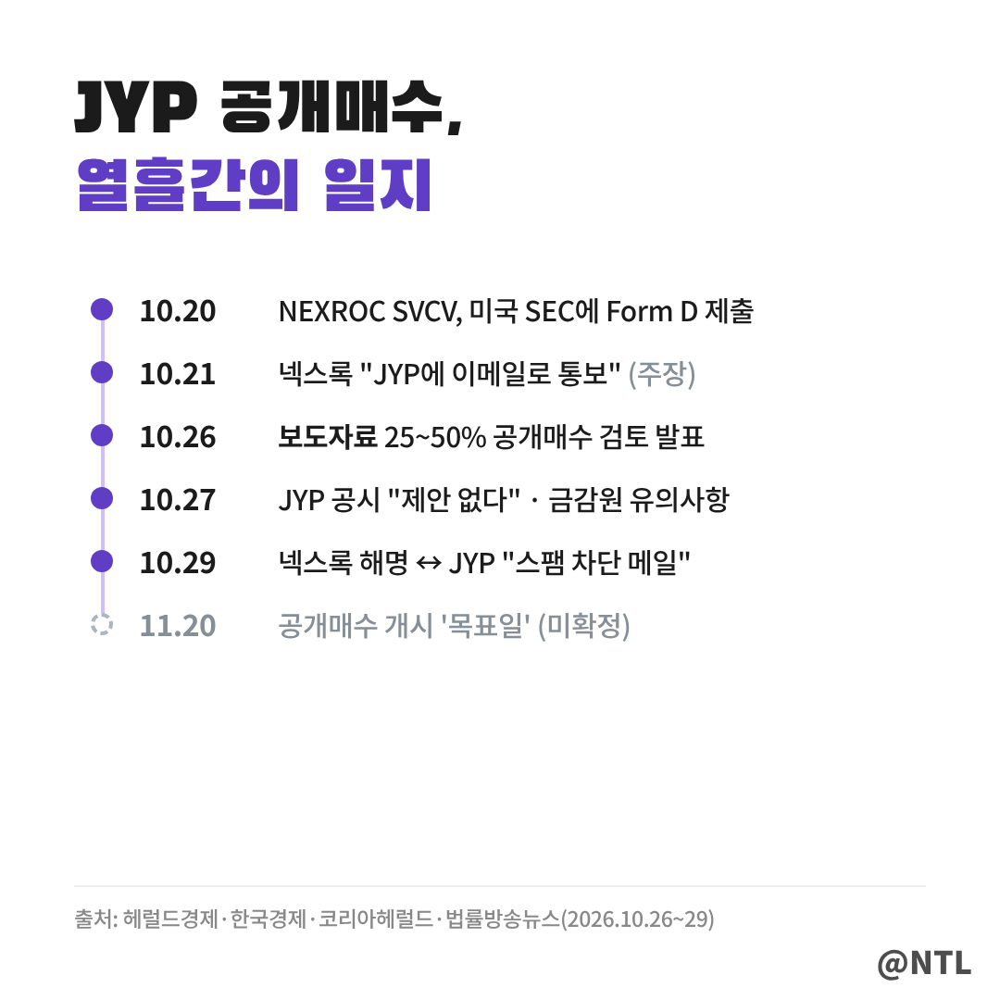
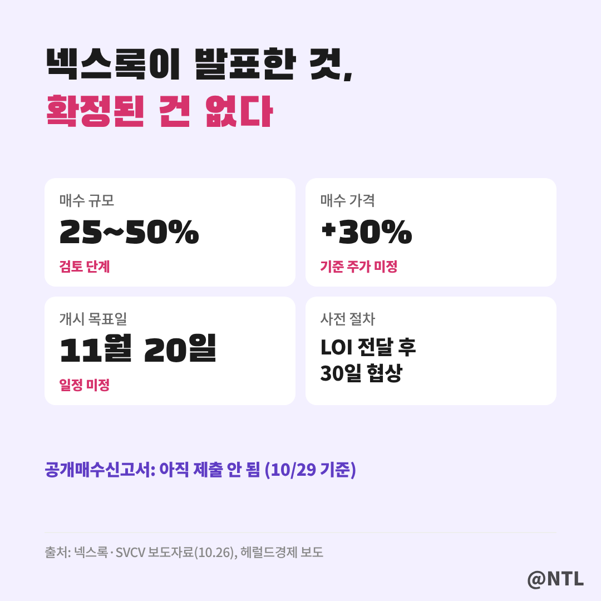
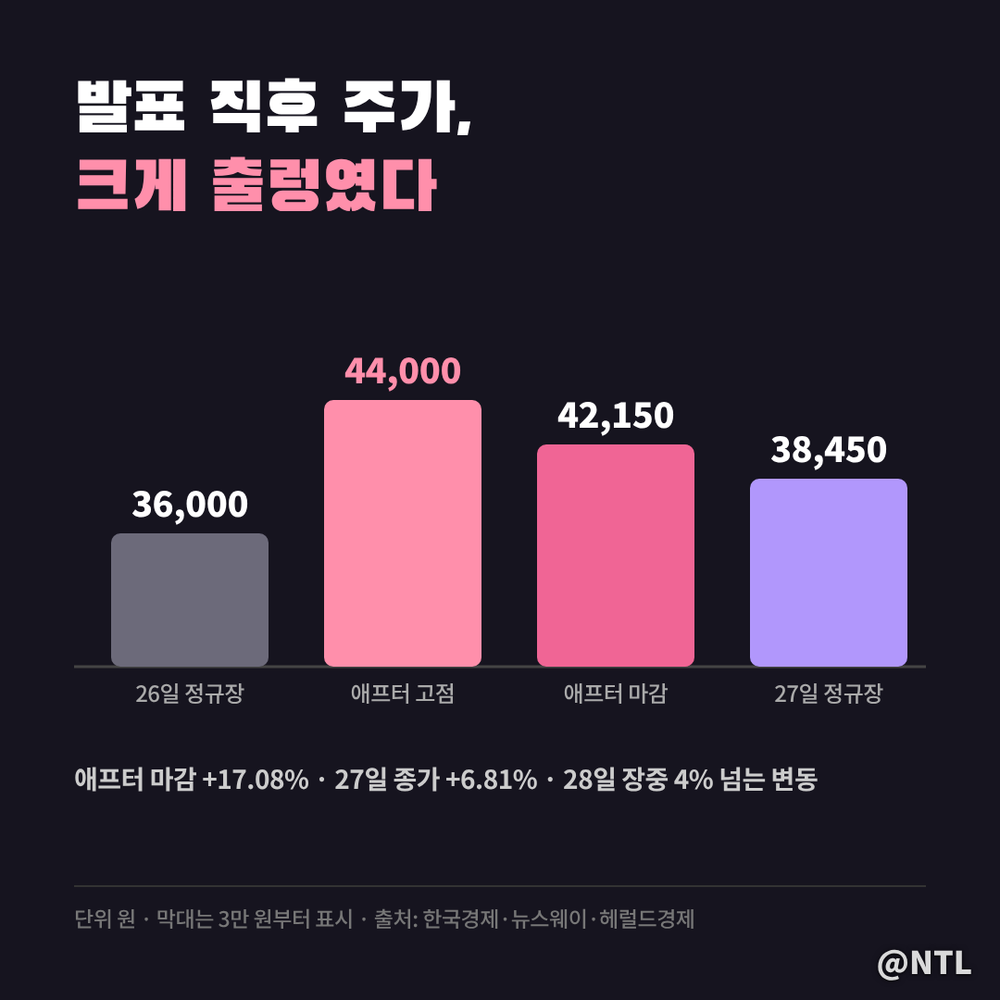
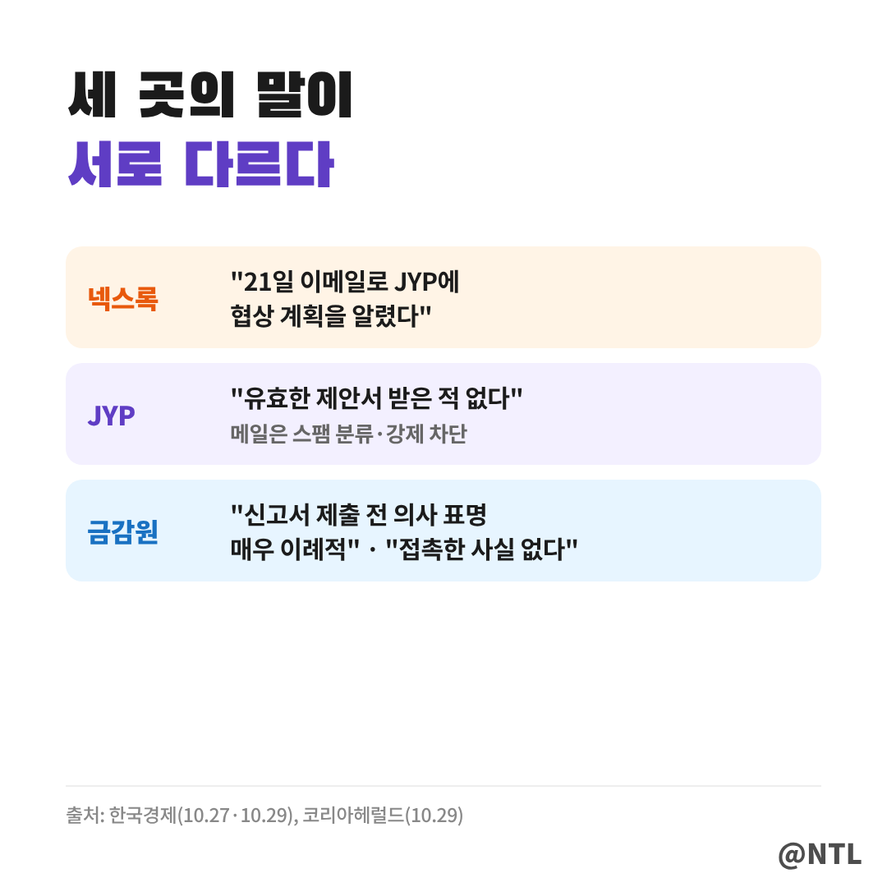
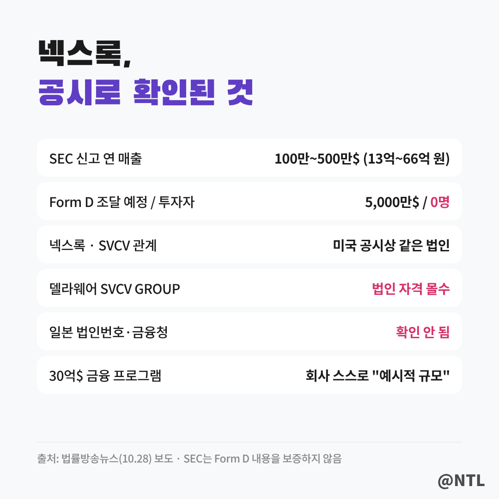
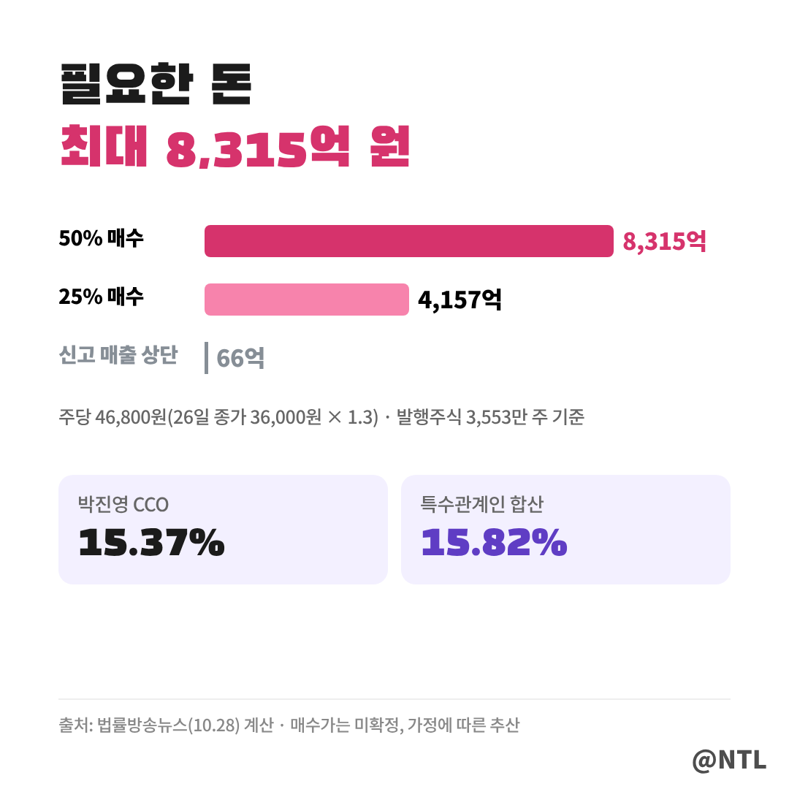

# JYP 공개매수, 넥스록 "사전 통보했다" vs JYP "스팸 차단 메일"…지금까지 확인된 사실 총정리

**제목 후보**
1. JYP 공개매수, 넥스록 "사전 통보했다" vs JYP "스팸 차단 메일"…지금까지 확인된 사실 총정리 ← 추천
2. JYP 공개매수 30% 프리미엄, 실제로 가능할까? 인수 자금 8,315억 원과 미국 공시로 본 팩트체크
3. JYP 공개매수 일지｜보도자료부터 금감원 '이례적' 경고까지, 열흘 동안 무슨 일이

---

일본계 투자그룹이라고 밝힌 회사가 **JYP엔터테인먼트 지분을 최대 50%까지 공개매수하겠다**고 예고하면서 시장이 술렁였습니다.
그런데 JYP는 처음부터 "제안을 받은 적이 없다"고 했고, 10월 29일에는 상대측이 보냈다는 메일이 **"스팸으로 차단돼 회사에 도달하지 않았다"**고 반박했습니다.

이번 글은 전망이나 추측 없이, **10월 29일까지 언론 보도와 공시로 확인된 사실만** 정리했습니다.
누가 무엇을 주장했는지, 어디까지가 확인된 내용이고 어디부터가 아직 모르는 부분인지 나눠서 보겠습니다.
(2026년 10월 29일 한국경제 보도 기준)

**🔎 핵심 요약**
- 넥스록·SVCV, 10/26 보도자료로 "JYP 지분 25~50% 공개매수 검토, 30% 프리미엄, 11/20 개시 목표"
- JYP, "공식적으로 유효한 제안서를 받거나 검토한 바 없다"…넥스록 메일은 "스팸으로 차단"
- 금감원, "공개매수 신고서 제출 전 보도자료로 의사 표명은 매우 이례적", 이상거래 예의주시

> 열흘 동안 무슨 일이 있었나

타임라인을 보면 사건의 순서가 한눈에 들어옵니다.

- **10월 20일**: 'NEXROC SVCV, Inc.' 명의로 미국 증권거래위원회(SEC)에 사모증권 발행신고서(Form D) 제출
- **10월 21일**: 넥스록 측 주장으로는 이날 JYP에 이메일로 협상 계획을 알림
- **10월 26일**: 넥스록·SVCV가 국내 언론에 보도자료 배포, JYP는 "제안 받은 바 없다"
- **10월 27일**: JYP 공시로 같은 입장 재확인, 금융감독원 '투자자 유의사항' 배포
- **10월 29일**: 넥스록 "사전 통보했다" 해명, JYP "스팸으로 차단된 메일" 재반박

타임라인 맨 아래의 **11월 20일**은 넥스록이 제시한 공개매수 개시 '목표일'일 뿐, 확정된 일정이 아닙니다.

> 넥스록이 발표한 계획, 무엇이 정해졌나

넥스록과 SVCV가 26일 보도자료에서 밝힌 내용은 다음과 같습니다.

| 항목 | 발표 내용 | 확정 여부 |
|---|---|---|
| 매수 규모 | JYP 발행주식의 25~50% | 검토 단계 |
| 매수 가격 | 기준 주가에 30% 프리미엄 | 기준 주가 산정 방식·최종 가격 미정 |
| 개시 시점 | 11월 20일 목표 | 미정 |
| 사전 절차 | 비구속적 인수의향서(LOI) 비공개 전달 후 30일 협상 | 결렬 시 다시 발표 |
| 인수 목적 | 아시아 문화·엔터 투자 포트폴리오 확대 | - |

카드에서 보듯 **숫자는 많지만 확정된 건 없습니다.**
가격도 '30% 프리미엄'이라는 방향만 있을 뿐, 어느 날 주가를 기준으로 할지는 정해지지 않았습니다.
공개매수는 매수 가격과 기간을 미리 공고하고 증권시장 밖에서 주주들로부터 주식을 사들이는 방식인데, 그 공고에 해당하는 **공개매수 신고서는 아직 제출되지 않았습니다.**

> 주가는 어떻게 움직였나

발표 직후 주가는 크게 출렁였습니다.

26일 정규장에서 JYP는 2.31% 내린 **3만 6,000원**에 마감했습니다.
보도자료가 나온 뒤 넥스트레이드 애프터마켓에서는 한때 **4만 4,000원**까지 올랐고, 정규장 종가보다 17.08% 높은 **4만 2,150원**에 끝났습니다.

다음 날인 27일 정규장에서는 장중 15% 넘게 오르기도 했지만 상승분을 일부 반납하며 6.81% 오른 **3만 8,450원**에 마감했습니다.
28일에도 장중 4% 넘게 오르내리는 등 변동성이 컸습니다.
[직접 입력: 10월 28일·29일 종가와 등락률, 한국거래소 기준]

그래프처럼 애프터마켓 고점과 정규장 종가 사이 간격이 크다는 점이, 기대와 의구심이 동시에 반영되고 있다는 걸 보여줍니다.

> 세 곳의 말이 다르다: 넥스록·JYP·금감원

이번 건이 '진실공방'으로 불리는 이유는 당사자들의 말이 엇갈리기 때문입니다.

**넥스록**은 29일 "지난 21일 이메일을 통해 JYP에 향후 협상 계획을 알렸다"고 밝혔습니다.
또 "단순한 관심 표명 보도자료에 이처럼 면밀한 검증이 뒤따를 것으로 예상하지 못했다"는 입장도 냈습니다.

**JYP**는 같은 날 입장문에서 "지난 27일 공시로 지분 인수와 관련해 제안받은 사항이 없다고 밝힌 이후에도 공식적으로 유효한 제안서를 수령하거나 검토한 바 없다"고 했습니다.
넥스록이 보냈다는 메일은 발신 신뢰도 기준을 충족하지 못해 **스팸으로 분류돼 강제 차단됐고, 회사에 도달하지 않았다**고 설명했습니다.

**금융감독원**은 27일 "공개매수신고서를 제출하기 전에 보도자료 배포를 통해 공개매수 의사를 공개적으로 표명하는 경우는 매우 이례적"이라며 "이상거래 및 법규위반 여부 등에 대해 예의주시하고 있다"고 밝혔습니다.
또 "공개매수신고서가 제출되지 않은 상황에서는 공개매수자 및 자금에 관한 정보를 확인하기 어렵고 거래가 이행되지 않을 가능성이 존재한다"고 투자자 유의를 당부했습니다.
넥스록이 금감원에도 연락했다고 주장한 데 대해, 금감원은 "넥스록과 접촉한 사실이 없다"고 했습니다.

한 가지 짚어 둘 점은, 넥스록이 말한 '협상 계획 통보'와 JYP가 말한 '정식 인수 제안서'는 서로 다른 개념이라는 것입니다.
두 주장이 정면으로 부딪히는 것처럼 보여도, 무엇을 받았느냐에 대한 기준이 다를 수 있습니다.

> 넥스록은 어떤 회사인가, 공시로 확인된 것

넥스록은 스스로를 "일본과 중국을 기반으로 한 다각화 투자·지주 플랫폼"이라고 소개합니다.
JYP 외에도 일본 에이벡스(Avex), 미국·호주 상장 생명보험사 등 여섯 곳의 인수를 예고했습니다.

언론이 공개 자료로 확인한 내용은 체크리스트와 같습니다(법률방송뉴스 10월 28일 보도).

- 미국 SEC 신고서(Form D)상 법인명은 'NEXROC SVCV, Inc.', **연 매출 100만~500만 달러(약 13억~66억 원) 구간**
- 이번 달 신고한 조달 예정액은 5,000만 달러지만 **투자자 수는 '0명'**
- 보도자료에서는 별개 회사로 소개된 넥스록과 SVCV가 **미국 공시상으로는 같은 법인의 옛 이름**으로 등장
- 델라웨어주의 'SVCV GROUP INC.'는 연차보고서 미제출로 법인 자격이 '몰수(Forfeited)' 상태
- 일본 법인번호 공표 사이트와 금융청에서는 확인되지 않음

홈페이지에 적힌 총 30억 달러 규모의 금융 프로그램에 대해서는 회사 스스로 **"예시적 규모"이며 실제 조달 실적이 아니라고** 밝혔습니다.
참고로 SEC는 Form D 신고 내용의 정확성을 심사하거나 보증하지 않습니다.

> 인수에 필요한 돈, 그리고 박진영 지분

26일 종가 3만 6,000원에 30% 프리미엄을 붙이면 공개매수 가격은 주당 **4만 6,800원**입니다.
JYP 발행주식(3,553만 2,492주)을 기준으로 계산하면 필요한 돈은 이렇습니다.

- 25% 확보 시: 약 **4,157억 원**
- 50% 확보 시: 약 **8,315억 원**

막대를 보면 Form D에 신고된 매출 상단(약 66억 원)과 비교해 차이가 얼마나 큰지 알 수 있습니다.
넥스록은 아직 구체적인 자금 조달 계획을 밝히지 않았습니다.

JYP의 최대주주는 박진영 CCO로, 546만 2,511주(15.37%)를 갖고 있고 특수관계인을 합치면 **15.82%**입니다.
산술적으로는 25%를 확보하면 최대주주가 바뀔 수 있지만, 실제 경영권을 행사하려면 주주총회 결의 등을 거쳐야 합니다.

> 공개매수, 법적으로는 어떤 절차가 필요할까

자본시장법은 공개매수에 대해 꽤 구체적인 절차를 정해 두고 있습니다.

| 조항 | 내용 |
|---|---|
| 제133조 | 6개월간 장외에서 10인 이상에게 주식을 사 지분이 5% 이상이 되면 공개매수 방식 의무 |
| 제134조 | 공개매수 공고일에 금융위원회와 거래소에 공개매수신고서 제출 |
| 신고서 첨부 | 매수 자금 조성 내역(차입 시 대여자 등)과 자금 증빙 서류 |
| 제178조 제2항 | 풍문 유포·위계 사용 금지 |

공개매수를 미리 예고하는 것 자체를 금지하는 규정은 없습니다.
다만 법률방송뉴스 보도에 따르면 법조계 일부에서는 실행 의사나 자금 능력 없이 발표한 것으로 드러날 경우 "위계에 의한 부정거래로 평가될 여지가 크다"는 의견이 나왔습니다.
현재까지 금감원은 이상거래를 **'예의주시'하는 단계**이며, 불공정거래 혐의를 확인했거나 공식 조사에 착수했다고 발표한 것은 아닙니다.

결국 이번 건의 진위를 가를 가장 확실한 기준은 **공개매수신고서가 실제로 제출되느냐**입니다.
신고서가 나오면 매수 가격, 기간, 자금 출처가 모두 공개되기 때문입니다.

---

**자주 묻는 질문**

**Q. JYP 공개매수는 확정된 건가요?**
A. 아닙니다. 10월 29일 기준 공개매수신고서는 제출되지 않았고, 매수 가격과 일정도 확정되지 않았습니다.

**Q. 공개매수가 진행되면 지금 가진 주식을 30% 비싸게 팔 수 있나요?**
A. 신고서가 제출돼야 가격이 정해집니다. 기준 주가 산정 방식이 미정이고, 응모 물량이 목표를 넘으면 일부만 매수될 수 있습니다.

**Q. 금감원이 넥스록을 조사하고 있나요?**
A. 금감원은 이상거래와 법규 위반 여부를 예의주시하고, 의심되면 신속히 조사에 착수하겠다고 밝혔습니다. 공식 조사 착수 발표는 아직 없습니다.

---

**3줄 요약**
- 넥스록·SVCV가 JYP 지분 25~50% 공개매수를 예고했지만, 신고서 제출 전이라 가격·일정 모두 미확정
- JYP는 "유효한 제안서를 받은 적 없다, 메일은 스팸 차단", 금감원은 "매우 이례적"이라며 예의주시
- 미국 공시상 넥스록의 매출은 연 13억~66억 원 구간, 필요 자금은 최대 약 8,315억 원

이번 JYP 공개매수 소식, 여러분은 어떻게 보고 계신가요? 댓글로 의견 나눠주세요.

※ 본 글은 2026년 10월 29일까지의 언론 보도와 공시를 정리한 정보 제공 목적이며, 특정 종목의 매수·매도를 권유하지 않습니다. 당사자 주장은 확인되지 않은 부분이 있으며, 투자 판단과 책임은 본인에게 있습니다.

#JYP공개매수 #JYP #JYP엔터테인먼트 #JYP주가 #공개매수 #넥스록 #SVCV #박진영 #금융감독원 #엔터주 #JYP엔터 #공개매수뜻
