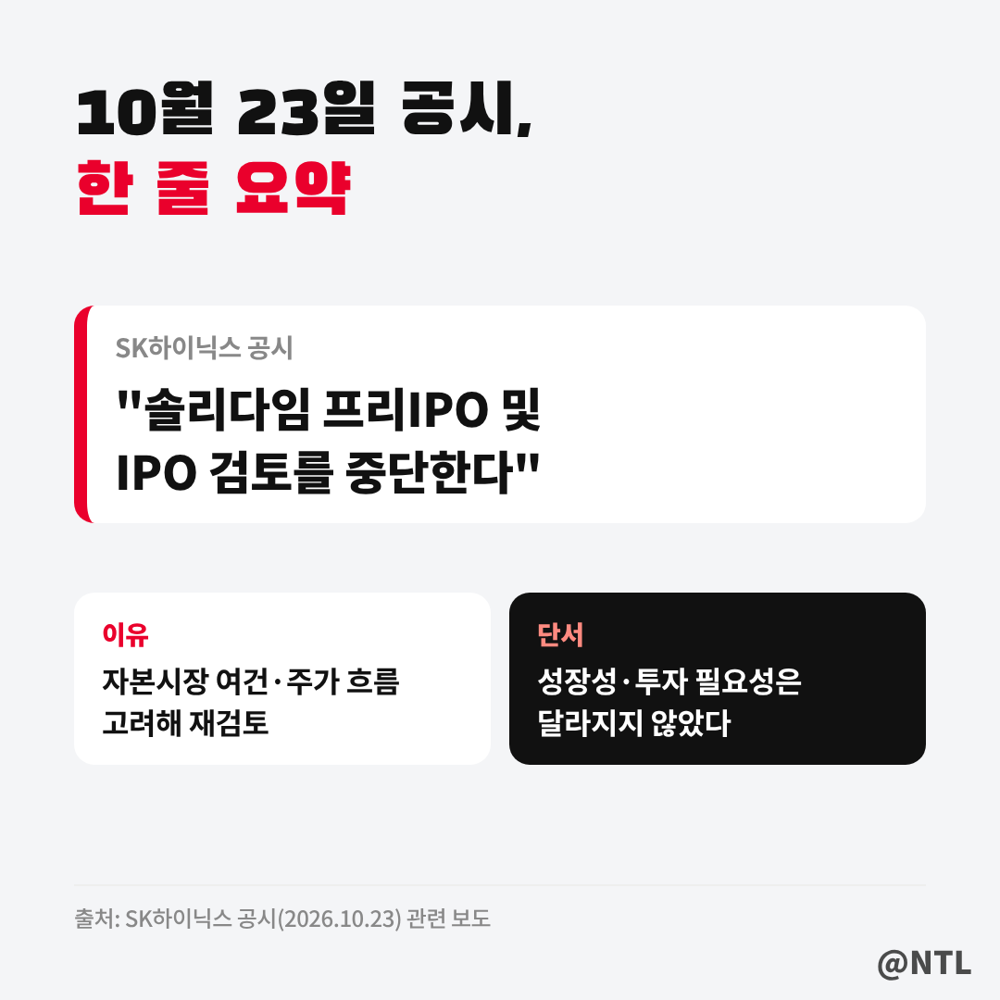
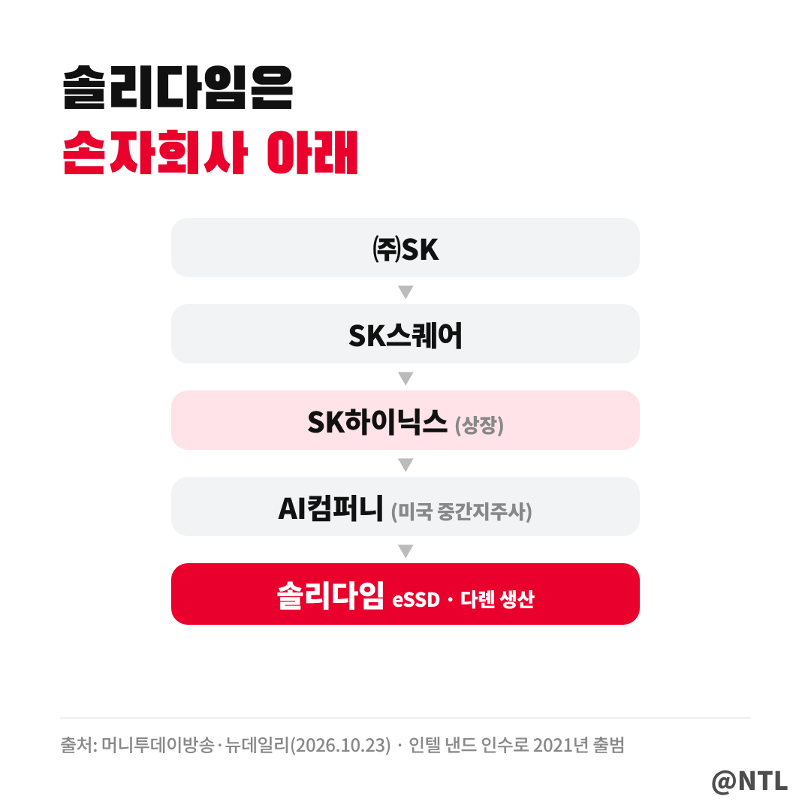
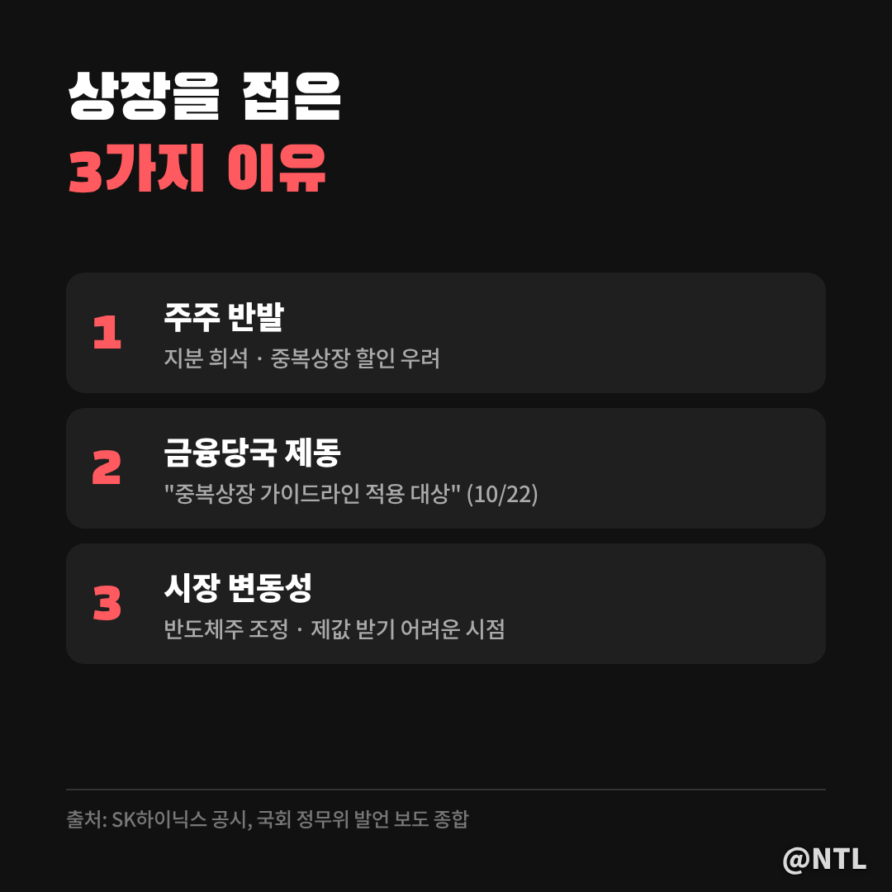
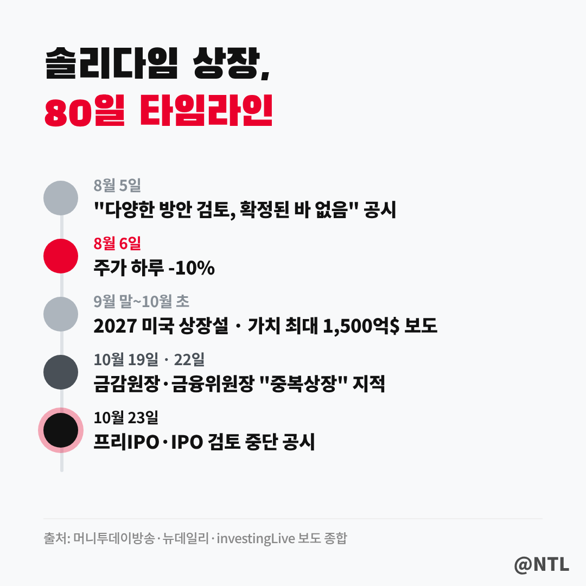
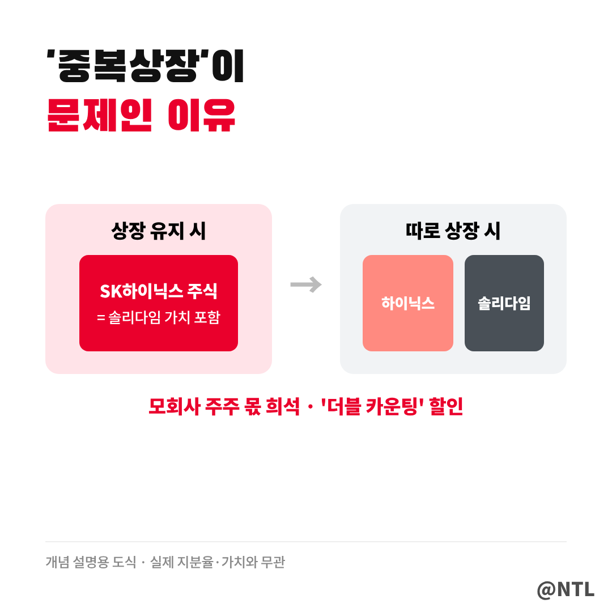
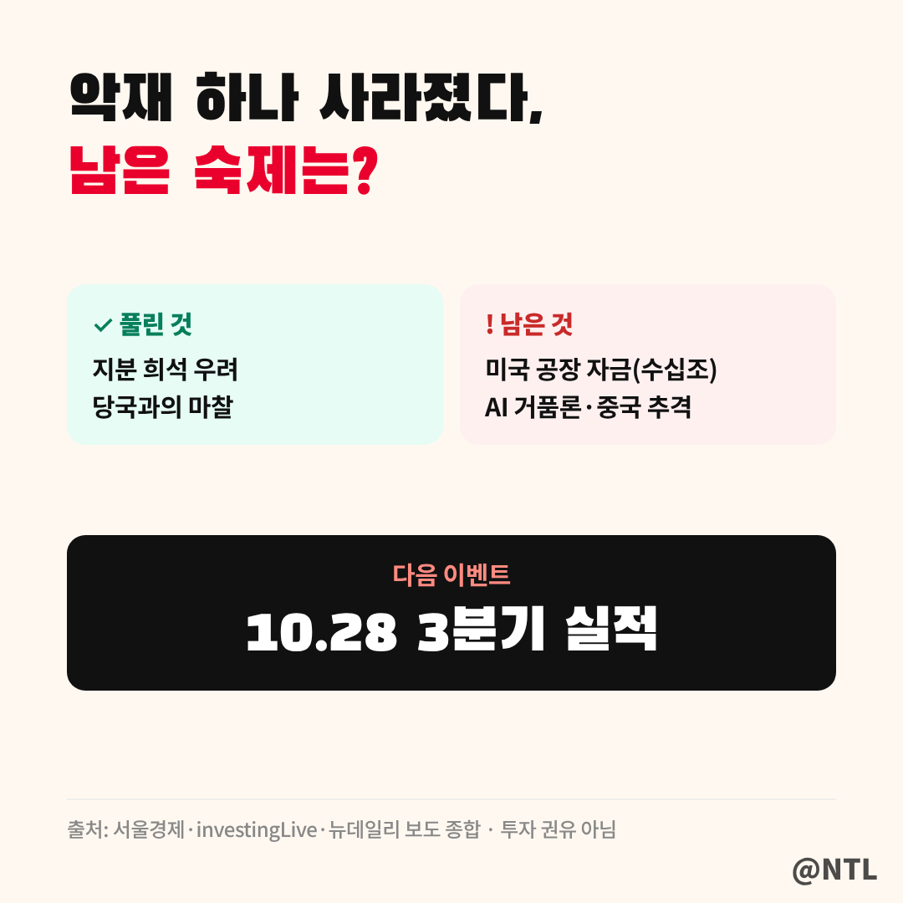

# SK하이닉스 솔리다임 상장 중단, 왜 접었을까? '중복상장' 논란부터 주가에 남은 숙제까지

**제목 후보**
1. SK하이닉스 솔리다임 상장 중단, 왜 접었을까? '중복상장' 논란부터 주가에 남은 숙제까지 ← 추천
2. SK하이닉스 솔리다임 상장 중단 "주주가 이겼다"…그런데 미국 공장 돈은 어디서?
3. SK하이닉스 솔리다임 상장 중단 총정리｜8월 공시부터 오늘 철회까지 80일 타임라인

---

SK하이닉스 주주들이 석 달 가까이 걱정하던 일이 결국 없던 일이 됐습니다.
SK하이닉스는 10월 23일 공시를 통해 **미국 자회사 솔리다임의 프리IPO와 IPO 검토를 모두 중단한다**고 밝혔습니다.

"이제 호재 아니냐"는 반응도 있지만, 상황을 조금 더 들여다보면 정리할 게 많습니다.
솔리다임이 어떤 회사인지, 왜 상장을 접었는지, 그리고 SK하이닉스 주가에는 무엇이 남았는지 순서대로 정리했습니다.
(2026년 10월 23일 보도 기준)

**🔎 핵심 요약**
- 10/23 공시: 솔리다임 프리IPO·미국 나스닥 상장 검토 중단
- 배경: 주주 반발 + 금융당국 "중복상장 가이드라인 적용 대상" + 반도체주 조정
- 남은 숙제: 미국 공장 투자 재원 마련, 10/28 3분기 실적

> SK하이닉스가 발표한 내용은?

공시 내용은 짧습니다.
**"솔리다임 프리IPO 및 IPO 검토를 중단한다."**

이유로는 "최근 자본시장 여건과 주가 흐름 등을 고려할 때, 현재 IPO가 SK하이닉스와 기존 주주들에게 가장 유리한 선택인지 재검토할 필요가 있다고 판단했다"고 설명했습니다.

눈여겨볼 대목은 그다음 문장입니다.
회사는 이번 결정이 **솔리다임의 성장 가능성이나 투자 필요성이 달라졌기 때문은 아니라고** 선을 그었습니다.
상장이라는 방법만 내려놓았을 뿐, 투자 계획 자체는 그대로라는 뜻입니다.

> 솔리다임은 어떤 회사일까

솔리다임은 SK하이닉스가 인텔의 낸드플래시·SSD 사업을 약 90억 달러에 인수하며 2021년 출범한 회사입니다.
본사는 미국 캘리포니아에 있고, AI 데이터센터에 들어가는 **기업용 SSD(eSSD)**가 주력입니다.

지배구조를 보면 왜 논란이 컸는지 감이 옵니다.
㈜SK → SK스퀘어 → SK하이닉스 → AI컴퍼니(미국 중간지주사) → 솔리다임으로 이어지는 **손자회사 이상 단계의 회사**입니다.
SK하이닉스는 올해 1월 AI컴퍼니를 세우고 그 아래 솔리다임을 두는 구조 개편도 진행했습니다.

한 가지 특징은 생산시설입니다.
솔리다임은 미국 회사지만 **생산은 중국 다롄 공장에서만** 하고 있습니다.
그래서 미국 동부에 첫 공장을 짓겠다는 계획을 추진 중이었고, 그 자금을 마련하는 방법으로 상장이 거론된 것입니다.

> 상장을 접은 3가지 이유

**첫째, 주주들의 반발입니다.**
솔리다임이 따로 상장하면 SK하이닉스 주주 입장에서는 알짜 사업의 가치가 떨어져 나가는 셈입니다.
지분 가치가 희석되고 지주사 할인이 커질 수 있다는 우려가 컸습니다.

**둘째, 금융당국의 제동입니다.**
이찬진 금융감독원장은 10월 19일 국정감사에서 "중복상장에 저촉된다는 판단은 금융위원회도, 금감원도 하고 있다"고 말했습니다.
이어 이억원 금융위원장도 22일 국회에서 솔리다임이 **"중복상장 가이드라인 적용 대상"**이며, 해외 상장에도 국내와 같은 기준을 적용한다고 못 박았습니다.
공시가 나온 건 바로 다음 날이었습니다.

**셋째, 시장 상황입니다.**
회사 공식 설명처럼 금융시장 변동성이 커지고 반도체주가 조정을 받았습니다.
주가가 내려간 상황에서 상장하면 제값을 받기 어렵다는 계산도 깔려 있었을 것으로 보입니다.

| 구분 | 내용 |
|---|---|
| 주주 | 지분 희석·중복상장 할인 우려로 강하게 반발 |
| 금융당국 | 10/19 금감원장·10/22 금융위원장 "중복상장 가이드라인 적용" |
| 시장 | 금융시장 변동성 확대, 반도체주 조정 |
| 회사 입장 | 성장성·투자 필요성은 그대로, 조달 방식만 재검토 |

> 80일 동안 무슨 일이 있었나

타임라인으로 보면 흐름이 더 분명해집니다.

8월 5일, 솔리다임 프리IPO 추진설에 SK하이닉스는 "다양한 방안을 검토하고 있으나 확정된 바는 없다"고 공시했습니다.
시장은 사실상 상장 추진으로 받아들였고, **다음 날 주가는 하루 만에 10% 떨어졌습니다.**

이후 9월 말에는 2027년 미국 상장을 검토 중이라는 외신 보도가, 10월 초에는 대형 투자은행이 주관사로 거론됐다는 보도가 이어졌습니다.
외신은 솔리다임의 기업가치를 **최대 1,500억 달러**로 추정하기도 했습니다.

분위기가 바뀐 건 10월 국정감사였습니다.
금융당국 수장 두 명이 잇따라 중복상장 문제를 지적했고, 10월 22일 주가가 다시 5% 넘게 빠지자 다음 날 아침 상장 중단 공시가 나왔습니다.

> '중복상장'이 뭐길래 이렇게 문제였을까

중복상장은 **이미 상장된 모회사가 자회사를 따로 또 상장시키는 것**을 말합니다.

예를 들어 SK하이닉스 주식을 산 사람은 솔리다임의 가치까지 함께 산 셈입니다.
그런데 솔리다임이 따로 상장하면 투자자들은 솔리다임 주식을 직접 살 수 있게 되고, 굳이 SK하이닉스를 통해 살 이유가 줄어듭니다.
그 결과 모회사 주가가 자회사 가치만큼 제대로 평가받지 못하는 **'더블 카운팅 할인'**이 생깁니다.

과거 국내에서도 모회사가 핵심 사업부를 떼어내 상장할 때마다 같은 논란이 반복됐습니다.
그래서 금융당국이 중복상장 가이드라인을 마련했고, 이번에 그 기준이 해외 상장에도 적용된다는 점이 확인된 셈입니다.

> 그래서 SK하이닉스 주가에는 호재일까

단기적으로는 **주가를 누르던 악재 하나가 사라진 것**은 맞습니다.
8월 이후 주가 하락의 원인 중 하나로 꼽혔던 지분 희석 우려가 해소됐기 때문입니다.
[직접 입력: 10월 23일 SK하이닉스 종가·등락률, 출처]

하지만 이걸로 모든 게 풀린 건 아닙니다.
외신에 따르면 SK하이닉스 주가는 9월 말 이후 약 30% 하락했는데, 여기에는 상장 이슈 외에도 **AI 거품론, 중국 메모리 업체의 추격, 환율 변화에 따른 실적 우려**가 함께 작용했다는 분석이 많습니다.

무엇보다 숙제가 남았습니다.
미국 공장 한 곳을 짓는 데만 수십조 원이 드는데, 상장 없이 그 돈을 어떻게 마련할지는 아직 정해지지 않았습니다.
회사는 직접투자 등 다른 방안을 계속 검토하겠다는 입장입니다.

앞으로 볼 포인트는 세 가지입니다.
첫째, **10월 28일 3분기 실적 발표**에서 나올 숫자와 투자 계획.
둘째, 미국 공장 자금 조달 방식이 직접투자인지, 다른 외부 자금인지.
셋째, 반도체 업황과 AI 투자 사이클이 다시 살아나는지입니다.

---

**자주 묻는 질문**

**Q. 솔리다임 상장은 완전히 취소된 건가요?**
A. 회사는 '검토 중단'이라고 표현했습니다. 다만 금융당국이 중복상장 가이드라인 적용 대상이라고 밝힌 만큼, 같은 방식으로 다시 추진하기는 쉽지 않아 보입니다.

**Q. 상장 중단은 SK하이닉스 주주에게 좋은 건가요?**
A. 지분 희석 우려가 사라졌다는 점에서는 긍정적입니다. 다만 미국 공장 투자 재원 마련이라는 숙제는 그대로 남았습니다.

**Q. SK스퀘어, ㈜SK 주주에게도 영향이 있나요?**
A. 솔리다임 상장이 SK하이닉스와 SK스퀘어, ㈜SK의 가치 희석으로 이어질 수 있다는 분석이 있었던 만큼, 이번 결정은 그룹 전체 주주에게 같은 방향의 영향을 줍니다.

---

**3줄 요약**
- SK하이닉스, 10/23 솔리다임 프리IPO·미국 상장 검토 중단 공시
- 주주 반발과 금융당국의 '중복상장' 제동, 반도체주 조정이 겹친 결과
- 악재는 하나 사라졌지만, 미국 공장 자금과 10/28 실적이 다음 관전 포인트

여러분은 이번 결정, SK하이닉스 주가에 호재라고 보시나요? 댓글로 의견 나눠주세요.

※ 본 글은 10월 23일 공시와 언론 보도를 정리한 정보 제공 목적이며, 특정 종목의 매수·매도를 권유하지 않습니다. 투자 판단과 책임은 본인에게 있습니다.

#SK하이닉스 #솔리다임 #솔리다임상장중단 #솔리다임IPO #SK하이닉스주가 #중복상장 #솔리다임상장 #주주가치 #반도체주식 #낸드플래시 #SK스퀘어
