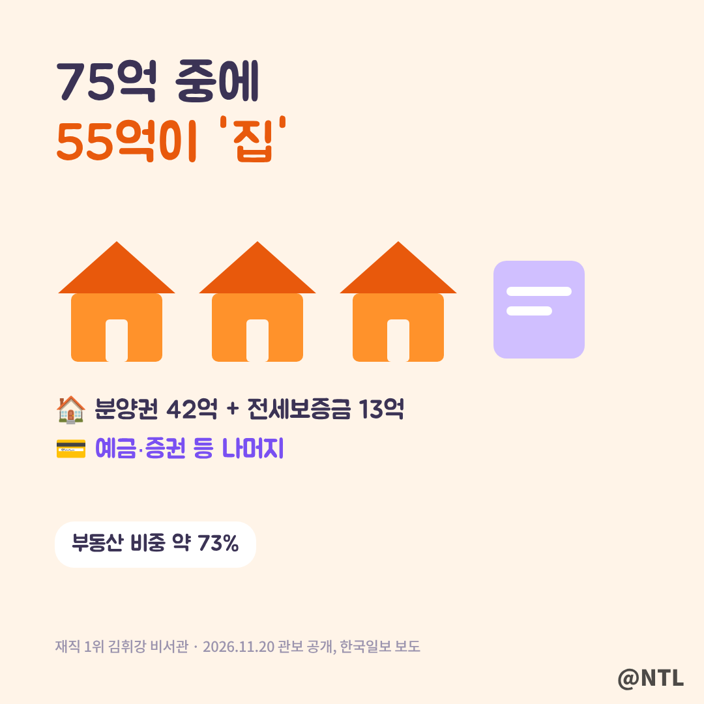
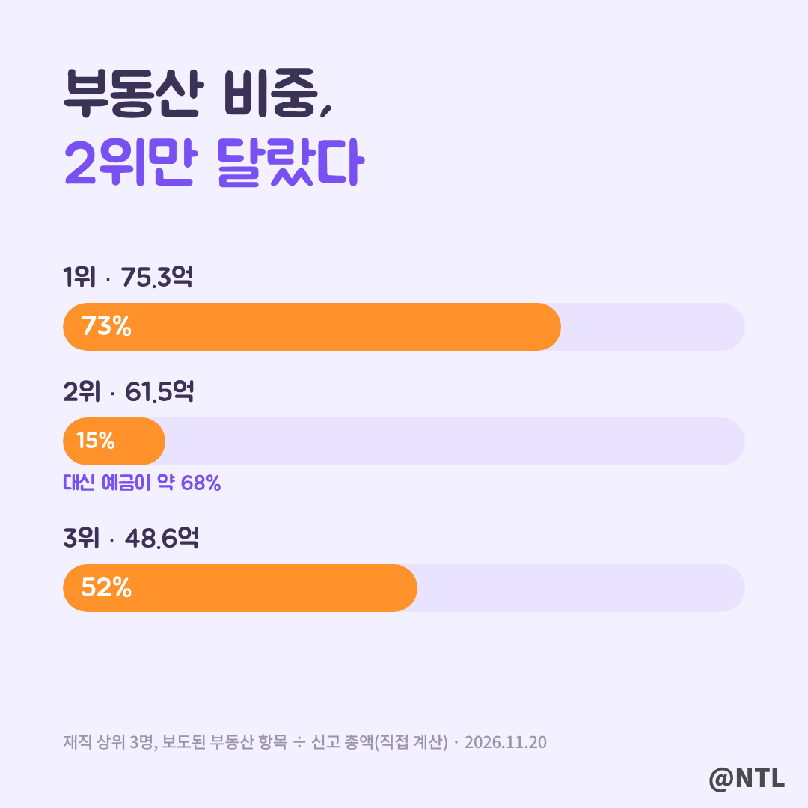
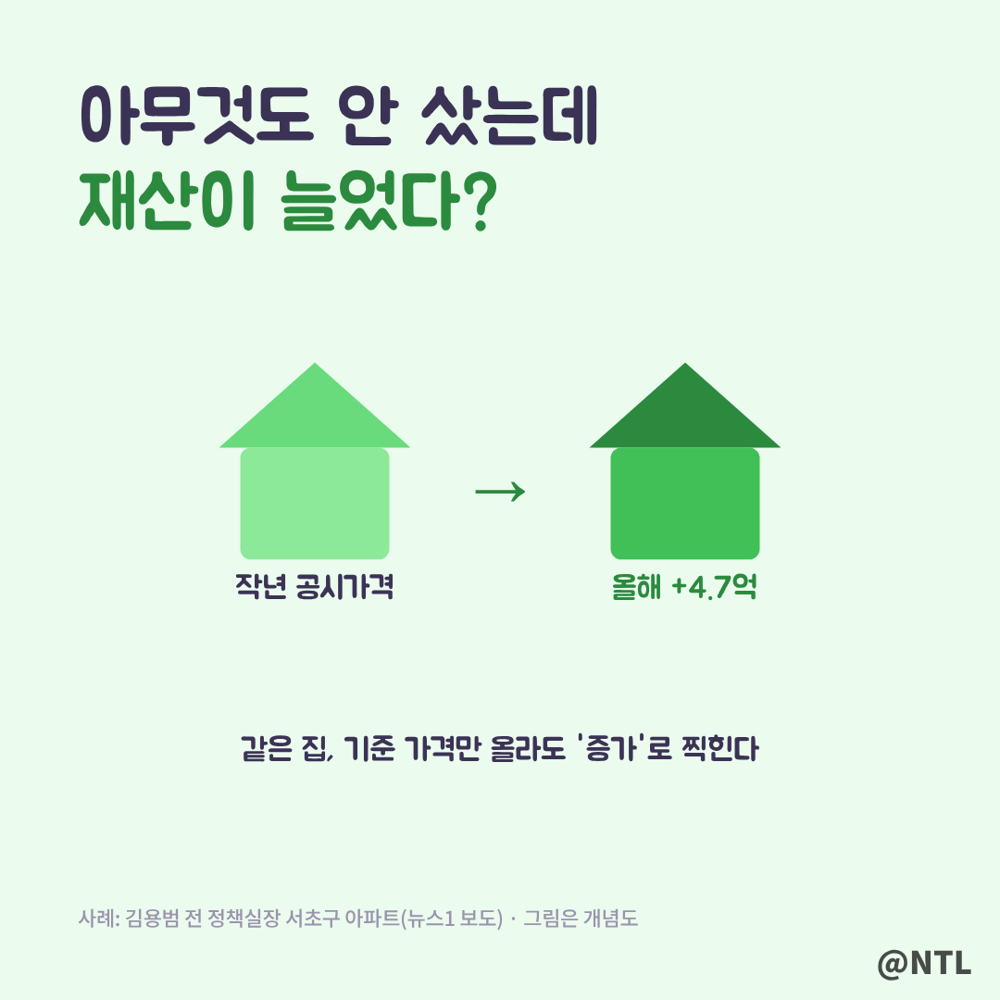
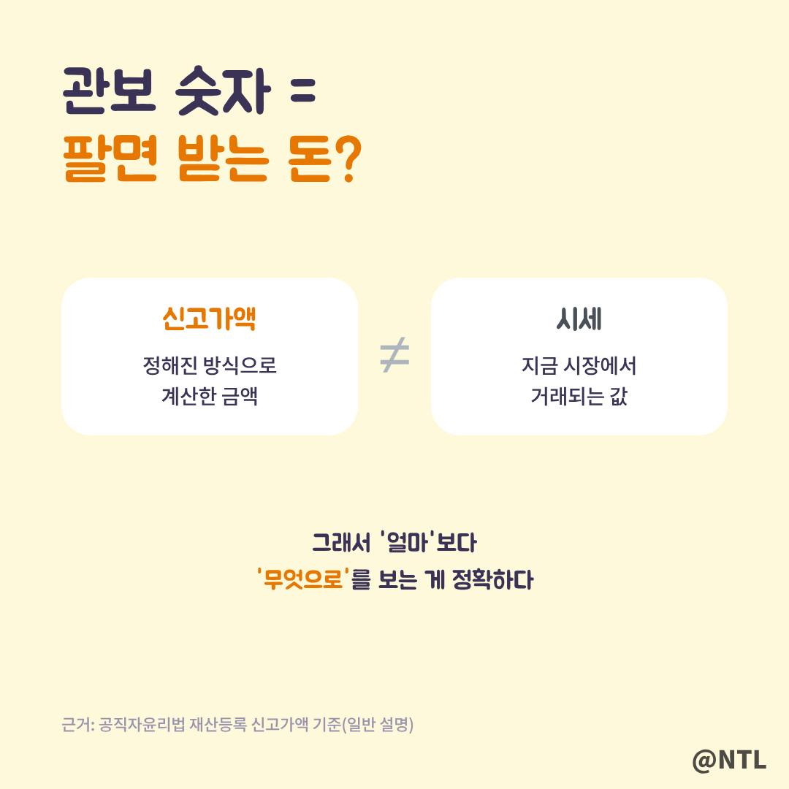

# 고위공직자 재산공개, 결국 집값 순위였다

**제목 후보**
1. 고위공직자 재산공개, 결국 집값 순위였다 ← 추천
2. 고위공직자 재산공개, 2위만 달랐던 이유
3. 고위공직자 재산공개, '늘었다'의 진짜 뜻

---

재산공개 기사가 뜨면 다들 1위 금액부터 보게 되죠.
이번에도 "75억"이 제목마다 걸려 있었습니다.
그런데 이번엔 금액 말고 '어디에 들어 있나'를 따라가 봤어요.
그랬더니 순위표가 조금 다르게 읽혔습니다.

[직접 입력: 재산공개 순위를 볼 때 평소 내가 먼저 보는 것, 또는 내 자산과 비교해 든 생각]

> 75억 가운데 55억이 집이었다

이번 공개는 8~9월 사이 자리가 바뀐 공직자 60명이 대상이었어요.
그중 현직에서 가장 많이 신고한 사람이 김휘강 국가안보실 사이버안보비서관, 75억 3,315만 원입니다.
이 중 55억 원이 부동산입니다. 그림처럼 넷 중 셋이 집인 셈이죠.

더 들여다보면 그 '집'도 우리가 생각하는 집과는 좀 다릅니다.
55억 가운데 42억은 배우자와 함께 가진 반포 새 아파트의 분양권, 나머지 13억은 도곡동에 전세로 살면서 맡긴 보증금이거든요.
아직 다 지어지지 않은 집에 대한 권리, 그리고 집주인에게 맡겨 둔 돈.
숫자로는 75억이지만, 당장 손에 쥔 현금과는 거리가 있습니다.

현직 3위도 그림이 비슷했어요.
48억 6,463만 원을 신고한 노승일 마사회 감사위원은 아파트, 오피스텔, 배우자 명의 상가를 합쳐 부동산이 25억 원을 넘깁니다. 절반이 집과 상가인 거죠.

> 그런데 2위는 정반대였다

재직자 2위 남영준 국립중앙도서관장은 61억 5,047만 원을 신고했습니다.
눈에 띄는 건 통장이에요. 본인과 배우자 예금을 합치면 41억 원대로, 전체의 68%쯤 됩니다.
부동산은 노량진동 아파트와 이천의 작은 땅을 합쳐 9억 원대, 비중으로는 15% 정도입니다.

막대를 나란히 놓고 보면 차이가 확 보여요.
1위 73%, 3위 52%가 부동산인데 2위만 15%입니다.
같은 '수십억'이라도 한쪽은 집과 분양권, 다른 쪽은 통장인 거죠.

간단히 계산해 볼까요. 집값이 10% 움직이면 1위는 부동산 55억의 10%인 5억 5,000만 원이 오르내리지만, 2위는 9억 원대의 10%, 1억 원이 채 안 됩니다.
같은 시장 변화에도 두 사람의 다음 공개 숫자는 전혀 다르게 움직일 수 있다는 얘기예요.
결국 이번 순위표는 '누가 어느 동네에 어떤 집을 갖고 있나'에 크게 좌우된 셈입니다.
사실 우리나라 가계 자산 대부분이 부동산이라는 통계는 해마다 나오죠. 고위공직자 명단도 그 모습에서 크게 벗어나지 않는다는 게 이번 공개에서 보이는 지점이에요.

> '재산이 늘었다'는 말의 진짜 뜻

퇴직자 쪽 기사에서는 김용범 전 청와대 정책실장(49억 7,014만 원)의 재산이 늘었다는 내용이 눈에 띄었어요.
기사를 따라가 보니 이유 중 하나가 서초구 아파트였어요. 공시가격이 4억 7,000만 원 정도 올랐다고 뉴스1이 전했습니다.

재산공개에서 '증가'는 무언가를 새로 샀다는 뜻만은 아니에요.
가진 집의 기준 가격이 오르기만 해도 숫자는 커집니다.
반대로 집값이 내리는 해에는 아무것도 팔지 않았는데 '감소'로 찍히기도 하고요.
그래서 재산이 몇 억 늘었다는 제목을 볼 때마다, 관보 표 맨 끝 '변동사유' 칸을 같이 봐야 정확합니다.
이번에 처음 이름을 올린 사람들도 내년 3월 정기공개 때 한 번 더 숫자가 나와요. 그때 집값 흐름에 따라 '늘었다'와 '줄었다'가 갈릴 겁니다.

덧붙이면, 관보 숫자는 시장에서 거래되는 값이 아니라 정해진 산정 방식을 따른 '신고가액'입니다.
지금 그 집을 팔면 받을 수 있는 시세와는 차이가 날 수 있습니다.
75억이라는 숫자를 볼 때 '실제로는 더 많을 수도, 다르게 셀 수도 있다'는 여지를 남겨 두는 게 공정한 읽기라고 생각해요.

재산 구성이 왜 중요하냐고 물으면, 공직자는 자기가 맡은 일과 재산이 얽히지 않아야 하기 때문이에요.
부동산 정책을 다루는 자리에 집을 여러 채 가진 사람이 앉으면 논란이 되는 것도 같은 이유죠.
이번 상위권 인사들의 자리가 부동산 정책과 직접 맞닿아 있다는 뜻은 아닙니다. 다만 재산공개가 '얼마'보다 '무엇'을 보라고 만든 제도라는 점은 기억해 둘 만해요.

[직접 입력: 이번 공개를 보며 든 내 생각 한 줄]

---

**3줄 요약**
- 11월 재산공개 재직 1위 75억 중 55억(73%)이 분양권·전세보증금 등 부동산
- 2위는 예금이 3분의 2, 부동산은 15%로 정반대 구성
- '재산 증가'는 공시가격 상승만으로도 생기니 변동사유 칸을 함께 봐야 한다

고위공직자라면 재산을 집보다 예금처럼 투명한 형태로 갖는 게 맞을까요, 아니면 개인의 선택일까요? 여러분 생각이 궁금합니다.

※ 2026년 11월 20일 정부공직자윤리위원회 관보 공개와 언론 보도(한국일보·뉴스1)를 바탕으로 했으며, 개인에 대한 평가가 아닌 공개 자료 해석입니다.

#고위공직자재산공개 #재산공개 #공직자재산 #11월재산공개 #고위공직자재산 #부동산 #분양권 #공시가격 #관보 #재산등록
