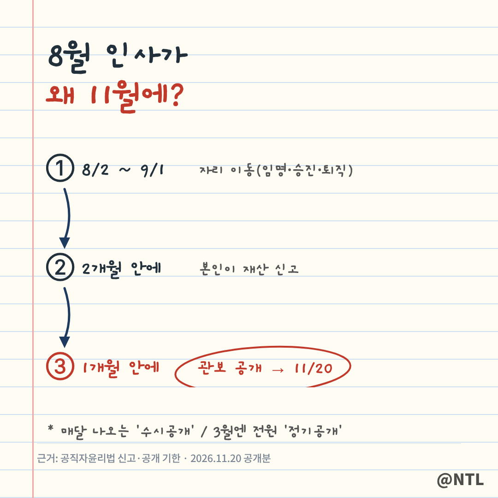
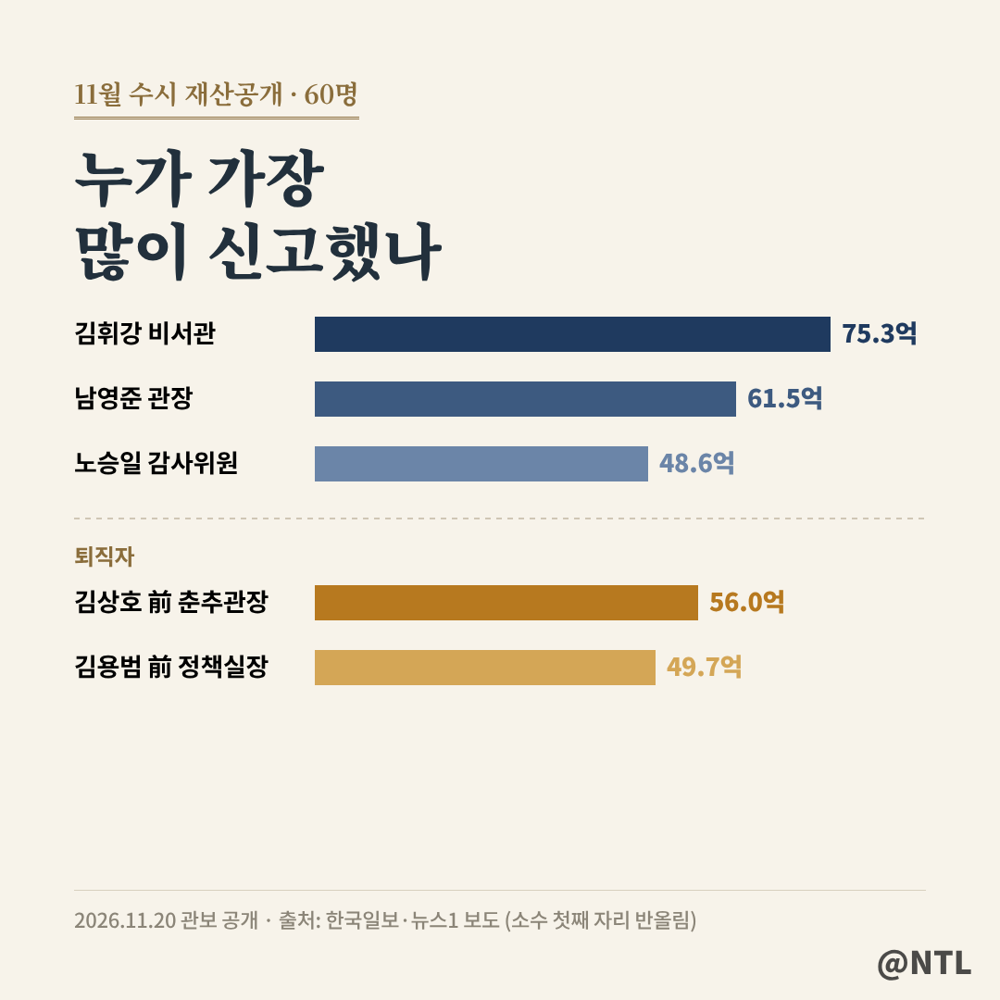
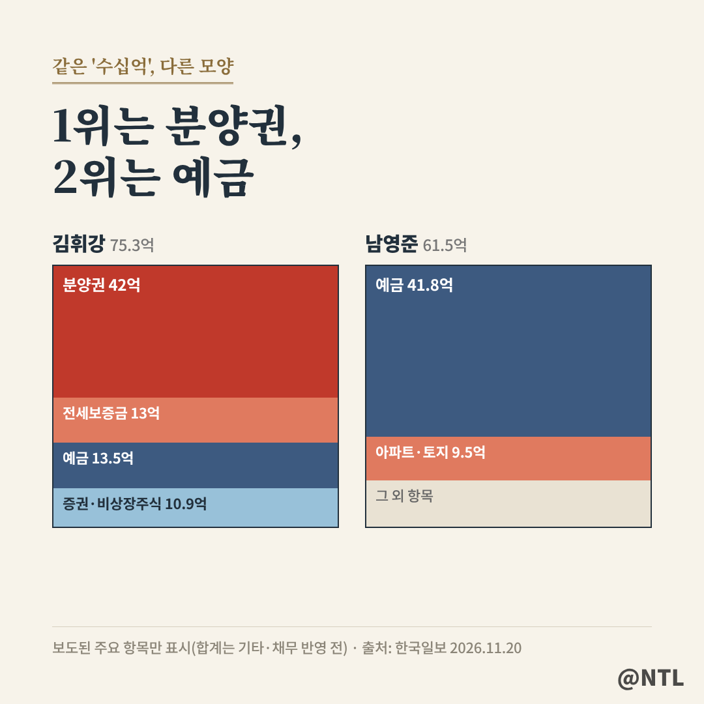
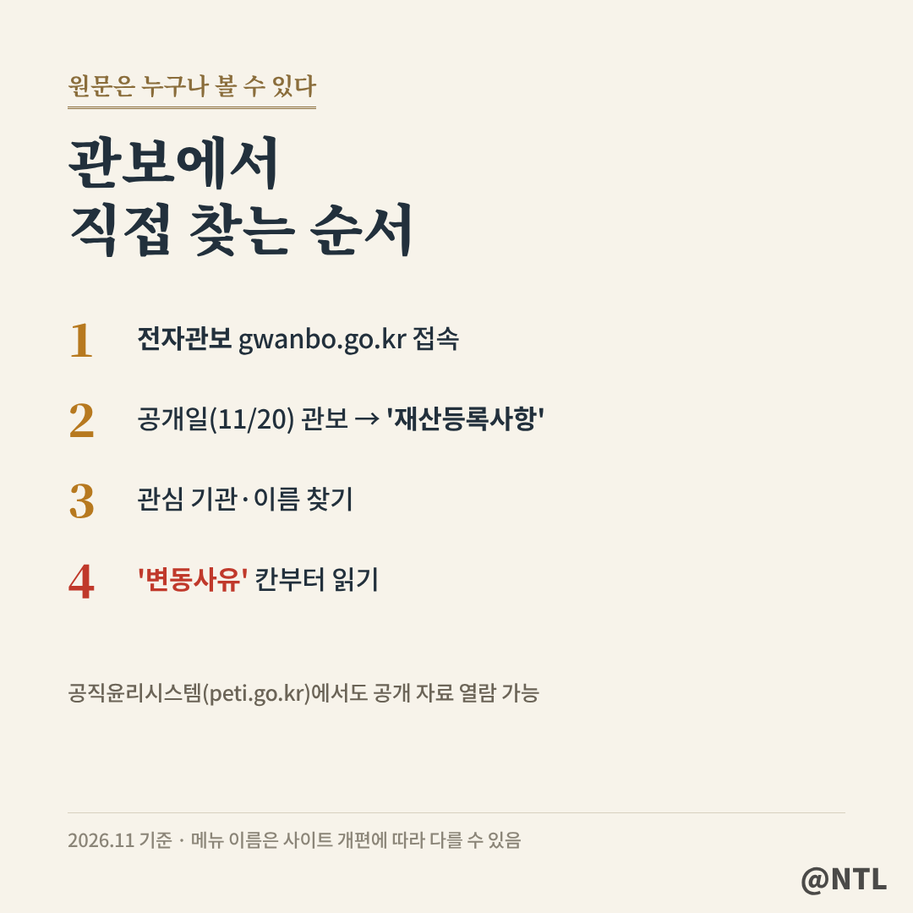

# 고위공직자 재산공개, 75억 중 42억은 분양권

**제목 후보**
1. 고위공직자 재산공개, 75억 중 42억은 분양권 ← 추천
2. 고위공직자 재산공개, 왜 석 달 늦게 나올까
3. 고위공직자 재산공개, 관보에서 직접 찾는 법

---

11월 20일 관보에 고위공직자 60명의 재산이 올라왔습니다.
기사 제목은 대부분 "1위 75억"이었는데, 내역을 열어 보면 그 75억이 우리가 떠올리는 '현금 75억'과는 꽤 달라요.
이번 공개에서 숫자 뒤에 있는 구조를 같이 보고, 관보를 직접 찾아보는 방법까지 정리했습니다.
(2026년 11월 20일 정부공직자윤리위원회 공개·언론 보도 기준)

[직접 입력: 재산공개 기사를 보고 든 내 생각 한두 줄]

> 왜 11월에 '8월 인사'가 나올까

이번에 공개된 60명은 8월 2일부터 9월 1일 사이에 새로 임명되거나 승진하거나 퇴직한 사람들이에요.
그런데 공개는 11월 20일. 석 달 가까이 걸렸죠.

메모에 적어 둔 것처럼 순서가 정해져 있어서 그렇습니다.
공직자윤리법상 임명이나 퇴직 후 2개월 안에 재산을 신고하고, 정부공직자윤리위원회는 신고 마감 후 1개월 안에 공개합니다.
매년 3월 모든 대상자를 한꺼번에 공개하는 '정기공개'와 달리, 이렇게 매달 자리가 바뀐 사람만 모아 내는 게 '수시공개'입니다.
그래서 10월에는 82명, 이번 11월에는 60명처럼 달마다 인원이 달라져요.

여기서 많이들 헷갈리는 게 '등록'과 '공개'의 차이입니다.
재산을 등록하는 공직자는 4급 이상 공무원 등으로 범위가 넓지만, 그 내용을 관보에 공개하는 건 1급 이상 공무원, 장·차관 같은 정무직, 국회의원, 자치단체장 등 일부예요.
공기업의 기관장과 상임감사도 공개 대상이라, 이번 명단에 한국마사회 상임감사위원이 들어간 겁니다.

> 재직자·퇴직자, 누가 많이 신고했나

막대그래프로 보면 재직자 중에서는 김휘강 국가안보실 사이버안보비서관이 75억 3,315만 원으로 가장 많았습니다.
2위는 남영준 국립중앙도서관장(61억 5,047만 원), 3위는 노승일 한국마사회 상임감사위원(48억 6,463만 원)이었어요.

퇴직자 가운데서는 김상호 전 대통령비서실 춘추관장이 55억 9,758만 원으로 가장 많았고, 김용범 전 청와대 정책실장이 49억 7,014만 원을 신고했습니다.
김 전 실장은 직전 신고보다 재산이 늘었다고 보도됐는데, 뉴스1은 서초구 아파트의 공시가격이 4억 7,000만 원가량 오른 영향을 짚었어요.
재산이 '늘었다'는 기사 중에는 이렇게 새로 산 게 아니라 가진 집값의 기준 가격이 오른 경우도 많습니다.

| 구분 | 이름(직위) | 신고액 |
|---|---|---|
| 재직 1위 | 김휘강 국가안보실 사이버안보비서관 | 75억 3,315만 원 |
| 재직 2위 | 남영준 국립중앙도서관장 | 61억 5,047만 원 |
| 재직 3위 | 노승일 한국마사회 상임감사위원 | 48억 6,463만 원 |
| 퇴직 1위 | 김상호 전 대통령비서실 춘추관장 | 55억 9,758만 원 |
| 퇴직 | 김용범 전 청와대 정책실장 | 49억 7,014만 원 |

참고로 기사마다 금액 끝자리가 조금씩 달랐어요. 75억 3,000만 원처럼 반올림한 곳이 있어서인데, 위 표는 관보 금액을 그대로 옮긴 한국일보 보도 기준입니다.

> 같은 수십억, 들여다보면 모양이 다르다

이번 공개에서 제일 흥미로웠던 건 1위와 2위의 재산 '모양'이 정반대라는 점이에요.

1위 김휘강 비서관은 부동산이 55억 원으로 대부분입니다.
그런데 그중 42억 원은 배우자와 공동명의인 서울 반포동 아파트 **분양권**이고, 13억 원은 강남구 도곡동 아파트 전세보증금이에요.
아직 입주 전인 집의 권리와, 살고 있는 집에 맡겨 둔 보증금이 부동산의 전부인 셈이죠.
여기에 예금 13억 4,752만 원, 증권 6억 4,962만 원, 배우자 명의 비상장주식 4억 3,732만 원 등이 더해졌습니다.
고려대 정보보호대학원 교수 출신이고, 보안 컨설팅 회사를 창업한 이력도 있어요. 청와대에는 9월에 합류했습니다.

2위 남영준 관장은 거꾸로 **예금이 41억 7,871만 원**으로 재산의 3분의 2가 넘습니다.
부동산은 본인 명의 노량진동 아파트(7억 9,600만 원)와 배우자 명의 경기 이천 토지(1억 5,000만 원) 정도예요.

그래프에서 보듯 총액은 비슷한 '수십억'이어도, 한쪽은 분양권과 보증금, 다른 쪽은 은행 예금입니다.
순위만 보고 넘기면 이런 차이가 다 묻혀 버려요. 기사 제목의 '1위'가 담지 못하는 부분입니다.

> 재산공개 숫자, 이렇게 읽어야 오해가 없다

이 숫자를 볼 때 알아 두면 좋은 게 세 가지 있습니다.

먼저 본인 것만이 아니라 배우자와 직계 존·비속 재산까지 합친 금액이에요.
다만 부모나 자녀가 독립해서 생계를 따로 꾸리면 허가를 받아 공개를 거부(고지거부)할 수 있어서, 가족 재산이 다 들어 있다고 단정하긴 어렵습니다.

다음으로, 신고액은 법에서 정한 기준으로 적는 '신고가액'이라 지금 시세와 차이가 날 수 있어요.
마지막으로 빚은 빼고 계산합니다. 대출이 많으면 집이 비싸도 총액은 작게 나올 수 있죠.

하나 더 붙이자면, 공개 대상자는 가진 주식이 3,000만 원을 넘으면 그 주식이 직무와 관련 있는지 심사를 받습니다.
관련이 있다고 판단되면 팔거나 백지신탁을 해야 하고요.
그래서 재산공개 명단에 이름이 오른 뒤 몇 달 사이에 주식 내역이 바뀌는 경우가 종종 보입니다.

[직접 입력: 숫자를 보며 의외였던 점이나 내 생각]

> 관보에서 직접 찾아보는 방법

기사에는 상위 몇 명만 나오죠. 원문에는 60명 전원의 내역이 다 들어 있어요.
대한민국 전자관보(gwanbo.go.kr)에서 공개일(11월 20일) 관보를 열고 '재산등록사항'을 찾으면 돼요.
기관별로 정리돼 있어서, 우리 지역 기관장이나 관심 있는 부처 인사를 골라 보기 좋습니다.

표를 열면 항목마다 종전가액, 증가액, 감소액, 현재가액이 나오고 맨 끝에 '변동사유' 칸이 있어요.
처음 보면 숫자가 많아 막막한데, 이 변동사유 칸부터 읽으면 훨씬 쉽습니다.
새로 샀는지, 팔았는지, 아니면 가격 기준만 바뀌었는지가 거기에 적혀 있거든요.
공직윤리시스템(peti.go.kr)에서도 공개 자료를 볼 수 있어요.

[사진: 직접 캡처한 전자관보 재산공개 검색 화면]

---

**자주 묻는 질문**

**Q. 다음 재산공개는 언제인가요?**
A. 수시공개는 매달 이어집니다. 9월 이후 자리가 바뀐 공직자는 12월 공개에 나올 가능성이 커요. [직접 입력: 12월 수시공개 날짜, 관보 확인] 전체 대상자의 1년치 변동은 매년 3월 정기공개에서 나옵니다.

**Q. 재산이 많으면 문제가 되나요?**
A. 재산 규모 자체가 문제는 아닙니다. 공개 제도는 재산이 어떻게 바뀌었는지, 직무와 이해가 얽힌 재산은 없는지 들여다보려는 목적이에요.

---

**3줄 요약**
- 11월 20일 고위공직자 60명 수시 재산공개, 재직 1위 75억 3,315만 원·퇴직 1위 55억 9,758만 원
- 1위의 부동산 55억 중 42억은 분양권, 2위는 예금이 41억대로 재산 구성은 정반대
- 신고액은 가족 합산·법정 기준가·빚 차감 금액이라 시세와 다를 수 있고, 원문은 전자관보에서 볼 수 있다

재산공개에서 여러분은 총액이 궁금하신가요, 아니면 어떻게 모았는지가 궁금하신가요? 댓글로 남겨 주세요.

※ 본 글은 2026년 11월 20일 정부공직자윤리위원회 관보 공개와 언론 보도를 정리한 것이며, 개인에 대한 평가가 아닌 공개 자료 소개입니다.

#고위공직자재산공개 #고위공직자재산 #공직자재산공개 #재산공개 #11월재산공개 #수시재산공개 #정부공직자윤리위원회 #전자관보 #김휘강 #재산등록 #공직자윤리법
