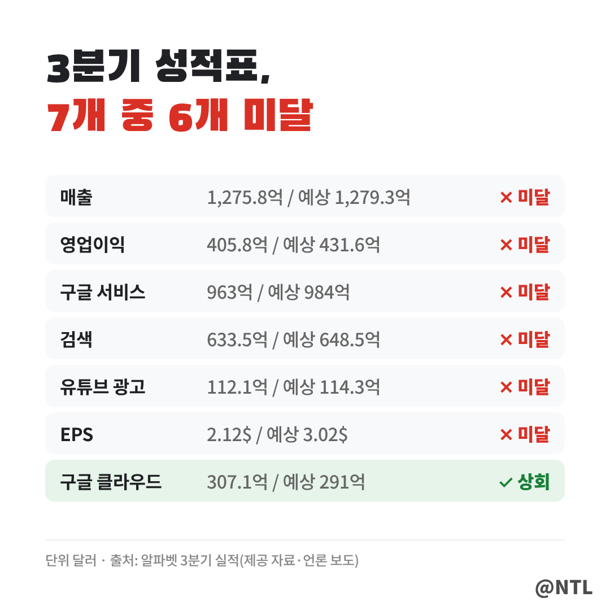
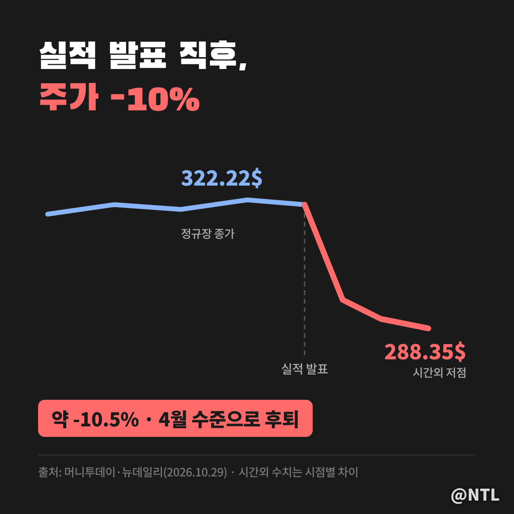
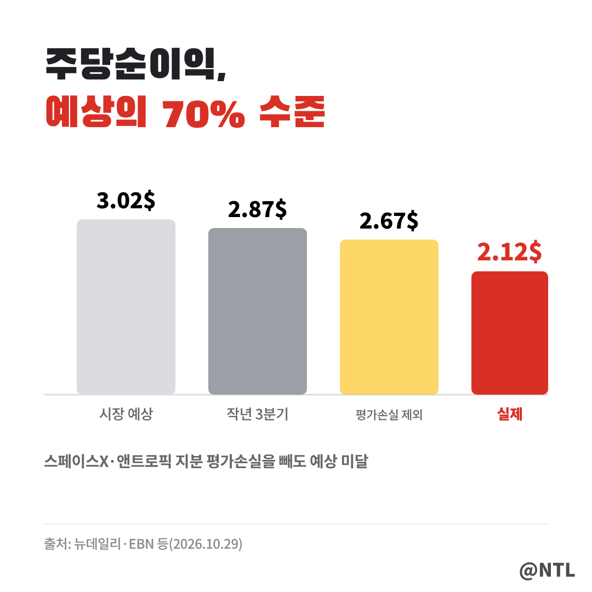
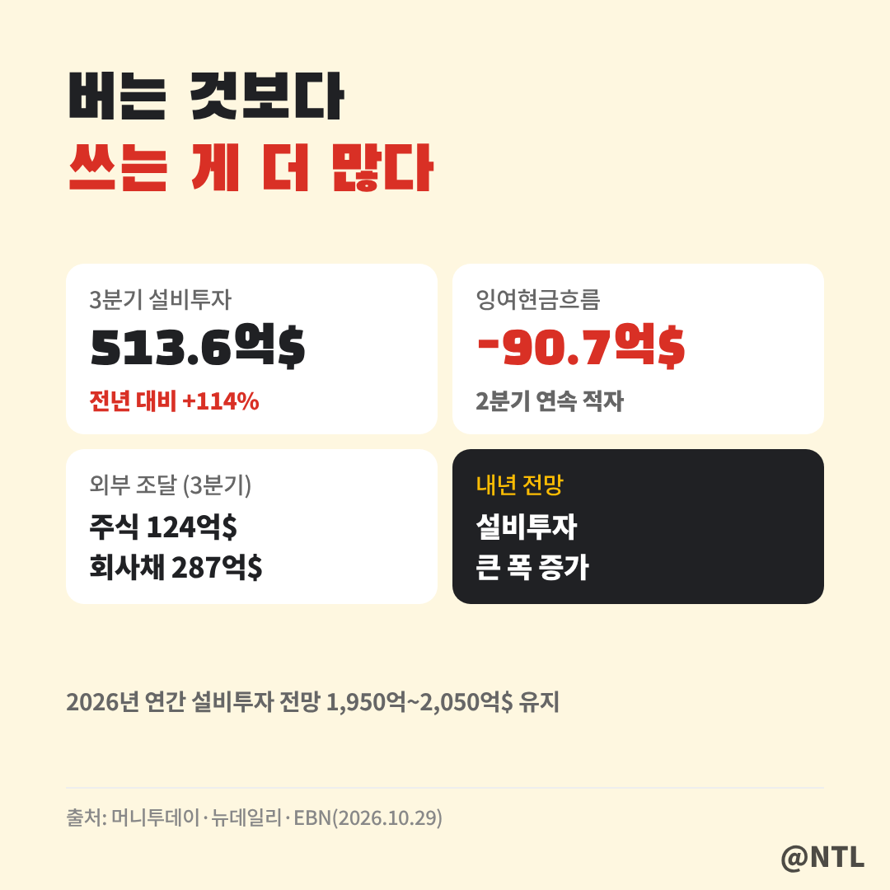
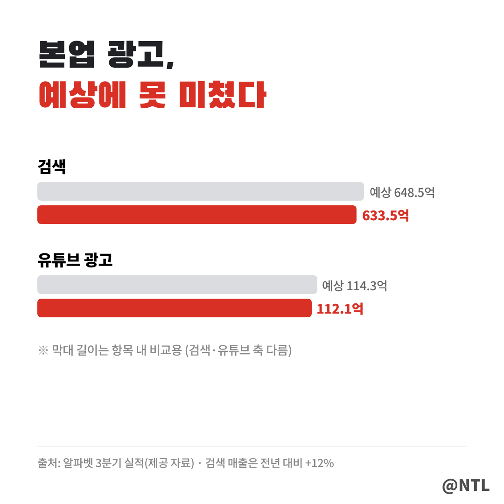
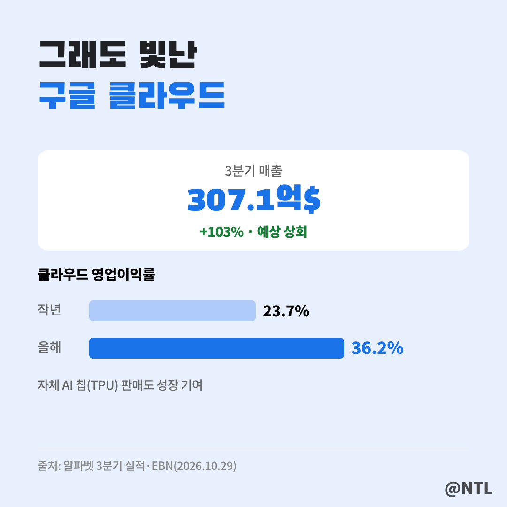

# 구글 3분기 실적 '어닝쇼크', 시간외 주가 10% 급락…클라우드 103% 성장에도 떨어진 이유 3가지

**제목 후보**
1. 구글 3분기 실적 '어닝쇼크', 시간외 주가 10% 급락…클라우드 103% 성장에도 떨어진 이유 3가지 ← 추천
2. 구글 3분기 실적, 클라우드는 2배 컸는데 왜 주가는 -10%? 현금이 마이너스 90억 달러가 된 사연
3. 구글 3분기 실적 총정리｜EPS 2.12달러 어닝쇼크·검색·유튜브 미달·내년 투자 더 늘린다

---

구글 모회사 알파벳이 10월 28일(현지시간) 3분기 실적을 발표했습니다.
결과는 시장의 기대와 거리가 멀었습니다.
**매출, 영업이익, 주당순이익(EPS)이 모두 예상치를 밑돌았고, 주가는 시간외 거래에서 약 10% 급락했습니다.**

이상한 점은 클라우드 사업이 1년 만에 두 배로 커졌다는 겁니다.
잘한 사업이 분명히 있는데 왜 주가는 이렇게 크게 빠졌을까요?
숫자부터 하나씩 짚어 보겠습니다.
(2026년 10월 29일 기준)

**🔎 핵심 요약**
- 매출·영업이익·EPS 모두 예상 미달, 시간외 주가 약 -10%
- 구글 클라우드만 307억 달러(+103%)로 예상 상회
- 설비투자 급증으로 잉여현금흐름 -90억 달러, 내년 투자는 더 늘린다

> 숫자로 본 3분기, 대부분 '미달'

성적표를 보면 분위기가 한눈에 들어옵니다.
주요 항목 중 예상을 넘은 건 **구글 클라우드 하나뿐**입니다.

| 항목 | 3분기 실적 | 시장 예상 | 결과 |
|---|---|---|---|
| 매출 | 1,275.8억 달러 | 1,279.3억 달러 | 미달 |
| 영업이익 | 405.8억 달러 | 431.6억 달러 | 미달 |
| 구글 서비스 | 963억 달러 | 984억 달러 | 미달 |
| 검색 | 633.5억 달러 | 648.5억 달러 | 미달 |
| 유튜브 광고 | 112.1억 달러 | 114.3억 달러 | 미달 |
| 구글 클라우드 | 307.1억 달러 | 291억 달러 | **상회** |
| 설비투자(CAPEX) | 513.6억 달러 | 557.8억 달러 | 예상보다 적음 |

매출 자체는 1년 전보다 25% 늘었습니다.
성장은 했지만, 시장이 기대한 만큼은 아니었다는 뜻입니다.

> 주가는 하룻밤 새 10% 증발

정규장에서 322.22달러로 마감한 주가는 실적 발표 직후 시간외 거래에서 **288.35달러까지 밀렸습니다.**
종가 대비 약 10.5% 하락입니다.

알파벳 정도 덩치의 회사가 하루에 10% 빠진다는 건, 시가총액으로 수천억 달러가 사라진다는 뜻입니다.
일부 매체는 6개월 넘게 쌓아 온 상승분을 한 번에 반납하고 4월 수준으로 돌아갔다고 전했습니다.
[직접 입력: 10월 29일 정규장 종가·등락률]

> 떨어진 이유 ① 이익이 기대에 한참 못 미쳤다

가장 큰 충격은 이익이었습니다.
EPS는 **2.12달러로, 시장 예상치 3.02달러를 크게 밑돌았습니다.**
1년 전(2.87달러)보다도 줄었습니다.

이익이 줄어든 데는 투자 지분의 평가손실도 영향을 줬습니다.
알파벳이 들고 있는 **스페이스X와 앤트로픽 지분의 평가손실**이 반영된 건데, 이를 빼고 계산한 EPS도 2.67달러로 여전히 기대에 못 미쳤습니다.
영업이익 역시 405.8억 달러로 예상(431.6억 달러)보다 약 26억 달러 적었습니다.
일회성 요인만 탓하기 어려운 성적이라는 게 시장의 판단이었습니다.

> 떨어진 이유 ② 버는 것보다 쓰는 게 더 많아졌다

시장이 더 크게 걱정한 건 **돈을 쓰는 속도**입니다.

3분기 설비투자는 513.6억 달러로 1년 전보다 **114% 늘었습니다.**
AI 데이터센터와 칩에 쏟아붓는 돈입니다.
그 결과 잉여현금흐름(FCF)은 **약 -90억 7,000만 달러**로, 두 분기 연속 마이너스를 기록했습니다.

부족한 돈은 외부에서 조달했습니다.
3분기에 보통주를 발행해 124억 달러를, 회사채로 287억 달러를 마련했습니다.
현금이 넘쳐나던 구글이 주식과 빚으로 투자 자금을 채우는 모습이 낯설게 받아들여진 겁니다.

여기에 결정타가 있었습니다.
경영진은 올해 연간 설비투자 전망(1,950억~2,050억 달러)을 유지하면서, **내년에는 설비투자가 큰 폭으로 더 늘어날 것**이라고 밝혔습니다.
"언제 이 투자가 돈이 되느냐"는 질문에 확실한 답을 못 준 셈입니다.

> 떨어진 이유 ③ 본업인 광고가 기대에 못 미쳤다

구글의 진짜 돈줄은 여전히 광고입니다.
그런데 검색 매출은 633.5억 달러로 1년 전보다 12% 늘었지만 예상치(648.5억 달러)에 못 미쳤습니다.
유튜브 광고도 112.1억 달러로 예상(114.3억 달러)을 밑돌았습니다.

검색과 유튜브를 합친 구글 서비스 매출 역시 963억 달러로 예상보다 21억 달러 적었습니다.
AI 챗봇이 검색을 대신할 수 있다는 걱정이 늘 따라붙는 상황이라, **광고 둔화 신호는 다른 회사보다 더 민감하게** 받아들여집니다.

> 그래도 빛난 한 가지, 구글 클라우드

모든 게 나빴던 건 아닙니다.
**구글 클라우드 매출은 307.1억 달러로 1년 만에 103% 늘었습니다.**
예상치(291억 달러)도 넉넉히 넘었습니다.

수익성도 좋아졌습니다.
클라우드 영업이익률은 전년 23.7%에서 **36.2%**로 뛰었고, 자체 개발 AI 칩(TPU) 판매도 성장을 거들었습니다.
결국 지금의 설비투자는 이 클라우드 성장을 위한 것이고, 이 속도가 유지되느냐가 주가 회복의 열쇠가 될 가능성이 큽니다.

앞으로 볼 포인트는 세 가지입니다.
첫째, 클라우드 100%대 성장이 이어지는지.
둘째, 내년 설비투자 규모가 구체적으로 얼마인지.
셋째, 검색 광고가 다시 예상을 넘어서는지입니다.
알파벳이 지분을 가진 앤트로픽이 상장을 앞두고 있다는 점도 지분 가치 측면에서 지켜볼 대목입니다.
▶ 앤트로픽 상장과 관련 기업은 이전 글에서 정리했습니다. [직접 입력: '앤트로픽 상장' 글 링크]

---

**자주 묻는 질문**

**Q. 구글 주가는 얼마나 떨어졌나요?**
A. 정규장 종가 322.22달러에서 시간외 288.35달러까지, 약 10% 하락했습니다. 매체·시점에 따라 8~10%로 차이가 있습니다.

**Q. 클라우드가 103% 성장했는데 왜 주가가 빠졌나요?**
A. 이익(EPS)이 예상보다 크게 낮았고, 설비투자 급증으로 현금흐름이 마이너스가 된 데다 내년 투자를 더 늘린다고 밝혔기 때문입니다.

**Q. 실적 미달이 일회성인가요?**
A. 스페이스X·앤트로픽 지분 평가손실 같은 일회성 요인이 있지만, 이를 빼도 EPS가 예상에 못 미쳐 일회성으로만 보기는 어렵다는 평가입니다.

---

**3줄 요약**
- 구글 3분기 매출·영업이익·EPS 모두 예상 미달, 시간외 주가 약 10% 급락
- 설비투자 +114%로 현금흐름 -90억 달러, 내년 투자는 더 늘린다는 전망이 결정타
- 클라우드만 +103%로 선방, 이 성장이 이어지느냐가 회복의 열쇠

여러분은 구글의 공격적인 AI 투자, 기회라고 보시나요 위험이라고 보시나요? 댓글로 의견 나눠주세요.

※ 본 글은 알파벳 3분기 실적 발표와 언론 보도를 정리한 정보 제공 목적이며, 특정 종목의 매수·매도를 권유하지 않습니다. 투자 판단과 책임은 본인에게 있습니다.

#구글 #구글3분기실적 #알파벳실적 #구글주가 #알파벳주가 #GOOGL #구글클라우드 #구글실적발표 #빅테크실적 #미국주식 #유튜브 #어닝쇼크
