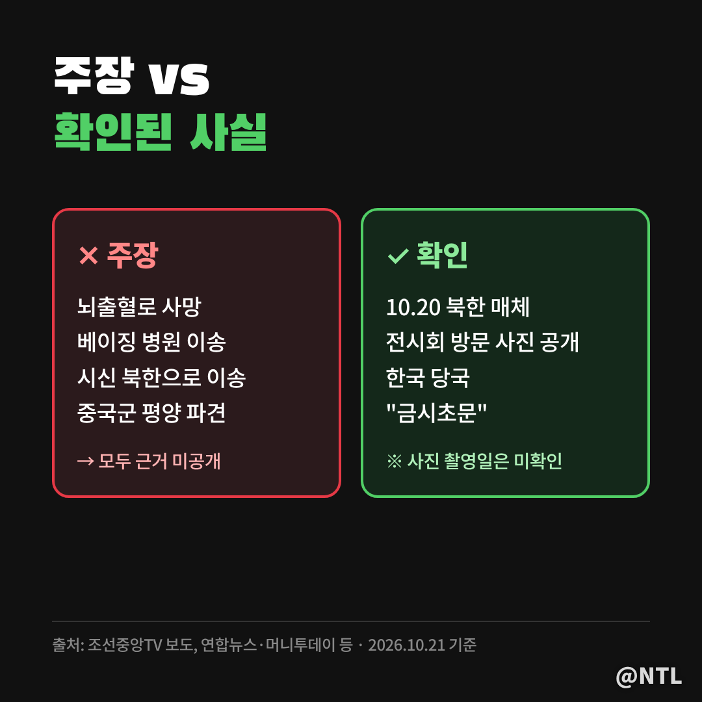
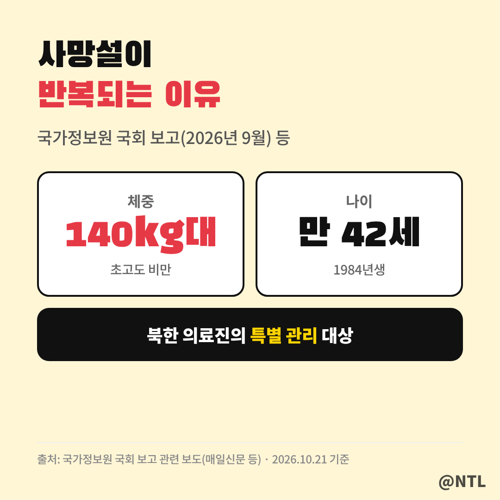
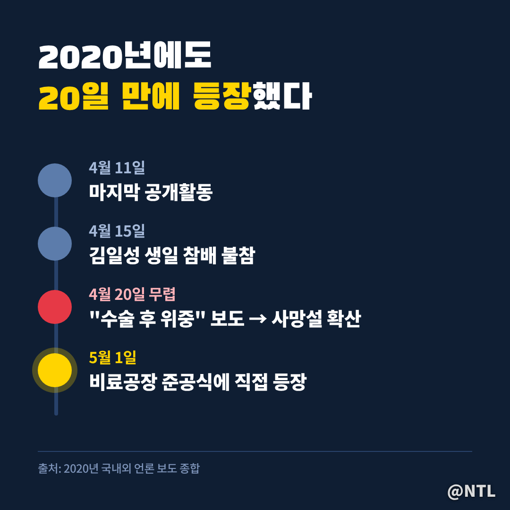

# 김정은 사망설 "뇌출혈로 숨졌다?" 북한이 하루 만에 내놓은 사진, 믿어도 될까

**제목 후보**
1. 김정은 사망설 "뇌출혈로 숨졌다?" 북한이 하루 만에 내놓은 사진, 믿어도 될까 ← 추천
2. 김정은 사망? 지금까지 확인된 사실은 '이것'뿐
3. 김정은 사망설 또 터졌다, 2020년엔 20일 만에 나타났는데 이번엔?

---

"김정은이 뇌출혈로 숨졌다."
주말 사이 SNS에 이런 글이 퍼지면서 검색량이 폭발했습니다.
결론부터 말하면 **10월 21일 현재, 사망을 뒷받침하는 공식 근거는 없습니다.**
어디서 시작됐는지, 무엇이 확인됐는지만 차분히 정리했습니다.

> 사망설, 어디서 시작됐나

출발점은 미국에 사는 중국 반체제 인사 셰완쥔의 X(옛 트위터) 게시글이었습니다.
베이징 병원에서 뇌출혈로 숨졌고, 시신이 북한으로 옮겨졌다는 주장입니다.
하지만 구체적인 출처는 밝히지 않았고, 과거에도 확인되지 않은 정보를 퍼뜨린 적이 있다는 평가를 받는 인물입니다.

> 주장과 확인된 사실, 나란히 놓고 보면

보시는 것처럼 주장은 많지만 확인된 건 거의 없습니다.
북한 조선중앙TV는 20일, 김 위원장이 전날 평양의 의류·신발 전시회를 둘러보는 사진을 공개했습니다.
한국 외교·안보 당국자들도 "금시초문"이라는 반응입니다.
다만 공개된 사진이 **실제로 언제 찍혔는지는 확인되지 않았다**는 점은 기억해 둘 필요가 있습니다.

| 구분 | 내용 |
|---|---|
| 주장 | 뇌출혈 사망, 시신 북한 이송, 중국군 평양 파견 |
| 확인 | 북한 매체 공개활동 보도(10.20), 한국 당국 "금시초문" |
| 미확인 | 사진 촬영 시점, 중국 측 입장 |

> 왜 이런 소문이 계속 나올까

국가정보원은 9월 국회에서 김 위원장이 140kg대의 초고도 비만으로 북한 의료진의 특별 관리를 받고 있다고 보고했습니다.
건강 이상 신호가 꾸준히 거론되다 보니, 공개활동이 조금만 뜸해도 사망설이 붙는 구조입니다.

> 2020년에도 똑같은 일이 있었다

2020년 4월에도 '수술 후 위중'이라는 보도와 함께 사망설이 번졌습니다.
결과는 타임라인 맨 아래처럼, 약 20일 뒤 비료공장 준공식에 직접 모습을 드러내며 끝났습니다.

> 가짜뉴스, 이렇게 걸러 보세요

북한 소식은 확인이 어려워 소문이 사실처럼 퍼지기 쉽습니다.
특히 '사망설'에 놀라 주식이나 환전을 서두르는 건 피하는 게 좋습니다.
[직접 입력: 10월 20~21일 코스피·원달러 환율·방산주 움직임, 출처]

---

**3줄 요약**
- 김정은 사망설은 해외 SNS발 주장으로, 10월 21일 현재 공식 확인된 근거 없음
- 북한은 20일 공개활동 사진으로 반박했지만 촬영 시점은 미확인
- 2020년에도 20일 만에 등장한 전례, 공식 발표 전까지는 '설'로 봐야

여러분은 이런 북한 관련 소문, 어디서 먼저 접하시나요? 댓글로 알려주세요.

※ 본 글은 10월 21일까지의 언론 보도를 정리한 것으로, 이후 공식 발표에 따라 내용이 달라질 수 있습니다.

#김정은사망 #김정은사망설 #김정은 #김정은건강 #김정은뇌출혈 #북한 #북한뉴스 #팩트체크 #가짜뉴스 #지정학리스크
