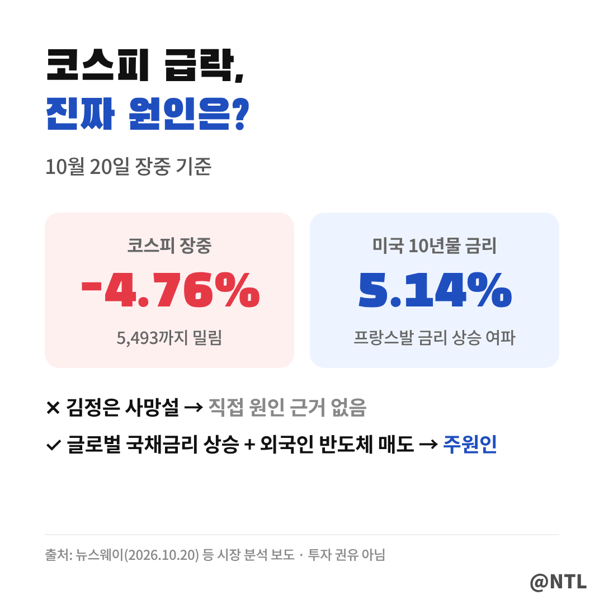
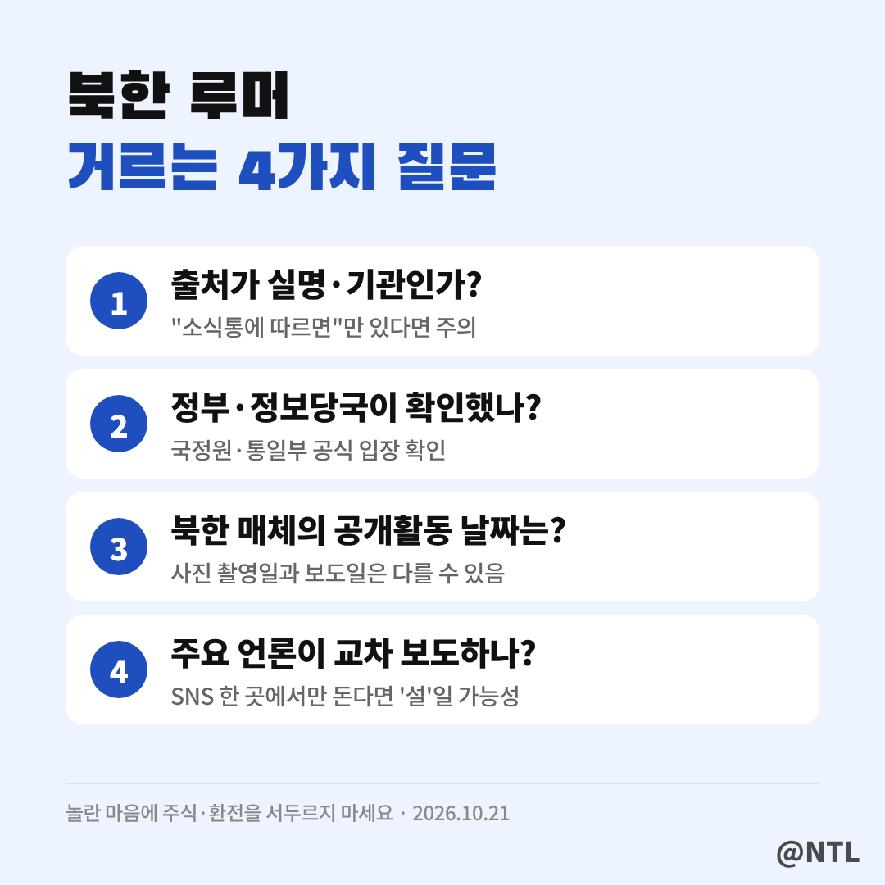

# 김정은 사망설 사실일까? "뇌출혈로 숨졌다"는 소문과 북한이 내놓은 사진, 코스피 급락까지 정리

**제목 후보**
1. 김정은 사망설 사실일까? "뇌출혈로 숨졌다"는 소문과 북한이 내놓은 사진, 코스피 급락까지 정리 ← 추천
2. 김정은 사망설 "김여정이 실권 장악?" 그런데 하루 뒤 공개된 사진 한 장
3. 김정은 사망설에 코스피 4% 급락? 알고 보니 진짜 원인은 따로 있었다

---

"김정은이 베이징 병원에서 뇌출혈로 숨졌다."
"김여정이 실권을 쥐었고, 중국군 9천 명이 평양에 들어갔다."

주말 사이 해외 SNS에서 시작된 이 소문이 국내까지 번지면서 검색량이 폭발했습니다.
같은 날 코스피까지 장중 4% 넘게 빠지자 "진짜 무슨 일 난 거 아니냐"는 불안도 커졌죠.

결론부터 말하면 **10월 21일 현재, 사망이나 권력 교체를 뒷받침하는 객관적인 근거는 없습니다.**
소문이 어디서 시작됐는지, 무엇이 확인됐고 무엇이 아직 모르는 건지, 그리고 내 돈과는 어떤 관계인지 순서대로 정리했습니다.

**🔎 핵심 요약**
- 출처는 미국에 사는 중국 반체제 인사의 SNS 글, 근거 제시 없음
- 북한은 20일 "김정은이 전날 전시회를 방문했다"며 사진 공개
- 코스피 급락의 주원인은 사망설이 아니라 글로벌 국채금리 상승

> 사망설, 어디서 시작됐나

출발점은 미국에 거주하는 중국 반체제 인사 셰완쥔의 X(옛 트위터) 게시글이었습니다.
김 위원장이 뇌출혈로 쓰러져 베이징의 병원으로 옮겨졌고, 치료 중 숨져 시신이 북한으로 돌아갔다는 내용입니다.

이 글을 인도 이코노믹타임스, 영국 더선, 파키스탄 지오뉴스 등 해외 매체가 인용하면서 판이 커졌습니다.
하지만 이들 매체도 **사실을 독자적으로 확인한 것이 아니라 SNS 주장을 옮긴 것**에 가깝습니다.
셰완쥔은 구체적인 출처를 밝히지 않았고, 과거에도 확인되지 않은 정보를 사실처럼 퍼뜨렸다는 평가를 받는 인물입니다.

> 주장과 확인된 사실, 나란히 놓고 보면

보시는 것처럼 왼쪽의 주장은 많지만 근거가 붙은 건 하나도 없습니다.
반면 오른쪽에는 확인 가능한 사실이 있습니다.

북한 조선중앙통신과 조선중앙TV는 20일, 김 위원장이 **전날(19일) 리설주 여사, 딸 김주애와 함께 평양의 의류·신발 전시회를 둘러봤다**고 보도하며 사진을 공개했습니다.
사진 속 김 위원장은 어린이 신발을 살펴보고 여성 의류를 점검하는 모습이었습니다.
한국 외교·안보 당국자들도 사망설에 대해 "금시초문"이라는 반응을 보였습니다.

다만 짚어 둘 점이 하나 있습니다.
북한 매체가 공개한 사진이 **실제로 언제 찍혔는지는 독립적으로 확인되지 않았습니다.**
북한은 과거에도 미리 찍어 둔 사진을 나중에 공개한 적이 있어, 사진 한 장으로 모든 의혹이 끝났다고 단정하기는 어렵습니다.

| 구분 | 내용 |
|---|---|
| 주장 | 뇌출혈 사망, 시신 북한 이송, 김여정 실권 장악, 중국군 9천 명 파견 |
| 확인 | 북한 매체 공개활동 보도(10.20), 한국 당국 "금시초문" |
| 미확인 | 사진 촬영 시점, 중국 정부 입장 |

> '김여정 실권 장악'과 '중국군 파견'은 사실일까

사망설에 따라붙은 두 가지 주장도 짚어 보겠습니다.

첫째, 김여정이 김주애 대신 실권을 잡았다는 주장입니다.
북한이 사망 발표를 미루는 사이 권력을 장악했다는 이야기인데, 이것 역시 **근거가 제시되지 않았습니다.**
오히려 북한이 공개한 사진에는 김주애가 아버지와 함께 등장했습니다.

둘째, 중국군 9천 명이 평양에 파견됐다는 주장입니다.
군 병력 수천 명이 움직였다면 위성이나 정보당국에 포착될 수밖에 없지만, 이를 확인한 기관이나 언론은 아직 없습니다.

김정은 유고 시 누가 권력을 이을지는 늘 관심사이지만, 지금 나도는 이야기는 **'만약'을 전제로 한 추측**이라는 점을 구분해서 볼 필요가 있습니다.

> 왜 이런 소문이 계속 나올까

사망설이 쉽게 퍼지는 데는 이유가 있습니다.
국가정보원은 9월 30일 국회 보고에서 김 위원장의 체중이 약 140kg에 이르러 **심혈관계 질환 위험이 높다**고 평가했습니다.
북한 의료진의 특별 관리를 받고 있다는 보고도 있었습니다.

여기에 북한은 최고지도자의 건강을 철저히 비밀에 부치는 폐쇄적인 체제입니다.
공식 정보가 없으니 공개활동이 조금만 뜸해도 온갖 추측이 끼어들 틈이 생기는 구조죠.

> 과거에도 같은 일이 반복됐다

김정은 사망설은 이번이 처음이 아닙니다.
2014년에는 약 40일 동안 공개석상에서 사라졌다가 지팡이를 짚고 나타나 건강 이상설이 돌았습니다.
가장 큰 소동은 2020년이었습니다. 4월 김일성 생일 참배에 불참한 뒤 '수술 후 위중'이라는 보도가 나오며 사망설이 번졌지만, 약 20일 뒤 비료공장 준공식에 직접 모습을 드러냈습니다.

타임라인 맨 아래처럼, 이번에는 소문이 퍼진 지 하루 만에 북한이 먼저 사진을 내놨다는 점이 과거와 다릅니다.

> 코스피 급락, 정말 사망설 때문일까

10월 20일 코스피는 장중 전 거래일보다 4.76% 떨어진 5,493까지 밀리며 5,500선이 무너졌습니다.
방산주와 남북경협주도 함께 약세를 보이면서 "사망설 때문 아니냐"는 말이 돌았습니다.

하지만 시장 분석은 다릅니다.
**진짜 원인은 글로벌 국채금리 상승과 외국인 매도**라는 해석이 우세합니다.
프랑스 시위로 프랑스 국채금리가 급등했고, 그 여파가 유럽을 거쳐 미국 국채시장까지 번졌습니다.
미국 10년물 금리가 5.14%까지 오르자 성장 기대가 큰 반도체주에 매물이 쏟아졌고, 삼성전자·SK하이닉스가 지수를 끌어내렸습니다.

방산주 하락 역시 미국 방산주 약세와 3분기 실적 우려가 겹친 영향으로, 사망설과 직접 연결 짓기는 어렵다는 분석입니다.
참고로 2020년 건강 이상설 보도 때 코스피는 장중 2% 안팎 하락했습니다.

▶ 프랑스 시위가 금리를 끌어올린 과정은 이전 글에서 정리했습니다.
[직접 입력: '프랑스 시위' 글 링크]

> 북한 루머, 이렇게 걸러 보세요

북한 소식은 직접 확인이 어려워 소문이 사실처럼 퍼지기 쉽습니다.
위 네 가지 질문만 던져 봐도 상당수는 걸러집니다.
특히 "사망설"에 놀라 주식을 팔거나 환전을 서두르는 건 피하는 게 좋습니다.
정말 큰일이라면 정부와 주요 언론이 가장 먼저, 가장 확실하게 알려 줍니다.

---

**자주 묻는 질문**

**Q. 김정은이 진짜 사망했나요?**
A. 10월 21일 현재 사망을 확인한 정부·기관은 없습니다. 북한은 19일 공개활동 사진으로 반박했습니다.

**Q. 북한이 공개한 사진은 믿을 수 있나요?**
A. 공개 자체는 사실이지만 촬영 날짜는 독립적으로 확인되지 않았습니다. 추가 공개활동이 나오는지 지켜볼 필요가 있습니다.

**Q. 코스피가 빠진 게 사망설 때문인가요?**
A. 직접 원인으로 보기는 어렵습니다. 글로벌 국채금리 상승과 외국인 매도가 주된 이유로 꼽힙니다.

---

**3줄 요약**
- 김정은 사망설은 해외 SNS발 주장으로, 사망·권력 교체를 뒷받침하는 근거는 없음
- 북한은 20일 김주애와 함께한 전시회 방문 사진으로 반박, 다만 촬영 시점은 미확인
- 같은 날 코스피 급락은 사망설보다 글로벌 금리 상승 영향이 크다는 분석

여러분은 이번 소문을 처음 어디서 접하셨나요? 댓글로 알려주세요.

※ 본 글은 10월 21일까지의 언론 보도를 정리한 것으로, 이후 공식 발표에 따라 내용이 달라질 수 있습니다. 특정 종목의 매수·매도를 권유하지 않습니다.

#김정은사망설 #김정은사망 #김정은 #김정은근황 #김정은건강이상설 #김정은뇌출혈 #김여정 #김주애 #북한뉴스 #북한정세 #코스피급락 #팩트체크
