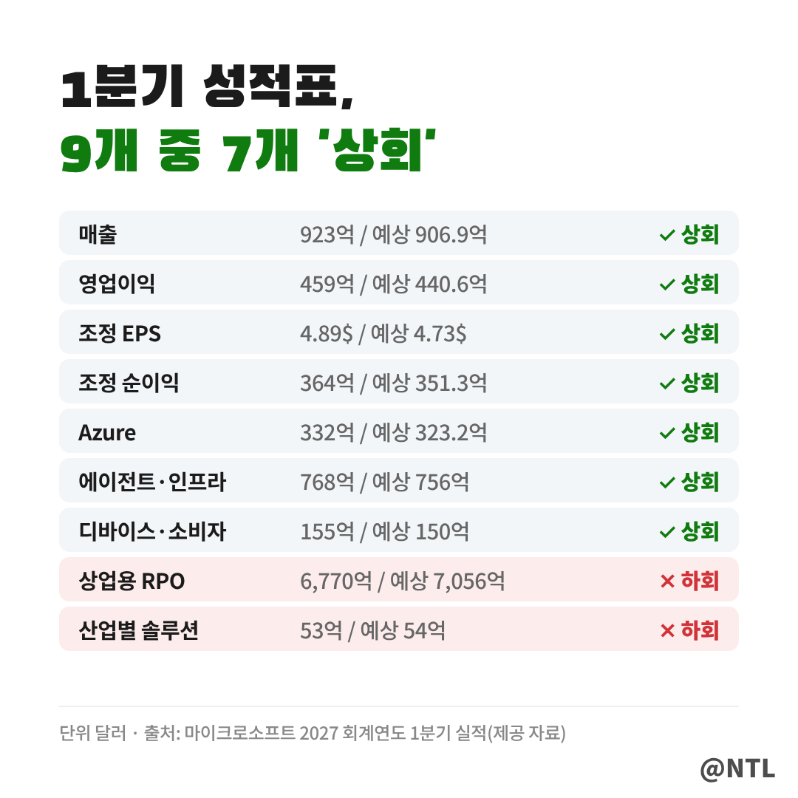
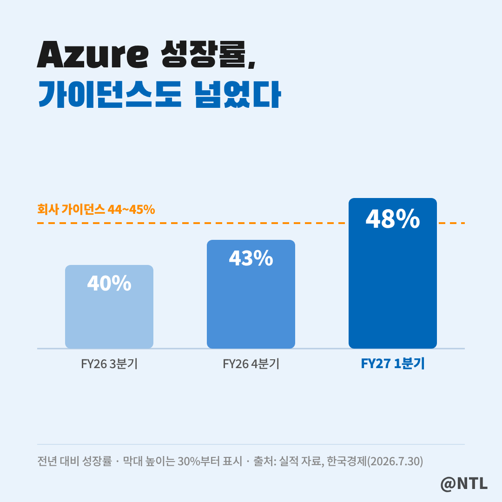
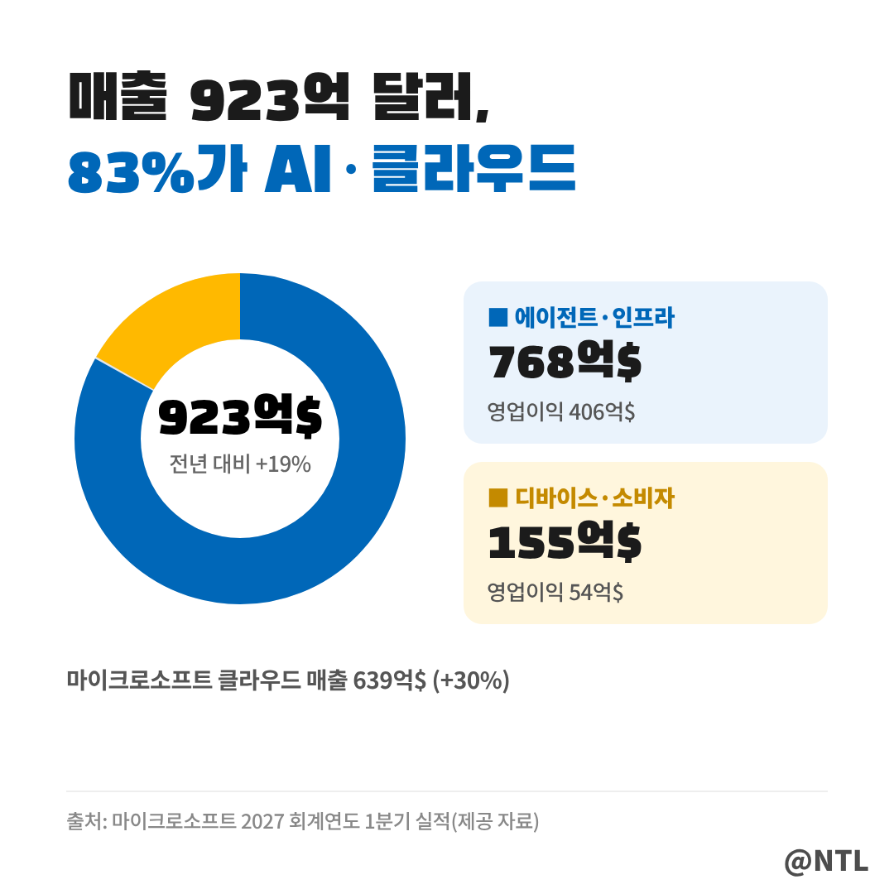
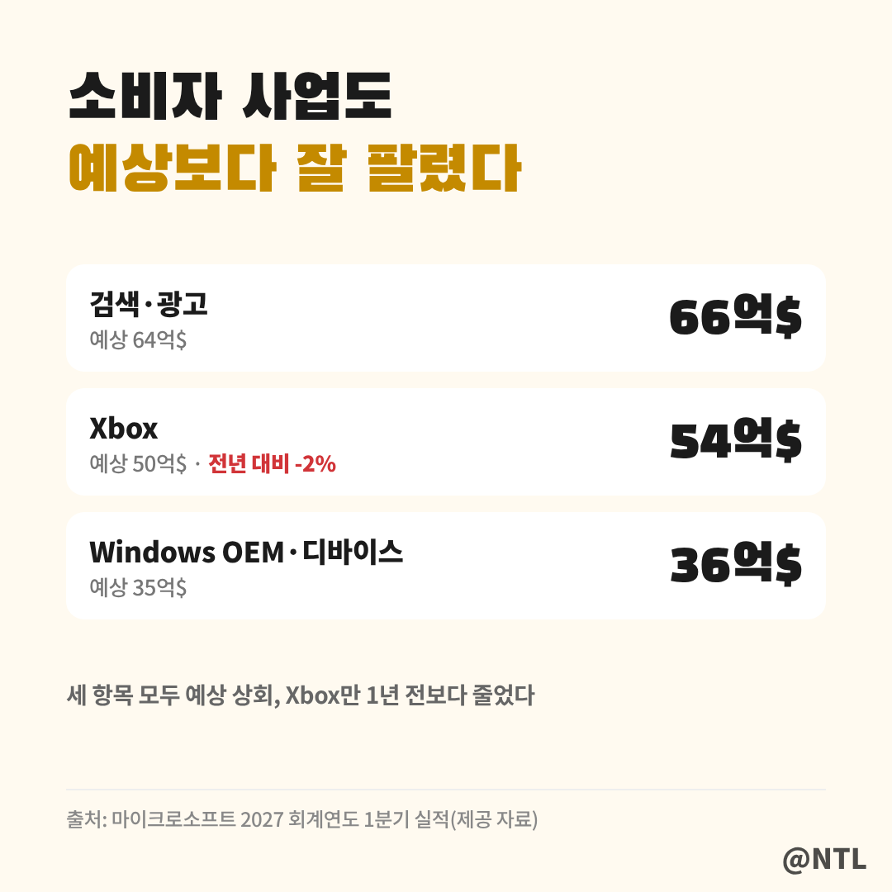
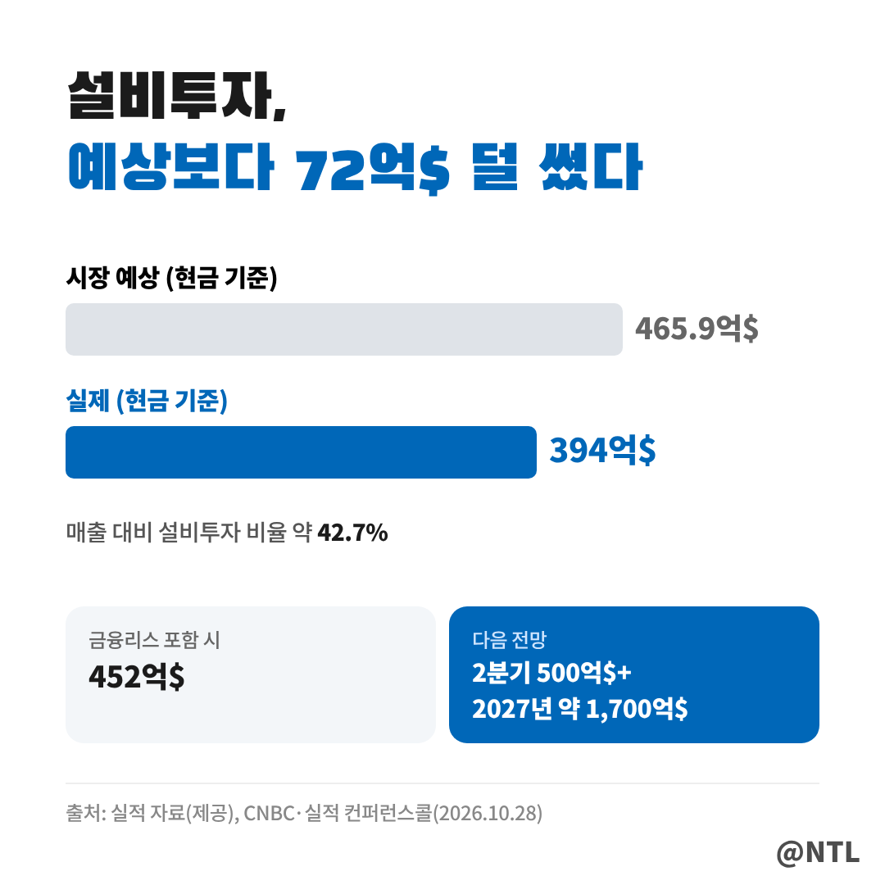
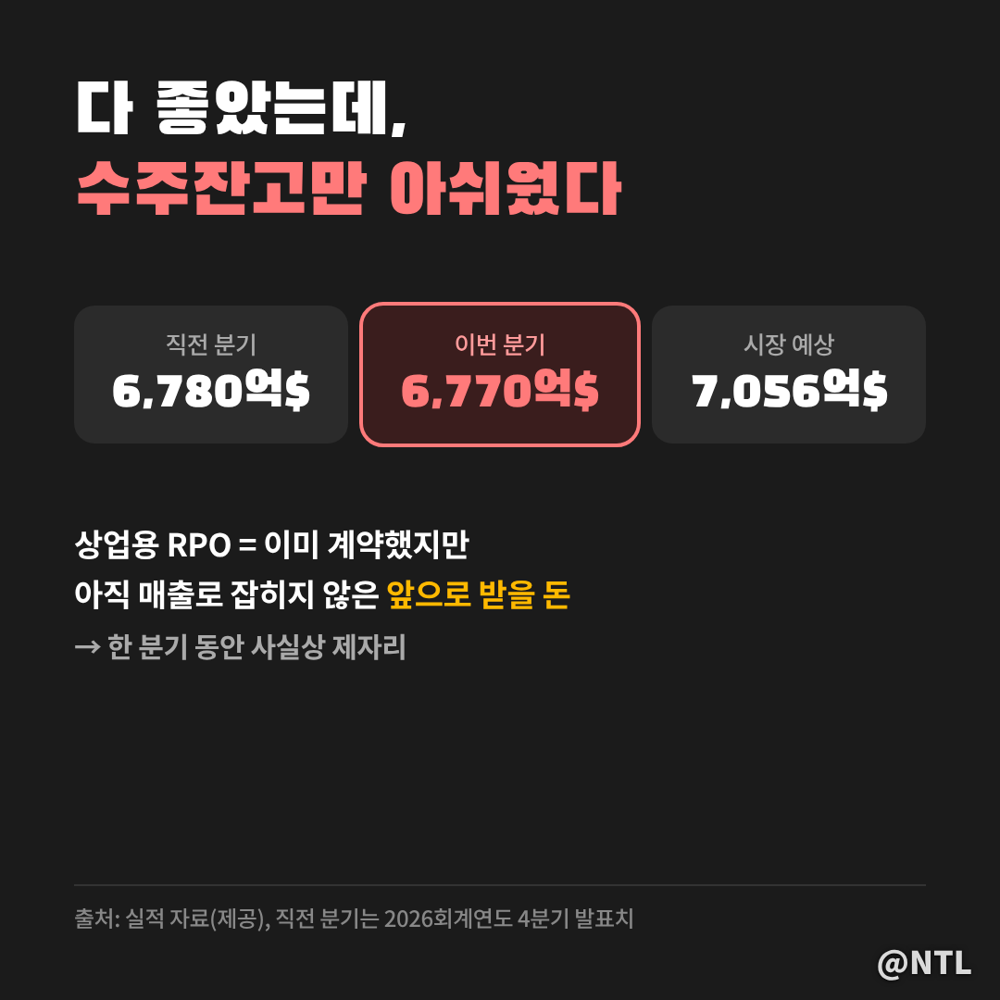

# 마이크로소프트 실적, 덜 쓰고 더 벌었다

**제목 후보**
1. 마이크로소프트 실적, 덜 쓰고 더 벌었다 ← 추천
2. 마이크로소프트 실적, 9개 중 7개 상회
3. 마이크로소프트 실적, 수주잔고만 멈췄다

---

마이크로소프트가 10월 28일(현지시간) 2027 회계연도 1분기(2026년 7~9월) 실적을 발표했습니다.
한 줄로 요약하면 **"거의 다 예상을 넘었다"**입니다.
매출, 영업이익, 주당순이익(EPS)이 모두 시장 기대치를 웃돌았고, 클라우드 핵심인 애저(Azure)는 48% 성장했습니다.

그런데 숫자를 하나씩 뜯어보면 **딱 하나, 예상에 못 미친 지표**가 있습니다.
잘한 것과 아쉬운 것, 그리고 경영진이 무슨 말을 했는지까지 순서대로 정리해 보겠습니다.
(2026년 10월 29일 기준, 금액은 달러)

**🔎 핵심 요약**
- 매출 923억 달러(+19%), 조정 EPS 4.89달러(+18%), 영업이익 459억 달러(+21%) 모두 예상 상회
- 애저 매출 332억 달러, 성장률 48%로 회사 가이던스(44~45%)까지 넘어섬
- 아쉬운 점은 상업용 RPO(수주잔고) 6,770억 달러로 예상(7,056억 달러) 하회

> 숫자로 본 1분기, 9개 중 7개 '상회'

성적표를 보면 초록색이 대부분입니다.
주요 지표 9개 중 7개가 예상치를 넘었고, 못 미친 건 **상업용 RPO와 산업별 솔루션** 두 개뿐입니다.
산업별 솔루션은 53억 달러로 예상(54억 달러)과 차이가 1억 달러에 불과해, 사실상 의미 있는 미달은 RPO 하나라고 볼 수 있습니다.

| 항목 | 1분기 실적 | 시장 예상 | 전년 대비 |
|---|---|---|---|
| 매출 | 923억 달러 | 906.9억 달러 | +19% |
| 영업이익 | 459억 달러 | 440.6억 달러 | +21% |
| 조정 EPS | 4.89달러 | 4.73달러 | +18% |
| 조정 순이익 | 364억 달러 | 351.3억 달러 | - |
| 애저 매출 | 332억 달러 | 323.2억 달러 | +48% |
| MS 클라우드 매출 | 639억 달러 | - | +30% |
| 설비투자(현금 기준) | 394억 달러 | 465.9억 달러 | - |
| 상업용 RPO | 6,770억 달러 | 7,056억 달러 | - |

영업이익 증가율(21%)이 매출 증가율(19%)보다 높다는 점도 눈여겨볼 만합니다.
많이 판 것뿐 아니라 **더 효율적으로 벌었다**는 뜻이기 때문입니다.

> 애저 48%, 회사 가이던스까지 넘었다

이번 실적의 주인공은 단연 애저입니다.
애저 매출은 332억 달러로 1년 전보다 **48% 늘었습니다.**
환율 영향을 뺀 성장률도 48%로, 시장 예상(45.2%)을 넘었습니다.

그래프를 보면 흐름이 더 분명해집니다.
애저 성장률은 2026 회계연도 3분기 40%, 4분기 43%에 이어 이번 분기 48%로 **두 분기 연속 빨라졌습니다.**
점선으로 표시한 회사 자체 가이던스(44~45%)도 훌쩍 넘었습니다.
회사가 스스로 제시한 목표보다 잘 나왔다는 건, 그만큼 AI·클라우드 수요가 예상보다 강했다는 의미입니다.

애저를 포함한 **마이크로소프트 클라우드 전체 매출은 639억 달러(+30%)**로, 회사 전체 매출의 약 70%를 차지합니다.

> 두 사업부로 보면, 매출 83%가 AI·클라우드

이번 실적에서 마이크로소프트의 사업은 크게 두 부문으로 나뉩니다.

**에이전트 및 인프라** 부문은 매출 768억 달러로 예상(756억 달러)을 넘었고, 영업이익은 406억 달러였습니다.
도넛 그래프의 파란 부분처럼 **전체 매출의 약 83%**를 차지하는 핵심 사업입니다.
애저와 기업용 AI 서비스가 여기에 속합니다.

**디바이스 및 소비자** 부문은 매출 155억 달러(예상 150억 달러), 영업이익 54억 달러였습니다.
비중은 약 17%로 작지만, 이 부문도 예상을 넘었습니다.

두 부문의 영업이익률을 계산해 보면 에이전트·인프라가 약 53%, 디바이스·소비자가 약 35%입니다.
**돈을 버는 무게중심이 AI·클라우드 쪽에 확실히 쏠려 있다**는 걸 보여주는 숫자입니다.

> 소비자 사업도 예상보다 잘 팔렸다

디바이스·소비자 부문을 조금 더 들여다보면 세 가지가 눈에 띕니다.

- **검색·광고** 매출 66억 달러로 예상(64억 달러) 상회
- **Xbox** 매출 54억 달러로 예상(50억 달러) 상회, 다만 1년 전보다는 2% 감소
- **Windows OEM·디바이스** 매출 36억 달러로 예상(35억 달러) 상회

카드에서 보듯 세 항목 모두 예상치를 넘었습니다.
Xbox는 시장이 워낙 낮게 봤던 터라 예상은 넘었지만, 전년보다 줄어든 만큼 게임 사업의 성장 동력은 여전히 숙제로 남아 있습니다.

> 설비투자, 예상보다 72억 달러 덜 썼다

빅테크 실적에서 요즘 가장 많이 보는 숫자가 설비투자(CapEx)입니다.
AI 데이터센터에 얼마나 돈을 쏟아붓느냐가 곧 미래 비용이기 때문입니다.

마이크로소프트의 1분기 설비투자는 현금 기준 **394억 달러로, 시장 예상(465.9억 달러)보다 약 72억 달러 적었습니다.**
매출 대비 설비투자 비율은 약 42.7%입니다.
다만 금융리스까지 포함하면 약 452억 달러로, 언론마다 숫자가 다르게 나오는 이유가 여기에 있습니다.

경영진은 설비투자의 약 4분의 3이 CPU·GPU처럼 수명이 짧은 장비에 쓰였다고 설명했습니다.
아래 파란 카드처럼 **2분기에는 500억 달러 이상, 2027년 한 해로는 약 1,700억 달러**를 쓸 계획이라, 투자 속도가 꺾인 건 아닙니다.

참고로 OpenAI 관련 영향으로 순이익이 2억 700만 달러 늘었고, EPS에는 0.03달러가 더해졌습니다.
EPS 4.89달러 가운데 비중은 크지 않아, 이익 서프라이즈의 대부분은 본업에서 나왔다고 볼 수 있습니다.

같은 날 실적을 낸 구글은 설비투자 급증으로 잉여현금흐름이 마이너스가 됐는데, 마이크로소프트는 이번 회계연도에도 잉여현금흐름이 플러스를 유지할 것이라고 밝혔습니다.
▶ 구글 3분기 실적은 이전 글에서 정리했습니다. [직접 입력: '구글 3분기 실적' 글 링크]

> 다 좋았는데, 수주잔고만 아쉬웠다

이번 실적에서 유일하게 아쉬운 숫자가 **상업용 잔여계약이행의무(RPO)**입니다.
어렵게 들리지만, 쉽게 말해 **이미 계약은 했지만 아직 매출로 잡히지 않은 '앞으로 받을 돈'**입니다.
일종의 수주잔고라서 미래 매출을 가늠하는 지표로 쓰입니다.

1분기 상업용 RPO는 6,770억 달러로 시장 예상(7,056억 달러)에 약 286억 달러 못 미쳤습니다.
직전 분기(6,780억 달러)와 비교하면 **한 분기 동안 사실상 제자리**였습니다.
지금의 애저 성장이 탄탄하더라도, 새 계약이 쌓이는 속도가 주춤했다는 신호일 수 있어 다음 분기에 다시 늘어나는지 확인이 필요합니다.

> 나델라 CEO와 후드 CFO가 한 말

이번 실적 발표에서 사티아 나델라 CEO는 **AI 에이전트**를 전면에 내세웠습니다.

"기업들이 자체적인 인공지능 역량을 구축하고 소유할 수 있도록 지원하고, AI 에이전트의 안전성과 보안을 통해 신뢰를 확보함으로써 우리의 혁신을 다양한 산업에서 AI 도입 확대와 실질적인 성과로 연결하고 있습니다."

핵심은 두 가지로 읽힙니다.
기업이 AI를 **빌려 쓰는 것을 넘어 직접 갖도록** 돕겠다는 것, 그리고 AI 에이전트가 늘어날수록 중요해지는 **보안과 신뢰**를 경쟁력으로 삼겠다는 것입니다.
사업부 이름에 '에이전트'를 내건 것과도 같은 방향입니다.

에이미 후드 CFO는 "매출, 영업이익, 주당순이익 모두 시장 기대치를 뛰어넘는 실적을 기록했다"고 짧게 정리했습니다.

주주환원도 이어졌습니다.
이번 분기 **배당과 자사주 매입으로 총 102억 달러**를 주주에게 돌려줬습니다.
분기 배당금은 지난 9월 발표대로 주당 0.98달러(직전 0.91달러, 약 8% 인상)이며, 11월 19일 기준 주주에게 12월 10일 지급됩니다.

---

**자주 묻는 질문**

**Q. 2027 회계연도 1분기가 2026년 3분기와 같은 건가요?**
A. 네. 마이크로소프트의 회계연도는 7월에 시작해서, 2027 회계연도 1분기는 2026년 7~9월입니다.

**Q. 설비투자 394억 달러와 452억 달러, 어느 게 맞나요?**
A. 둘 다 맞습니다. 394억 달러는 현금으로 쓴 설비투자이고, 452억 달러는 금융리스까지 포함한 금액입니다.

**Q. 상업용 RPO가 예상보다 낮은 게 큰 문제인가요?**
A. 한 분기만으로 판단하긴 이릅니다. 다만 미래 매출의 선행 지표라서, 다음 분기에 다시 늘어나는지 확인하는 게 좋습니다.

---

**3줄 요약**
- 마이크로소프트 1분기 매출 923억 달러·EPS 4.89달러·영업이익 459억 달러 모두 예상 상회
- 애저 48% 성장으로 가이던스 돌파, 설비투자는 현금 기준 394억 달러로 예상보다 적음
- 아쉬운 점은 상업용 RPO 6,770억 달러로 예상 하회, 다음 분기 수주 회복 여부가 관건

여러분은 마이크로소프트의 'AI 에이전트' 전략, 기대가 되시나요? 댓글로 의견 나눠주세요.

※ 본 글은 마이크로소프트 2027 회계연도 1분기 실적 발표와 언론 보도를 정리한 정보 제공 목적이며, 특정 종목의 매수·매도를 권유하지 않습니다. 투자 판단과 책임은 본인에게 있습니다.

#마이크로소프트 #마이크로소프트실적 #마이크로소프트실적발표 #MS실적 #MSFT #애저 #Azure #마이크로소프트주가 #마이크로소프트배당금 #빅테크실적 #미국주식 #AI에이전트
