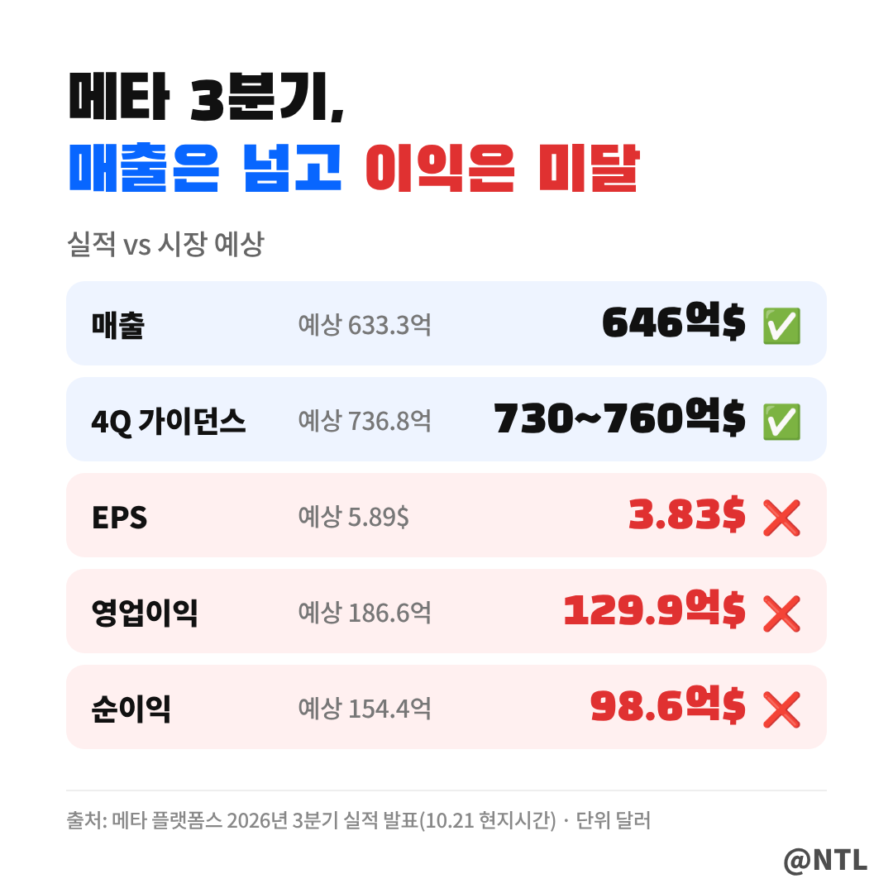
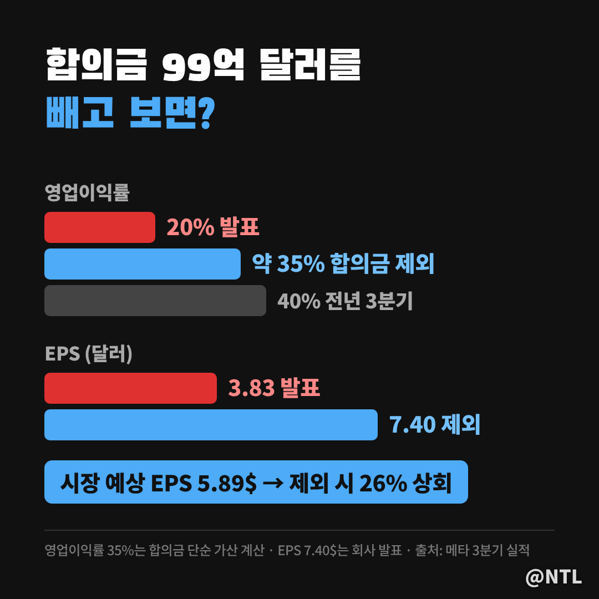
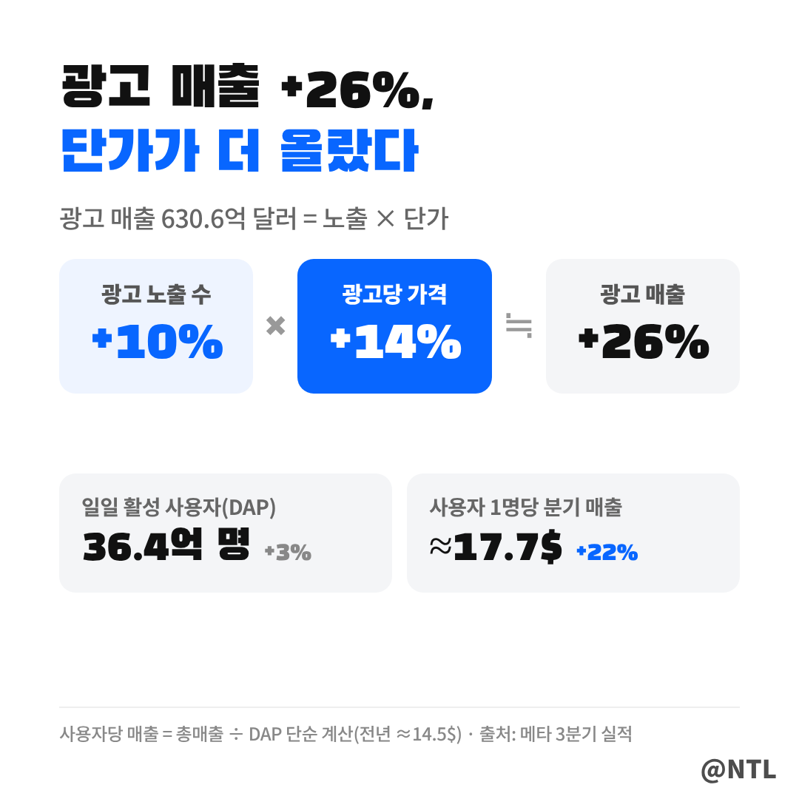
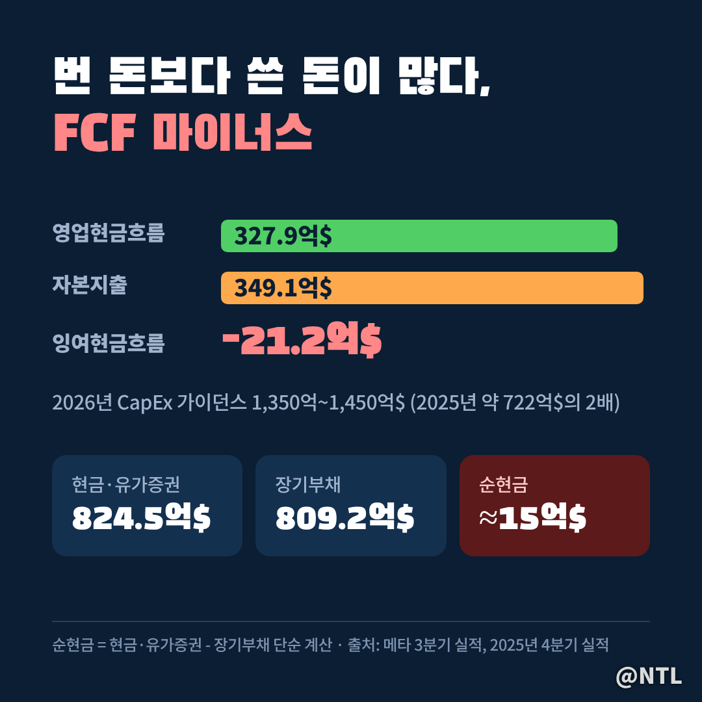
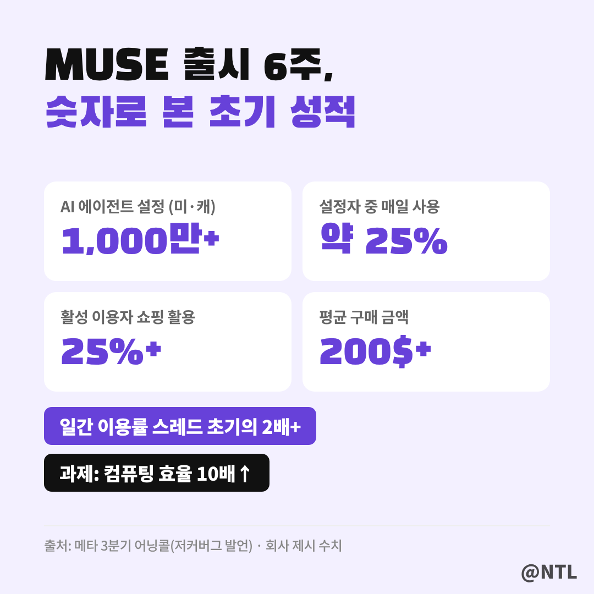
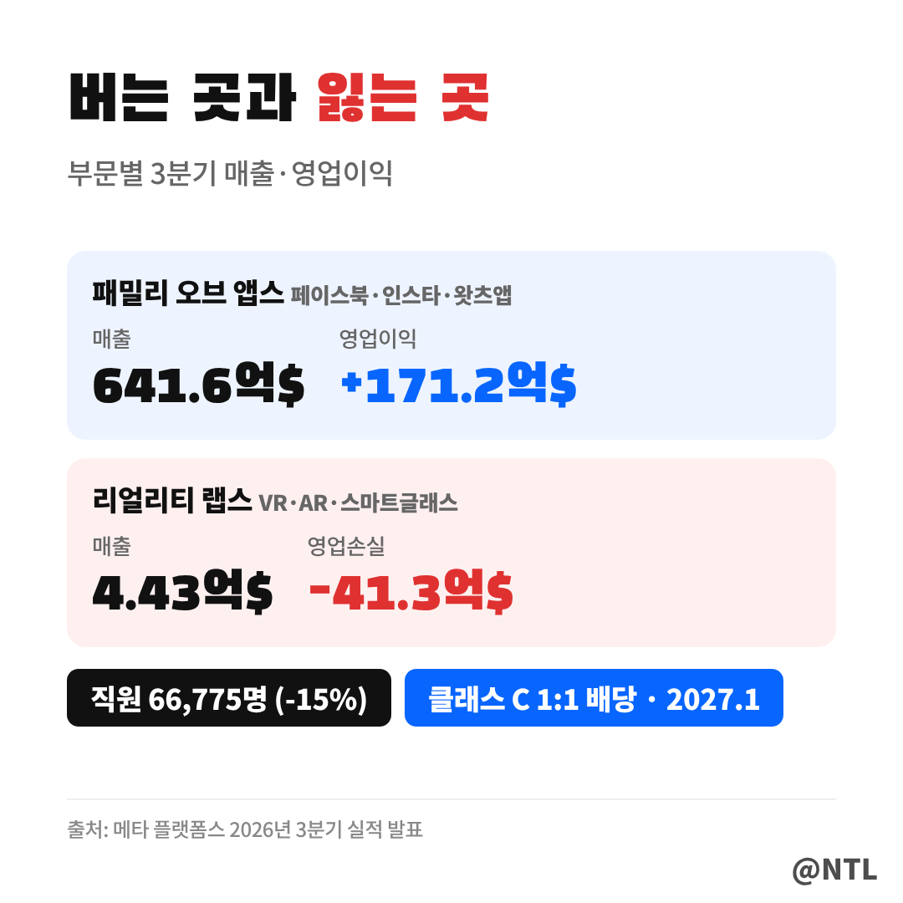
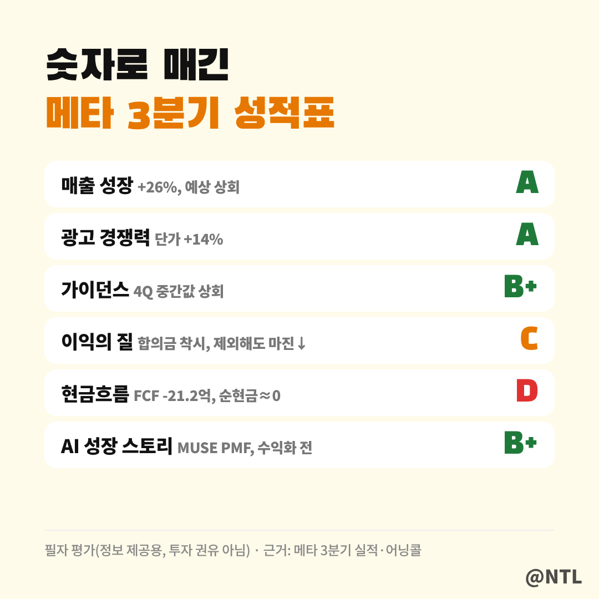

# 메타 3분기 실적 EPS 3.83달러 '쇼크'인데 주가는 +4%? 합의금 빼면 7.40달러였다

**제목 후보**
1. 메타 3분기 실적 EPS 3.83달러 '쇼크'인데 주가는 +4%? 합의금 빼면 7.40달러였다 ← 추천
2. 메타 3분기 실적 성적표｜광고는 A, 현금흐름은 D… 숫자 6개로 매겨봤다
3. 메타 3분기 실적 총정리｜매출 646억 달러·CapEx 1,450억·MUSE 1,000만 명까지

---

메타 플랫폼스(META)가 10월 21일(현지시간) 장 마감 후 2026년 3분기 실적을 발표했습니다.
주당순이익(EPS)은 3.83달러로 예상(5.89달러)에 한참 못 미쳤는데, 주가는 시간외에서 약 4% 올랐습니다.

이익은 '쇼크'인데 왜 주가는 오를까요?
숫자만 늘어놓지 않고, 각 숫자가 **무슨 뜻이고 왜 중요한지** 하나씩 쉽게 풀어보겠습니다.

**🔎 핵심 요약**
- 매출 646억 달러(+26%)로 예상 상회, 광고 단가 +14%
- EPS 미스는 99억 달러 법적 합의금 때문, 빼면 7.40달러
- 대신 CapEx 증가로 잉여현금흐름(FCF)은 -21.2억 달러

> 1. 숫자부터: 매출은 넘고, 이익은 못 미쳤다

보시는 것처럼 매출과 4분기 가이던스는 예상을 넘었고, 이익 지표 세 개는 모두 미달입니다.
영업이익률은 20%로, 1년 전 40%의 절반까지 내려왔습니다.

💡 영업이익률은 100달러를 팔아 본업으로 몇 달러를 남겼는지 보여주는 숫자입니다. 20%면 100달러 중 20달러를 남겼다는 뜻입니다.

| 항목 | 3분기 실적 | 시장 예상 | 판정 |
|---|---|---|---|
| 매출 | 646억 달러 | 633.3억 달러 | 상회 (+26% YoY) |
| EPS | 3.83달러 | 5.89달러 | 미달 (합의금 제외 7.40달러) |
| 영업이익 | 129.9억 달러 | 186.6억 달러 | 미달 (이익률 20%) |
| 순이익 | 98.6억 달러 | 154.4억 달러 | 미달 |
| 4분기 매출 가이던스 | 730억~760억 달러 | 736.8억 달러 | 중간값 상회 |
| 2026 CapEx 가이던스 | 1,350억~1,450억 달러 | 1,320.8억 달러 | 예상보다 많이 쓴다 |

참고로 EPS +265%는 작년 3분기 일회성 세금 비용에 따른 기저효과라 크게 의미를 두지 않아도 됩니다.

> 2. EPS가 크게 빗나간 이유는 '합의금'

이익이 예상보다 낮게 나왔을 때 먼저 따져볼 건 **"이 비용이 매 분기 반복되는가, 한 번뿐인가"**입니다.
한 번 내고 끝나는 비용이라면 회사의 돈 버는 힘 자체는 그대로이기 때문입니다.

이번에 예상을 밑돈 이유의 대부분은 미국 52개 주 법무장관과 맺은 청소년 정신건강 소송 합의 비용 99억 달러입니다.

그림처럼 이 비용을 단순히 더해 보면 영업이익은 약 228.9억 달러, 이익률은 약 35%로 올라갑니다.
메타가 밝힌 합의금 제외 EPS는 **7.40달러로 예상(5.89달러)을 26% 웃돈 셈**입니다.
시장이 EPS 쇼크를 '본업 쇼크'로 보지 않은 이유입니다.

💡 EPS(주당순이익)는 회사가 번 순이익을 주식 수로 나눈 값입니다. 내 주식 1주가 이번 분기에 얼마를 벌어줬는지로 이해하면 쉽습니다.

다만 35%도 1년 전 40%보다는 낮습니다.
AI 인프라 감가상각과 인건비가 이익률을 깎고 있다는 점은 기억해 둬야 합니다.

> 3. 광고는 오히려 더 비싸게 팔렸다

광고 매출 630.6억 달러(+26%)를 쪼개 보면 **노출 수 +10%, 광고 단가 +14%**입니다.
1.10 × 1.14 ≒ 1.25, 그림의 두 숫자를 곱하면 광고 성장률이 거의 그대로 나옵니다.

이 중 더 반가운 숫자는 '단가'입니다.
광고를 더 많이 보여줘서 버는 건 이용자 수에 한계가 있지만, 같은 광고를 더 비싸게 파는 건 광고 효과가 좋아졌다는 뜻이기 때문입니다.
일일 활성 사용자(DAP)는 36.4억 명으로 3% 늘었을 뿐인데 광고주가 돈을 더 냈다는 건, AI가 광고를 살 만한 사람에게 더 정확히 보여주고 있다는 신호입니다.
사용자 1명당 분기 매출도 약 17.7달러로 1년 전(약 14.5달러)보다 20% 넘게 늘었습니다.

> 4. 번 돈보다 쓴 돈이 많았다

이번 실적의 진짜 숙제는 현금입니다.
영업현금흐름 327.9억 달러보다 CapEx 349.1억 달러가 커서 **FCF가 -21.2억 달러**로 마이너스가 됐습니다.

💡 가계부로 비유하면, 월급(영업현금흐름)보다 집 리모델링비(CapEx, 데이터센터·서버 투자)를 더 쓴 달입니다. 잉여현금흐름(FCF)은 그러고 남은 돈인데, 이번엔 모자랐다는 뜻입니다. 배당·자사주 매입도 결국 이 돈에서 나옵니다.

그림 아래쪽 카드도 보세요.
현금·유가증권 824.5억 달러와 장기부채 809.2억 달러가 거의 같아, **순현금이 사실상 0에 가까워졌습니다.**
통장 잔고와 대출이 거의 같아진 셈이라, 앞으로 투자를 더 늘리려면 빚을 더 내야 할 수도 있습니다.
2026년 CapEx는 1,350억~1,450억 달러로, 2025년(약 722억 달러)의 두 배 수준입니다.

그래서 시장은 "언제 이 돈이 매출로 돌아오나"를 묻고, 메타의 답이 MUSE입니다.

> 5. MUSE, 비용을 정당화할 수 있을까

저커버그는 MUSE가 "명확한 제품·시장 적합성(PMF)을 확보했다"고 말했습니다.
출시 약 1개월 반 만에 미국·캐나다에서 1,000만 명 이상이 개인 AI 에이전트를 설정했고, 그중 약 25%가 매일 씁니다.
초기 일간 이용률은 스레드 초기의 2배 이상이라고 합니다.

가장 큰 사용처는 **쇼핑**입니다.
활성 이용자의 25% 이상이 쇼핑 기능을 쓰고 평균 구매 금액은 200달러 이상입니다.
첫 주 거래량이 예상을 넘어 Stripe와 신용 한도를 올렸을 정도입니다.

수익 모델은 무료 기본 서비스 + 거래 수수료 + 고급 모델 유료 구독 + 기업·소상공인용 에이전트 구독입니다.
최소 5억 개로 추산되는 소상공인과 소비자 에이전트를 직접 잇는 게 목표입니다.

다만 지금 MUSE는 추론 비용이 매우 큽니다.
메타는 1년 안에 컴퓨팅 효율을 10배 이상 높이겠다고 했는데, **이 약속이 지켜져야 MUSE가 흑자로 가는 그림**이 완성됩니다.

> 6. 리얼리티 랩스와 클래스 C 주식배당

부문별로 보면 패밀리 오브 앱스가 영업이익 171.2억 달러를 벌었고, 리얼리티 랩스는 매출 4.43억 달러에 영업손실 41.3억 달러였습니다.
매출 1달러당 손실이 약 9달러인 셈이라, 여전히 메타 이익의 큰 짐입니다.
직원 수가 66,775명으로 15% 줄어든 건 비용 통제 의지로 읽힙니다.

또 하나, 메타는 **무의결권 클래스 C 주식을 신설**하고 기존 A·B주 1주당 C주 1주를 나눠주기로 했습니다(2027년 1월 발효).
사실상 2대 1 액면분할이라 주주 가치는 그대로이고, 의결권 희석 없이 주식을 보상·인수에 쓸 수 있는 구조입니다.

> 7. 3분기 성적표와 앞으로 볼 것

종합하면 이번 실적은 **"본업은 A, 현금은 D, 미래는 아직 숙제"**입니다.
성적표처럼 매출·광고·가이던스는 좋았고, 이익은 일회성 요인 탓에 실제보다 나빠 보였으며, 현금흐름은 확실히 나빠졌습니다.

그래서 시장의 해석도 둘로 나뉩니다.
좋게 보는 쪽은 광고 단가 상승과 MUSE의 빠른 확산을 근거로 "투자가 이미 성과를 내고 있다"고 봅니다.
걱정하는 쪽은 FCF 마이너스와 줄어든 순현금을 보며, 1,450억 달러 투자가 AI로 버는 돈보다 너무 앞서 간다고 봅니다.
결국 앞으로 몇 분기 동안 **투자한 만큼 매출이 따라오는지**가 주가 방향을 가를 가능성이 큽니다.

10월 21일 종가는 697.43달러였고, 시간외에서 4% 안팎 올랐습니다.
[직접 입력: 10월 22일 정규장 종가·등락률, 출처]

다음 분기에 볼 세 가지는 이렇습니다.
첫째, 4분기 FCF가 다시 플러스로 돌아오는지.
둘째, MUSE 사용자 수와 쇼핑 수수료 같은 첫 매출 숫자가 공개되는지.
셋째, 2027년 CapEx 가이던스가 또 늘어나는지입니다.

---

**자주 묻는 질문**

**Q. EPS가 예상보다 35% 낮은데 왜 주가가 올랐나요?**
A. 미스의 주원인이 99억 달러 일회성 합의금이기 때문입니다. 이를 빼면 EPS 7.40달러로 예상을 웃돌았고, 매출과 4분기 가이던스도 좋았습니다.

**Q. FCF 마이너스는 위험한 신호인가요?**
A. 영업현금흐름은 327.9억 달러로 여전히 큽니다. 다만 순현금이 거의 0이 된 만큼, CapEx가 더 늘면 부채 의존도가 커질 수 있어 지켜봐야 합니다.

---

**3줄 요약**
- 매출 646억 달러로 예상 상회, EPS 미스는 99억 달러 합의금 탓(제외 시 7.40달러)
- 광고는 노출 +10%·단가 +14%로 강했지만, FCF는 -21.2억 달러로 마이너스
- MUSE는 1,000만 명·쇼핑 중심으로 순항 중, 컴퓨팅 비용 10배 절감이 관건

여러분은 메타의 1,450억 달러 AI 투자, '성장의 씨앗'으로 보시나요 '과속'으로 보시나요? 댓글로 의견 나눠주세요.

※ 본 글은 메타 플랫폼스 2026년 3분기 실적 발표와 어닝콜 내용을 정리한 정보 제공 목적이며, 특정 종목의 매수·매도를 권유하지 않습니다. 투자 판단과 책임은 본인에게 있습니다.

#메타 #메타3분기실적 #메타실적 #메타실적발표 #메타주가 #메타플랫폼스 #META #미국주식 #빅테크실적 #MUSE #메타AI #잉여현금흐름
