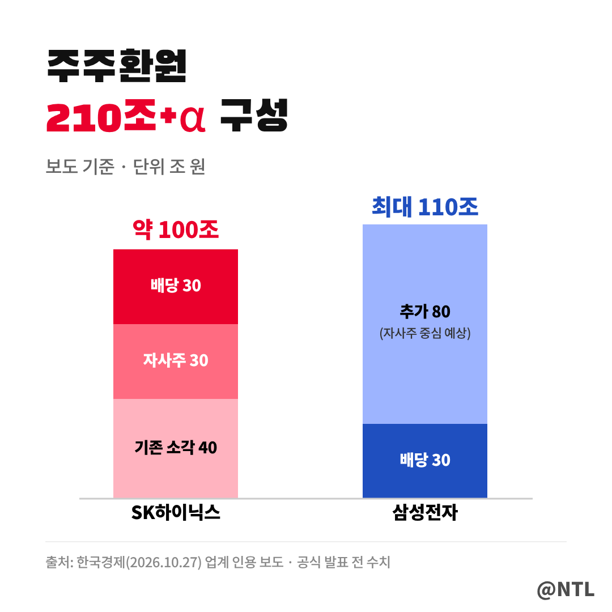
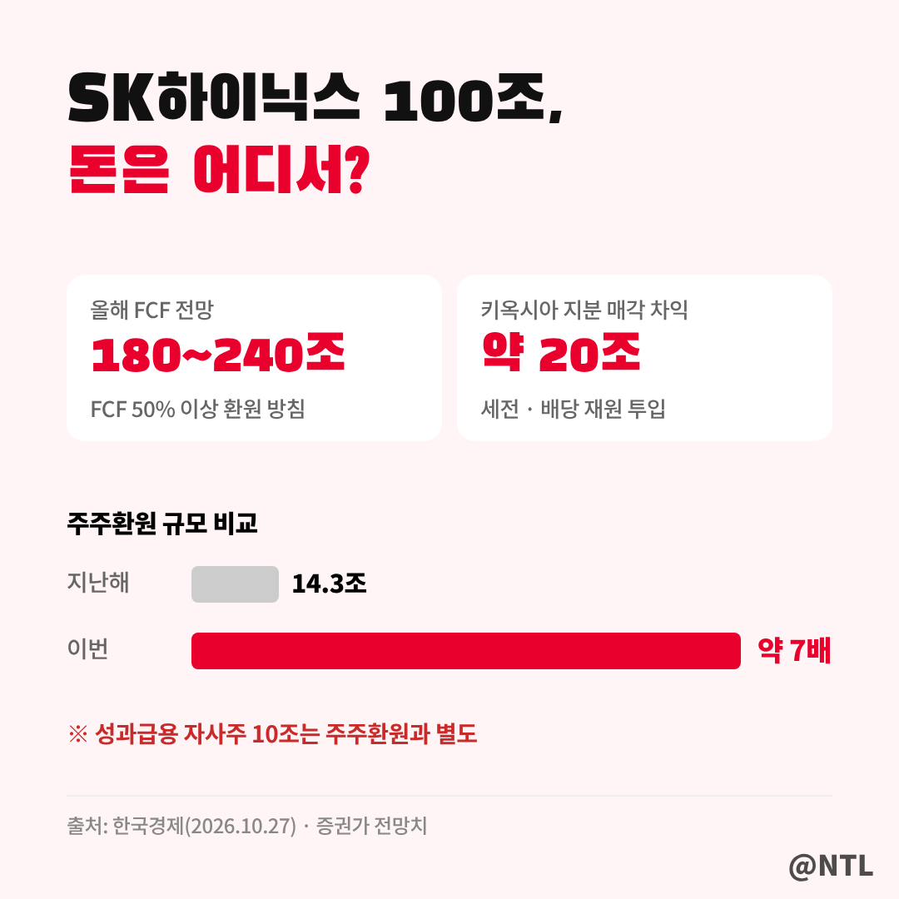
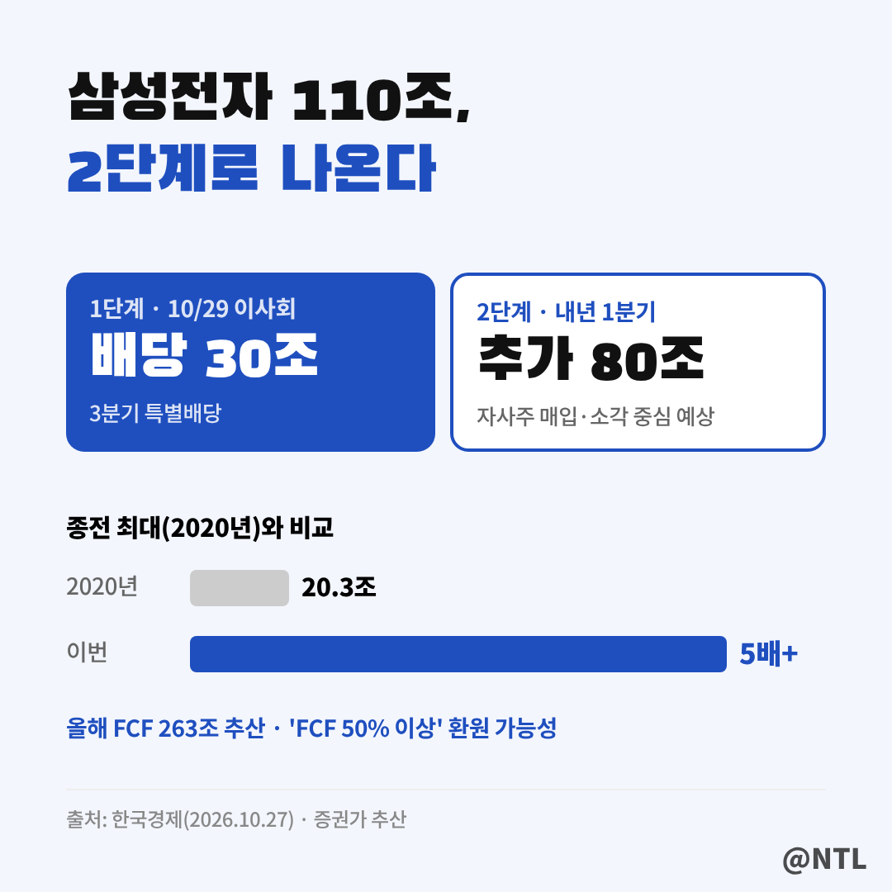
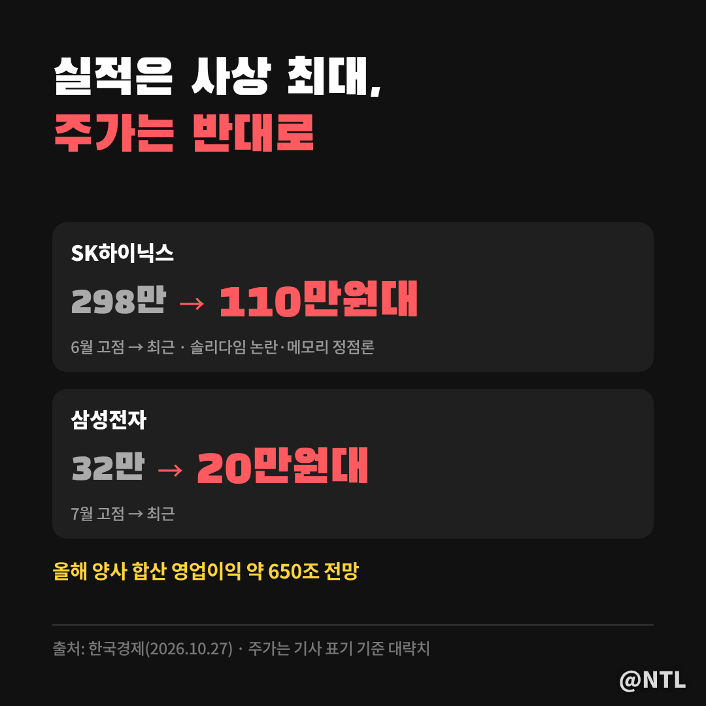
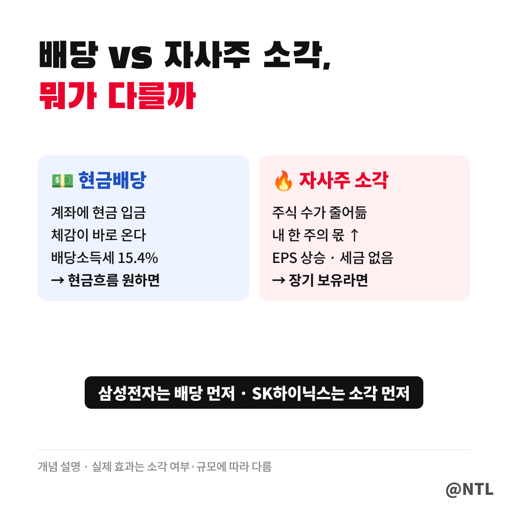
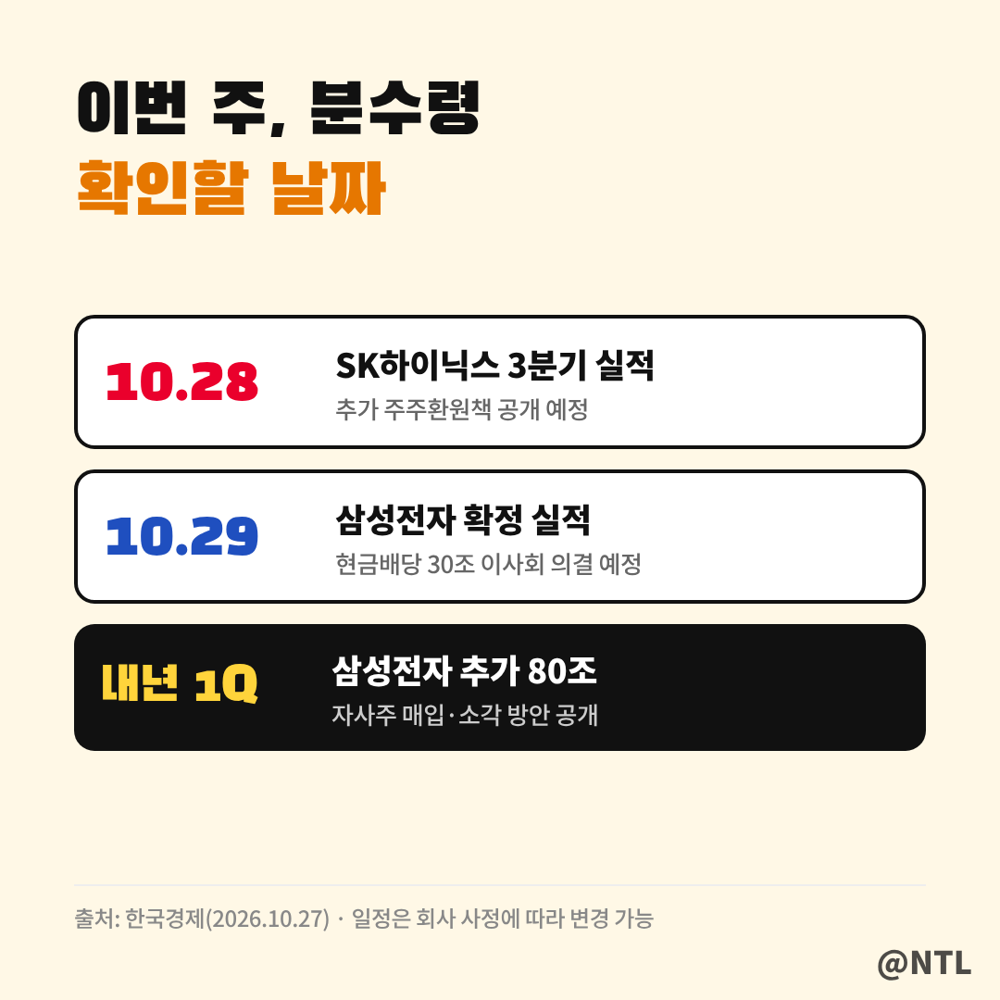

# 삼성전자 SK하이닉스 주주환원 210조+α, 배당 30조·자사주 소각 어떻게 나뉘나? 28·29일 실적 발표 전 총정리

**제목 후보**
1. 삼성전자 SK하이닉스 주주환원 210조+α, 배당 30조·자사주 소각 어떻게 나뉘나? 28·29일 실적 발표 전 총정리 ← 추천
2. 삼성전자 SK하이닉스 주주환원 "주가 급락했는데 이제야?" 210조 카드, 반등 신호일까
3. 삼성전자 110조 vs SK하이닉스 100조 주주환원 비교｜배당 먼저 vs 소각 먼저, 내 계좌엔 뭐가 유리할까

---

삼성전자와 SK하이닉스가 **합쳐서 210조 원이 넘는 주주환원**을 준비하고 있다는 보도가 나왔습니다.
삼성전자 최대 110조 원, SK하이닉스 약 100조 원입니다.

210조 원이면 국내 상장사 웬만한 대기업 몇 곳의 시가총액을 합친 수준입니다.
두 회사 모두 사상 최대 실적을 내고도 주가가 크게 밀린 상황이라, 이번 카드가 반등의 계기가 될지 관심이 쏠리고 있습니다.

다만 먼저 짚어 둘 점이 있습니다.
이 내용은 **한국경제가 업계를 인용해 단독 보도한 것으로, 아직 회사가 공식 발표한 숫자는 아닙니다.**
실제 규모와 방식은 SK하이닉스는 10월 28일, 삼성전자는 29일 실적 발표에서 확인됩니다.
(2026년 10월 27일 보도 기준)

**🔎 핵심 요약**
- SK하이닉스 약 100조: 기존 자사주 매입·소각 40조 + 추가 자사주 30조 + 현금배당 30조
- 삼성전자 최대 110조: 현금배당 30조 + 추가 80조(자사주 매입·소각 중심 예상)
- 확인 일정: 10/28 SK하이닉스 실적, 10/29 삼성전자 이사회·실적, 삼성 나머지는 내년 1분기

> 210조 원, 한눈에 정리

보시는 것처럼 두 회사의 구성은 조금 다릅니다.
SK하이닉스는 **이미 진행한 자사주 소각 40조 원**이 바탕에 깔려 있고, 여기에 추가로 60조 원을 더하는 구조입니다.
삼성전자는 **현금배당 30조 원**을 먼저 확정하고, 나머지 80조 원은 내년 초에 공개하는 2단계 구조입니다.

| 구분 | SK하이닉스 (약 100조) | 삼성전자 (최대 110조) |
|---|---|---|
| 현금배당 | 30조 원 (추가분) | 30조 원 (10/29 이사회 의결 예정) |
| 자사주 | 기존 매입·소각 40조 + 추가 매입 30조 | 추가 80조 원 중 상당 부분 예상 |
| 발표 시점 | 10/28 3분기 실적 발표 | 배당은 10/29, 나머지는 내년 1분기 |
| 별도 | 임직원 성과급용 자사주 10조 원 | FCF 50% 이상 환원 정책 가능성 |

제목의 **'+α'**는 표의 맨 아래 줄에서 나옵니다.
삼성전자가 앞으로 FCF 환원 비율을 50%보다 더 높이면 110조 원을 넘어설 수 있고, SK하이닉스도 올해 영업이익이 260조 원을 웃돌 것으로 보여 실제 발표 규모가 더 커질 여지가 있습니다.
반대로 보도된 숫자보다 줄어들 가능성도 있으니, 확정 전까지는 '최대치'로 보는 게 안전합니다.

> SK하이닉스 100조 원, 하나씩 뜯어보기

SK하이닉스 100조 원은 크게 세 덩어리입니다.

**① 기존 자사주 매입·소각 40조 원**은 이미 단행한 몫입니다.
**② 추가 자사주 매입 30조 원**과 **③ 현금배당 30조 원**이 이번에 새로 더해질 것으로 알려진 60조 원입니다.

재원은 어디서 나올까요?
증권가는 SK하이닉스의 올해 잉여현금흐름(FCF)을 **180조~240조 원**으로 봅니다.
SK는 앞서 "FCF의 50% 이상을 주주환원에 쓰겠다"고 밝혔습니다.
여기에 2018년 투자했던 **키옥시아 지분을 팔아 남긴 세전 20조 원 안팎의 차익**도 현금배당 재원으로 쓰일 것으로 전해졌습니다.

규모를 비교하면 더 실감이 납니다.
지난해 SK하이닉스의 주주환원은 14조 3,000억 원이었습니다. 이번엔 **약 7배**입니다.

한 가지 헷갈리기 쉬운 숫자가 있습니다.
**임직원 성과급용 자사주 10조 원은 주주환원과 별개**입니다.
자사주를 사들이는 건 같지만, 소각하지 않고 직원에게 지급하는 용도라 주주 몫을 늘리는 효과와는 다릅니다.

> 삼성전자 110조 원, 2단계로 나온다

삼성전자의 첫 단계는 **현금배당 30조 원**입니다.
29일 3분기 확정 실적 발표에 맞춰 이사회에서 의결할 예정입니다.
이 30조 원은 지난 8월 예고했던 3분기 특별배당과 같은 흐름으로, 주당 4,600원 안팎으로 추산되던 바로 그 배당입니다.
▶ 3분기 배당금 계산과 입금일은 이전 글에서 정리했습니다. [직접 입력: '삼성전자 배당금' 글 링크]

두 번째 단계는 **나머지 80조 원**입니다.
업계는 이 돈의 상당 부분이 **자사주 매입과 소각**에 들어갈 것으로 보고 있으며, 구체적인 방안은 내년 1분기 실적 발표 때 공개할 방침입니다.

삼성전자 역시 재원은 넉넉한 편입니다.
올해 영업이익은 370조 원, 증권가가 추산한 FCF는 **263조 원**입니다.
현재 'FCF의 50%를 주주에게 돌려준다'는 가이드라인을 **'50% 이상'으로 높일 가능성**도 거론됩니다.
종전 최대 주주환원이었던 2020년 20조 3,000억 원과 비교하면 **5배가 넘는** 규모입니다.

> 왜 하필 지금일까? 주가가 말해준다

이번 주주환원의 배경에는 **실적과 주가의 괴리**가 있습니다.

두 회사의 올해 합산 영업이익은 사상 최대인 650조 원 수준으로 예상됩니다.
그런데 주가는 반대로 움직였습니다.
SK하이닉스는 6월 298만 원까지 올랐다가 최근 110만 원대로 내려왔고, 삼성전자도 7월 32만 원에서 20만 원대로 밀렸습니다.

메모리 반도체가 정점을 찍었다는 '메모리 정점론'에, SK하이닉스는 **솔리다임 미국 상장을 둘러싼 중복상장 논란**까지 겹쳤습니다.
지난주 SK하이닉스가 솔리다임 상장 검토를 중단한 데 이어, 이번 주주환원 카드로 **흔들린 주주 신뢰를 되찾겠다는 의도**로 읽힙니다.

> 배당과 자사주 소각, 나에게 뭐가 다를까

주주환원은 크게 두 가지 방식입니다.

**현금배당**은 회사가 번 돈을 주주 계좌에 현금으로 넣어주는 방식입니다.
바로 손에 쥐는 돈이라 체감이 확실하지만, 배당소득세 15.4%를 떼고 받습니다.

**자사주 매입·소각**은 회사가 시장에서 자기 주식을 사서 없애는 방식입니다.
주식 수가 줄어드니 내가 가진 한 주의 몫이 커지고, 주당순이익(EPS)이 올라갑니다.
현금이 들어오진 않지만 세금 없이 주가에 반영되는 효과를 기대할 수 있습니다.

정리하면 **당장 현금 흐름을 원하는 사람에겐 배당**, **장기 보유하며 주가 상승을 노리는 사람에겐 소각**이 더 반가운 소식입니다.
두 회사 모두 두 방식을 섞었고 배당 비중은 30% 안팎으로 비슷합니다.
차이는 **순서**입니다. 삼성전자는 **배당 30조 원을 먼저** 확정하고 자사주는 내년에 공개하는 반면, SK하이닉스는 **소각 40조 원을 먼저** 해 온 데 이어 배당과 자사주를 함께 더하는 구조입니다.

> 이번 주 확인할 일정

이번 주가 사실상 분수령입니다.

- **10월 28일(수)**: SK하이닉스 3분기 실적 발표, 추가 주주환원책 공개 예정
- **10월 29일(목)**: 삼성전자 3분기 확정 실적, 현금배당 30조 원 이사회 의결 예정
- **내년 1분기**: 삼성전자 나머지 80조 원 주주환원 방안 공개 예정

실적 발표에서 볼 포인트는 세 가지입니다.
첫째, 보도된 숫자가 **실제 공식 발표와 얼마나 같은지**.
둘째, 자사주는 **매입만 하는지, 소각까지 하는지**.
셋째, 배당과 자사주가 **몇 년에 걸쳐 나뉘는지**입니다. 같은 100조 원이라도 1년에 하느냐 3년에 나누느냐에 따라 효과가 크게 다릅니다.

---

**자주 묻는 질문**

**Q. 210조 원 주주환원, 확정된 건가요?**
A. 아닙니다. 10월 27일 업계를 인용한 보도이며, SK하이닉스는 28일, 삼성전자는 29일 실적 발표에서 공식 내용을 확인할 수 있습니다.

**Q. 지금 주식을 사면 이번 배당을 받을 수 있나요?**
A. 삼성전자 30조 원 배당은 3분기 배당으로, 기준일이 9월 30일이라 지금 사도 받을 수 없습니다. SK하이닉스 추가 배당의 기준일은 발표 내용을 확인해야 합니다. [직접 입력: SK하이닉스 배당 기준일, 10/28 공시 확인]

**Q. 성과급용 자사주 10조 원도 주주에게 좋은 건가요?**
A. 주주환원과는 별개입니다. 소각하지 않고 임직원에게 지급하는 용도라 주식 수가 줄어드는 효과는 없습니다.

---

**3줄 요약**
- 삼성전자 최대 110조, SK하이닉스 약 100조, 합산 210조+α 주주환원 추진 보도
- SK하이닉스는 소각 40조 먼저+배당·자사주 추가, 삼성전자는 현금배당 30조 먼저·나머지 80조는 내년 초
- 10/28 SK하이닉스, 10/29 삼성전자 실적 발표에서 실제 숫자와 소각 여부 확인 필수

여러분은 배당과 자사주 소각 중 어느 쪽이 더 반가우신가요? 댓글로 의견 나눠주세요.

※ 본 글은 2026년 10월 27일 한국경제 보도를 바탕으로 정리한 정보 제공 목적이며, 회사의 공식 발표와 다를 수 있습니다. 특정 종목의 매수·매도를 권유하지 않으며, 투자 판단과 책임은 본인에게 있습니다.

#삼성전자 #SK하이닉스 #주주환원 #삼성전자주주환원 #SK하이닉스주주환원 #자사주소각 #삼성전자배당금 #SK하이닉스배당금 #삼성전자주가 #SK하이닉스주가 #특별배당 #삼전닉스
