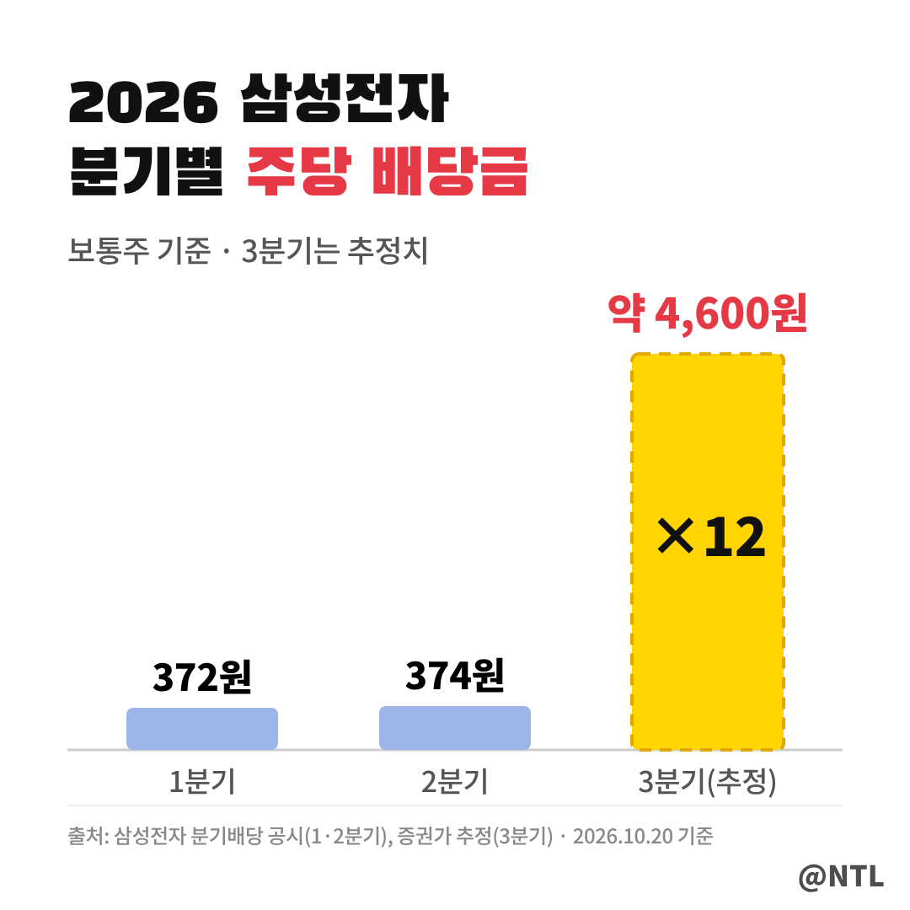
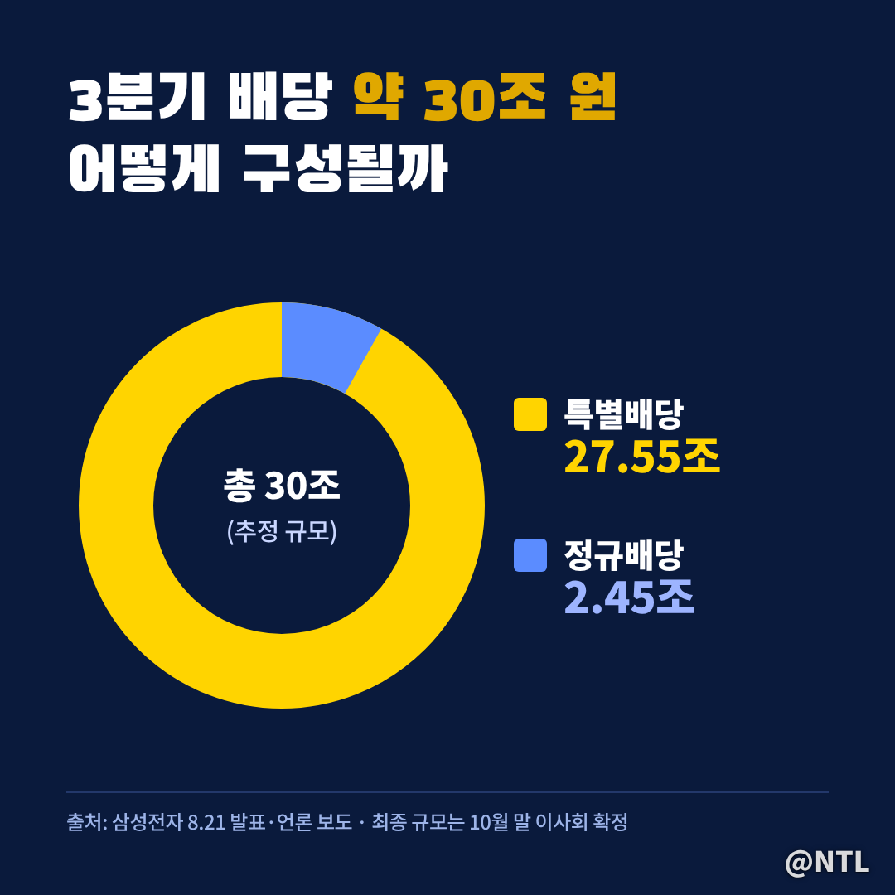
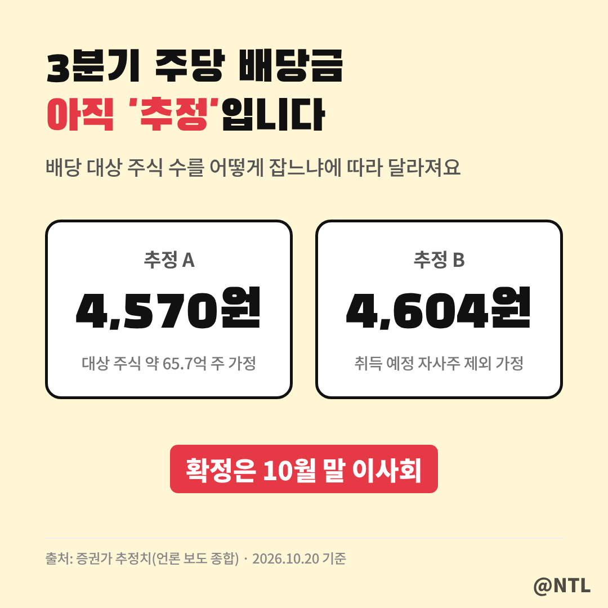
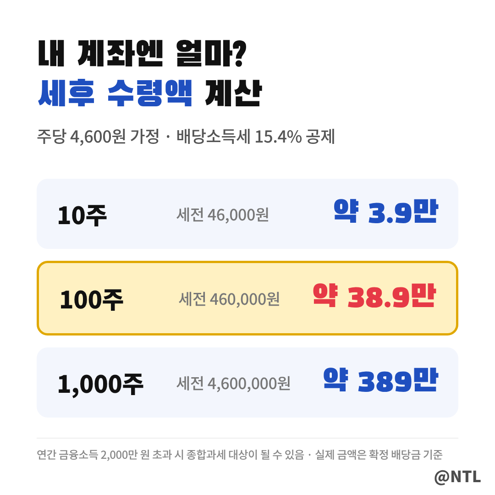

# 삼성전자 배당금 "이번엔 400원이 아니다" 3분기 주당 4,600원? 확정일·입금일 정리

**제목 후보**
1. 삼성전자 배당금 "이번엔 400원이 아니다" 3분기 주당 4,600원? 확정일·입금일 정리 ← 추천
2. 삼성전자 배당금 100주면 얼마? 3분기 30조 특별배당, 세후로 계산해 봤더니
3. 삼성전자 배당금 "10월 말 이사회가 끝이 아니다" 진짜 기다릴 날은 따로 있다

---

삼성전자 배당금 알림, 그동안은 커피 몇 잔 값이었죠.
1분기 372원, 2분기 374원. 100주를 갖고 있어도 3만 원대였습니다.

그런데 3분기는 막대 하나가 혼자 솟아 있습니다.
증권가 추정대로라면 **2분기의 12배가 넘는 금액**입니다.
주당 얼마인지, 언제 들어오는지, 세금 떼면 얼마인지 순서대로 정리했습니다.
(2026년 10월 20일 기준)

> 3분기 배당, 왜 갑자기 커졌을까

삼성전자는 8월 21일 이사회에서 올해 주주환원 규모를 약 90조~110조 원으로 잡았습니다.
3분기에 풀릴 배당만 **약 30조 원**입니다.

보시는 것처럼 대부분이 특별배당입니다.
매 분기 나가던 정규배당(약 2.45조 원)에 특별배당 약 27.55조 원이 더해진 구조라,
역대급 실적으로 쌓인 현금을 한 번에 돌려주는 셈입니다.

> 주당 얼마? 아직 '확정'은 아니다

주당 금액은 배당 대상 주식 수를 어떻게 잡느냐에 따라 조금씩 다르게 계산됩니다.

두 추정치의 차이는 34원 정도라 큰 차이는 아닙니다.
다만 **최종 금액은 10월 말 이사회**에서 결정되니, 3분기 실적 발표와 함께 확인하세요.

> 100주면 실제로 얼마 받을까

배당금에서는 배당소득세 15.4%가 원천징수됩니다.
주당 4,600원으로 가정하고 보유 수량별로 계산하면 이렇습니다.

100주 기준 세후 약 38만 9천 원.
그동안 분기마다 3만 원대를 받던 것과 비교하면 체감이 확실히 다릅니다.
연간 금융소득이 2,000만 원을 넘으면 종합과세 대상이 될 수 있으니, 많이 보유했다면 한 번 확인해 두세요.

> 지금 사도 받을 수 있을까

받을 수 없습니다.
3분기 배당 기준일은 **9월 30일**이었고, 9월 28일까지 매수한 주주만 대상입니다.
지금 사는 주식은 4분기 배당(기준일 12월 31일)부터 해당됩니다.

> 입금일, 그리고 진짜 기다릴 날

지급일은 이사회 공시 후 확정되며, 11월 중하순이 거론됩니다.
[직접 입력: 10월 말 이사회 공시 후 확정 지급일, 출처 DART]

그리고 타임라인 맨 아래 날짜가 진짜 변수입니다.
삼성전자는 **2027년 1월 말** 2027~2029년 새 주주환원 정책을 발표합니다.
정규배당 자체가 커질지, 이번 같은 특별배당이 반복될지는 그때 판가름 납니다.

---

**3줄 요약**
- 3분기 배당은 정규+특별 합쳐 약 30조 원, 주당 4,600원 안팎(추정)
- 주당 금액은 10월 말 이사회에서 확정, 지급은 11월 중하순 예상
- 진짜 변수는 2027년 1월 말 발표될 차기 주주환원 정책

여러분은 이번 배당금, 재투자하실 건가요 아니면 따로 쓰실 계획인가요? 댓글로 알려주세요.

※ 본 글은 공시와 언론 보도를 정리한 정보 제공 목적이며, 특정 종목의 매수·매도를 권유하지 않습니다. 투자 판단과 책임은 본인에게 있습니다.

#삼성전자배당금 #삼성전자배당 #삼성전자특별배당 #삼성전자3분기배당 #삼성전자배당금지급일 #삼성전자배당기준일 #삼성전자주주환원 #삼전배당 #배당금계산 #배당소득세
