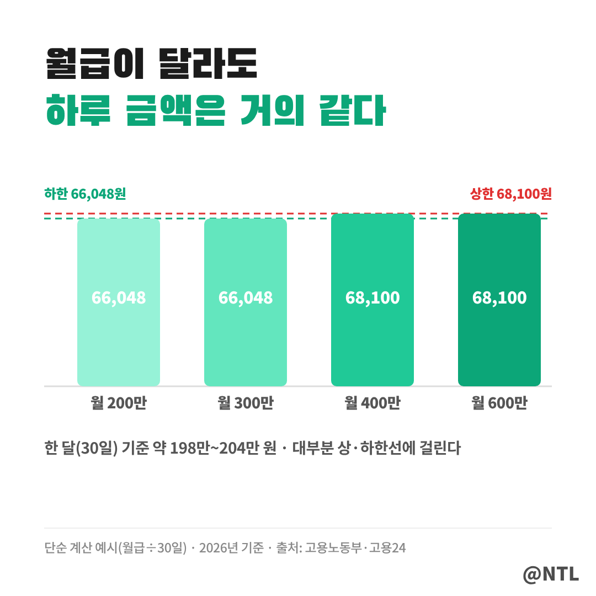
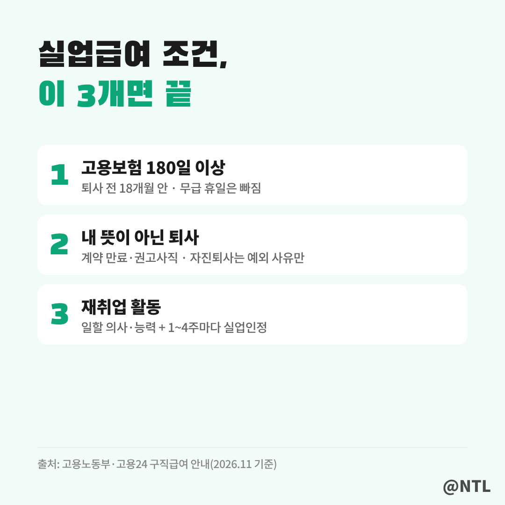
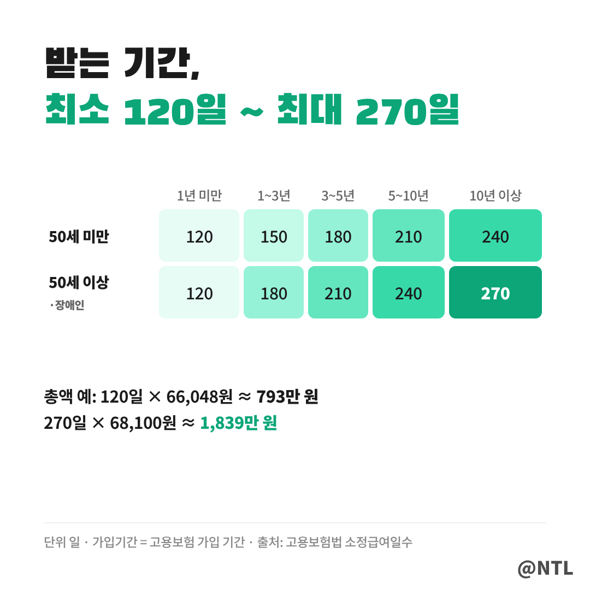
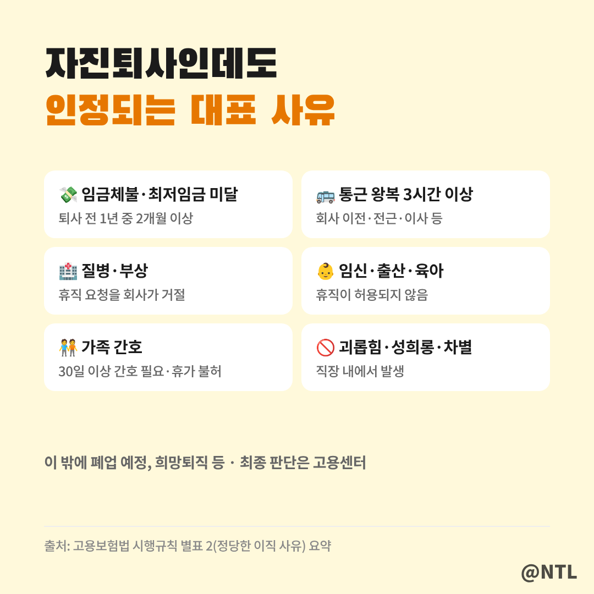
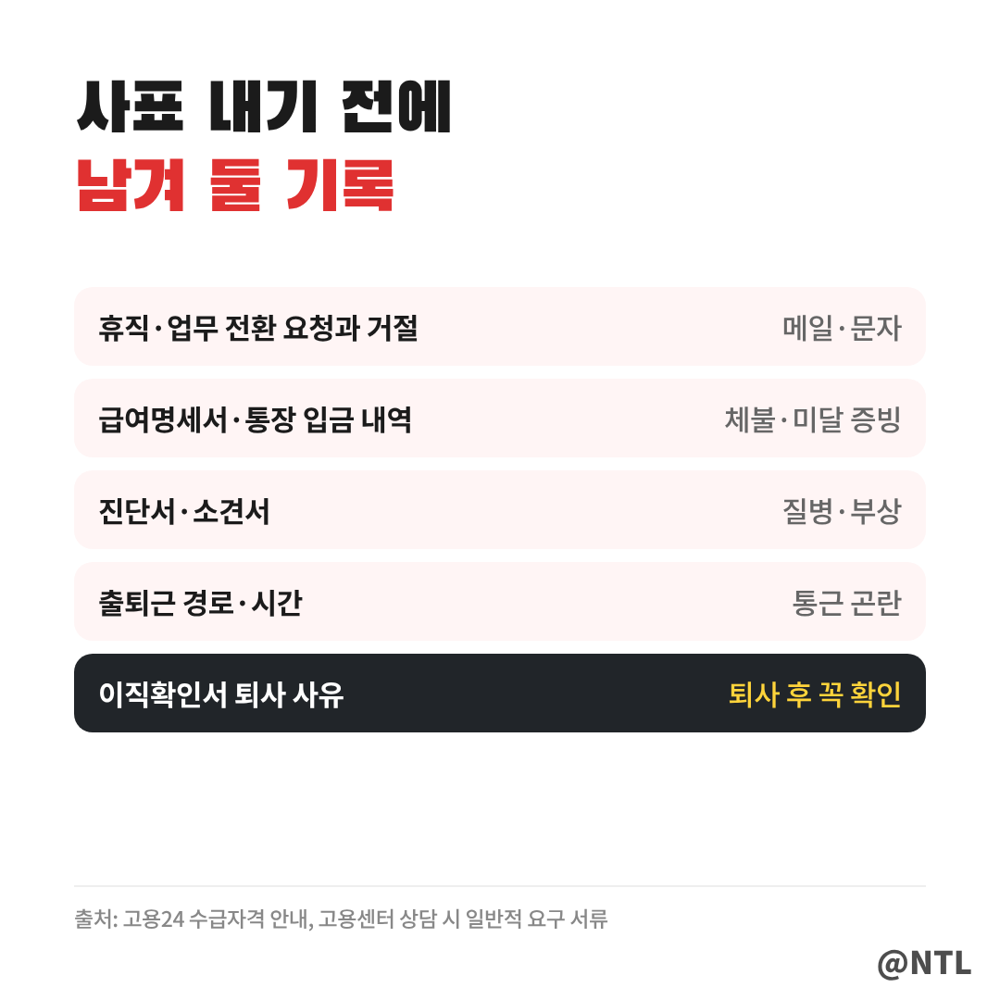
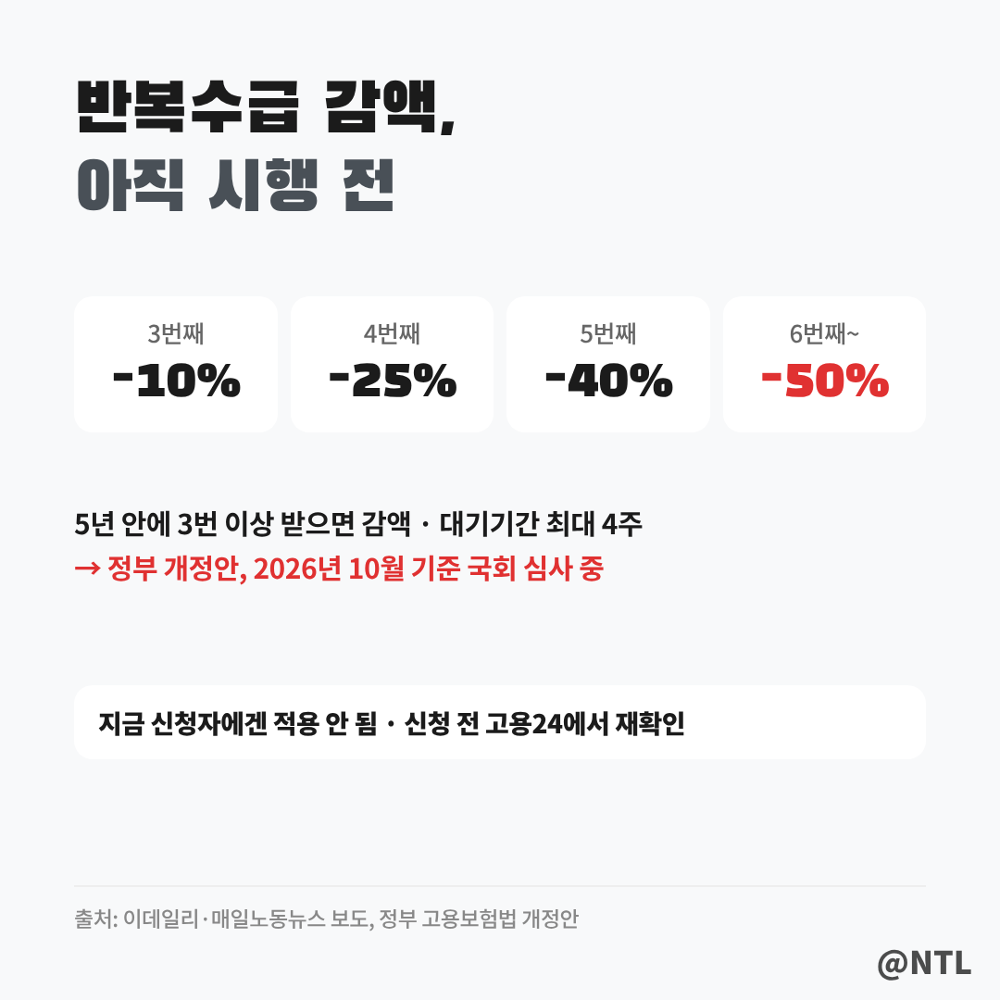

# 실업급여 조건, 월급 많아도 똑같이 받는 이유

**제목 후보**
1. 실업급여 조건, 월급 많아도 똑같이 받는 이유 ← 추천
2. 실업급여 조건, 자진퇴사인데 받은 사람들의 비밀
3. 실업급여 조건, 사표 내기 전에 몰래 챙길 것

---

월급 200만 원을 받던 사람과 500만 원을 받던 사람.
둘 다 회사를 그만두고 실업급여를 받으면, 하루 금액 차이는 **2,052원**밖에 나지 않습니다.
처음 들으면 이상하지만, 2026년 실업급여 구조를 보면 이유가 보입니다.
그리고 이 사실을 알면 실업급여에서 진짜 중요한 게 무엇인지도 달라집니다.
(2026년 11월 19일 기준, 고용노동부·고용24 안내)

[직접 입력: 내가 퇴사나 실업급여를 알아봤던 경험 한두 줄]

> 월급이 달라도 실업급여가 거의 같은 이유

실업급여(구직급여)는 원래 **퇴사 전 평균임금의 60%**를 줍니다.
그런데 여기엔 위아래로 벽이 있습니다.

2026년 기준 하루 **상한액은 6만 8,100원**, **하한액은 6만 6,048원**입니다.
하한액은 최저임금(시급 1만 320원)의 80%에 하루 8시간을 곱해 정해지고, 상한액은 올해 6만 6,000원에서 올랐습니다.
두 벽 사이가 2,052원밖에 안 되다 보니, 그래프처럼 월급이 200만 원이든 600만 원이든 하루 금액은 거의 같아집니다.

예를 들어 월급 200만 원이면 하루 평균임금의 60%가 약 4만 원이지만, 하한액이 적용돼 6만 6,048원을 받습니다.
월급 500만 원이면 60%가 약 10만 원인데, 이번엔 상한액에 걸려 6만 8,100원이 됩니다.
계산해 보면 한 달(30일)에 약 198만~204만 원 사이입니다.
월급이 적었던 사람은 하한액 덕분에 원래 계산보다 더 받고, 많았던 사람은 상한액에 걸려 덜 받는 구조입니다.

> 그래서 진짜 갈리는 건 '받느냐, 못 받느냐'

금액이 사실상 정해져 있으니, 결국 승부는 **자격**에서 납니다.
체크리스트처럼 조건은 세 가지입니다.

첫째, 퇴사 전 18개월 동안 고용보험 가입 기간(피보험단위기간)이 **180일 이상**이어야 합니다.
주말처럼 무급인 날은 빠지기 때문에 달력으로 6개월을 채웠다고 끝이 아닙니다.
주 15시간 미만으로 일한 초단시간 근로자는 24개월 안에서 180일을 셉니다.
둘째, 계약 만료·권고사직처럼 **본인 뜻이 아닌 퇴사**여야 합니다.
셋째, 일할 의사와 능력이 있고 **재취업 활동**을 해야 합니다.

받는 기간은 나이와 가입 기간으로 정해집니다.
표에서 보듯 짧게는 120일, 50세 이상이면서 10년 넘게 가입했다면 최대 270일입니다.
하루 금액이 거의 같으니, **총액을 바꾸는 건 사실상 이 기간**입니다.

> 자진퇴사인데 받은 사람들의 공통점

"스스로 그만두면 못 받는다"는 말은 반만 맞습니다.
고용보험법 시행규칙(별표 2)은 자진퇴사라도 **정당한 이직 사유**가 있으면 받을 수 있게 정해 두었습니다.

대표적인 게 카드에 정리한 경우들입니다.
퇴사 전 1년 안에 임금체불이나 최저임금 미달이 2개월 이상 있었던 경우, 회사 이전 등으로 통근이 왕복 3시간 이상이 된 경우, 질병이나 육아·가족 간호로 휴직을 요청했는데 회사가 거절한 경우 등입니다.

이 경우 받은 사람과 못 받은 사람을 가르는 건 대부분 **기록**입니다.
"휴직을 요청했는데 거절당했다"는 말만으로는 인정받기 어렵습니다.
요청 메일·문자, 급여명세서, 진단서처럼 **퇴사하기 전에** 남겨 둬야 하는 것들이 있고, 회사가 고용센터에 내는 이직확인서의 퇴사 사유도 꼭 확인해야 합니다.
사표를 쓰고 나서 모으려면 이미 늦은 경우가 많습니다.

순서도 알아 두면 덜 헤맵니다.
퇴사 후 고용24에서 구직 등록을 하고, 고용센터에서 수급자격을 인정받은 뒤, 1~4주마다 재취업 활동을 신고하는 '실업인정'을 받아야 돈이 나옵니다.
처음 7일은 대기기간이라 지급되지 않는다는 점도 기억해 두세요.

> 아직 바뀌지 않은 것 하나

"실업급여를 여러 번 받으면 반으로 깎인다"는 이야기도 많이 들으셨을 겁니다.
5년 안에 세 번 이상 받으면 최대 50%까지 줄이는 고용보험법 개정안이 추진되고 있는 건 맞습니다.
정부안은 세 번째 10%, 네 번째 25%, 다섯 번째 40%, 여섯 번째부터 50%를 깎고, 기다리는 기간도 최대 4주로 늘리는 내용입니다.
다만 2026년 10월 보도 기준으로 아직 국회 심사 단계라, **지금 신청하는 사람에게 적용되는 제도는 아닙니다.**
통과 여부는 신청 전에 고용24에서 한 번 더 확인하는 게 안전합니다.

---

**3줄 요약**
- 2026년 실업급여 하루 금액은 6만 6,048원~6만 8,100원으로, 월급이 달라도 거의 같다
- 그래서 중요한 건 180일·비자발적 퇴사·재취업 활동이라는 자격과, 나이·가입 기간으로 정해지는 지급일수
- 자진퇴사도 정당한 사유가 있으면 받을 수 있지만, 퇴사 전에 남긴 기록이 승부를 가른다

월급에 상관없이 실업급여가 거의 같은 지금 구조, 여러분은 공평하다고 보시나요? 댓글로 의견 나눠주세요.

※ 본 글은 2026년 11월 19일 기준 고용노동부·고용24 안내와 언론 보도를 정리한 것으로, 개인별 수급 여부는 관할 고용센터 판단에 따라 달라질 수 있습니다.

#실업급여조건 #실업급여 #구직급여 #실업급여자진퇴사 #자진퇴사실업급여 #실업급여상한액 #실업급여하한액 #실업급여기간 #고용24 #고용보험 #퇴사 #이직확인서
