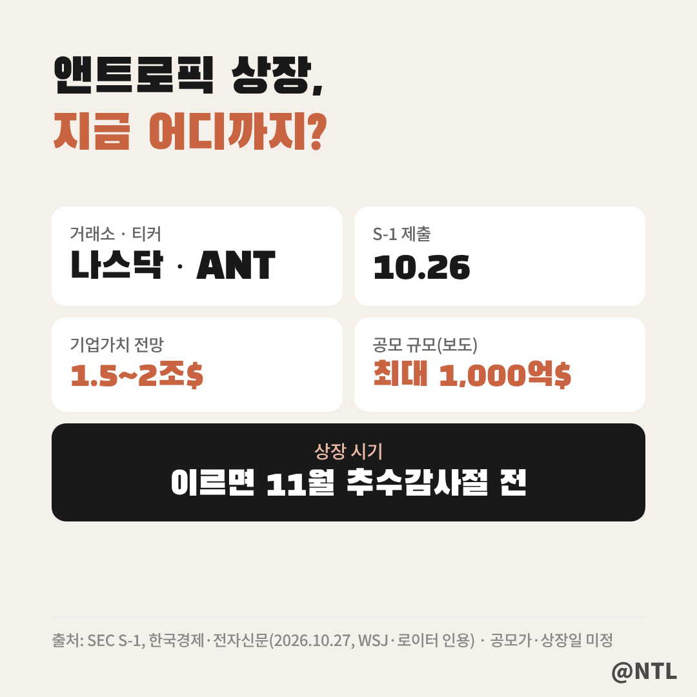
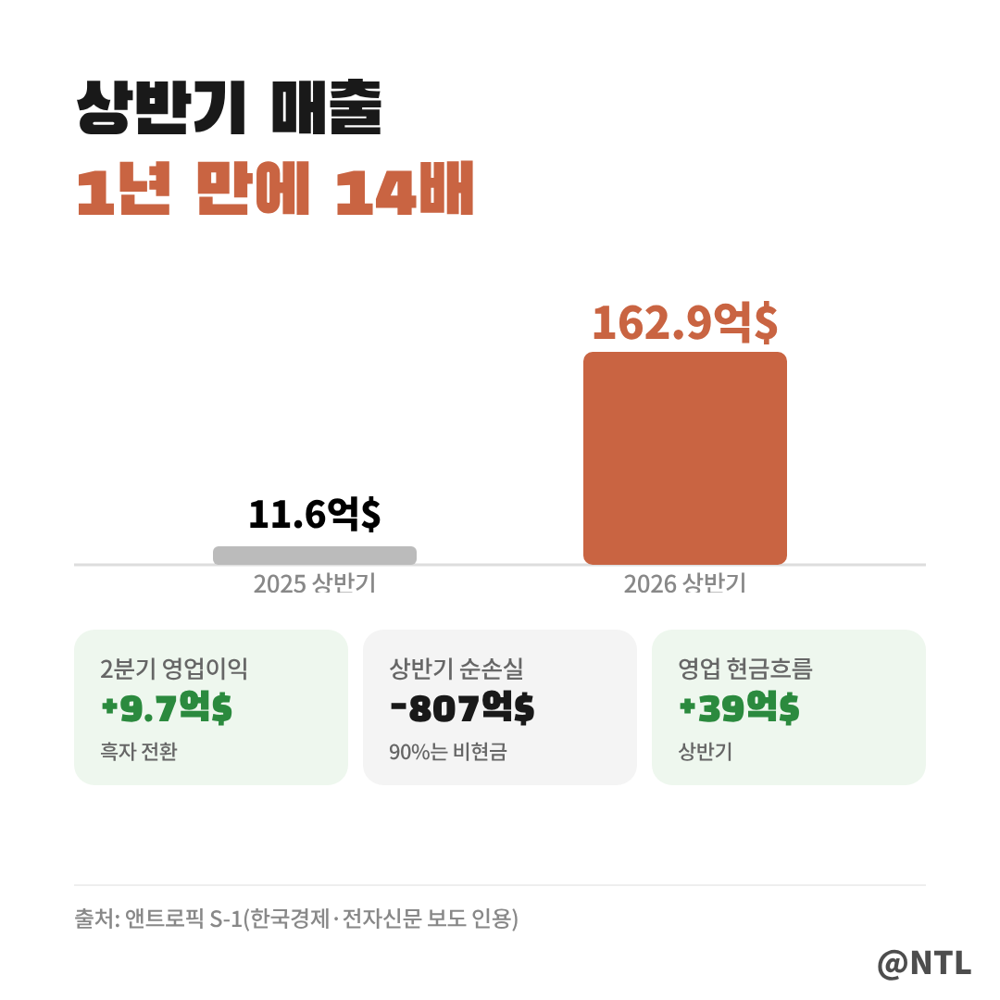
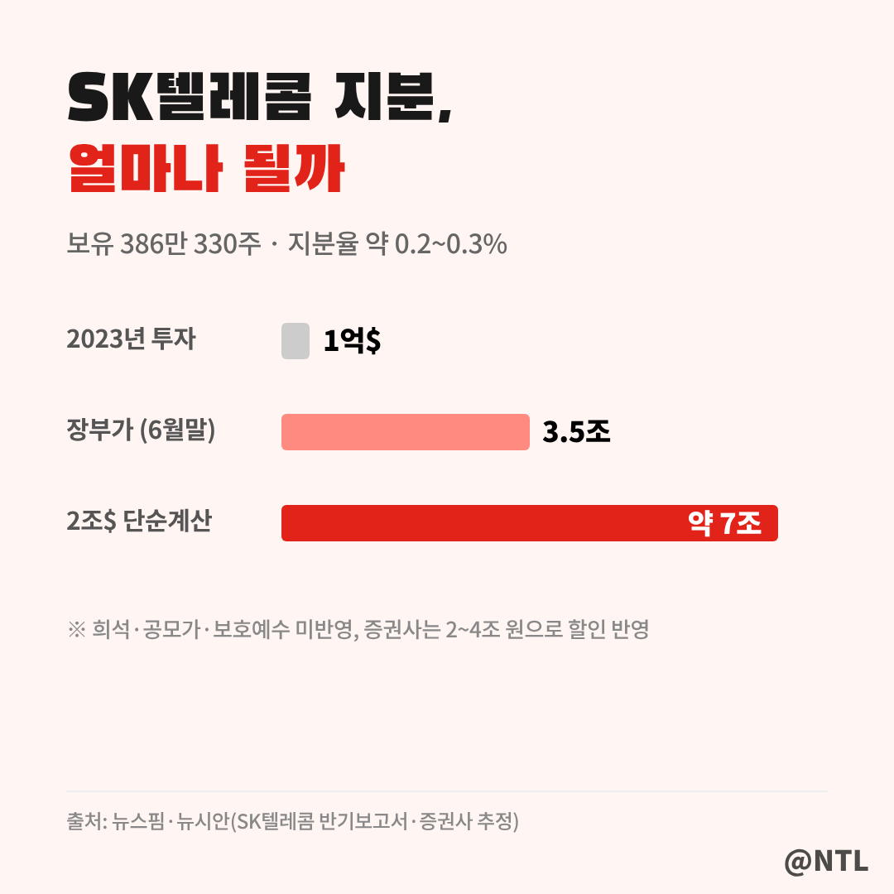
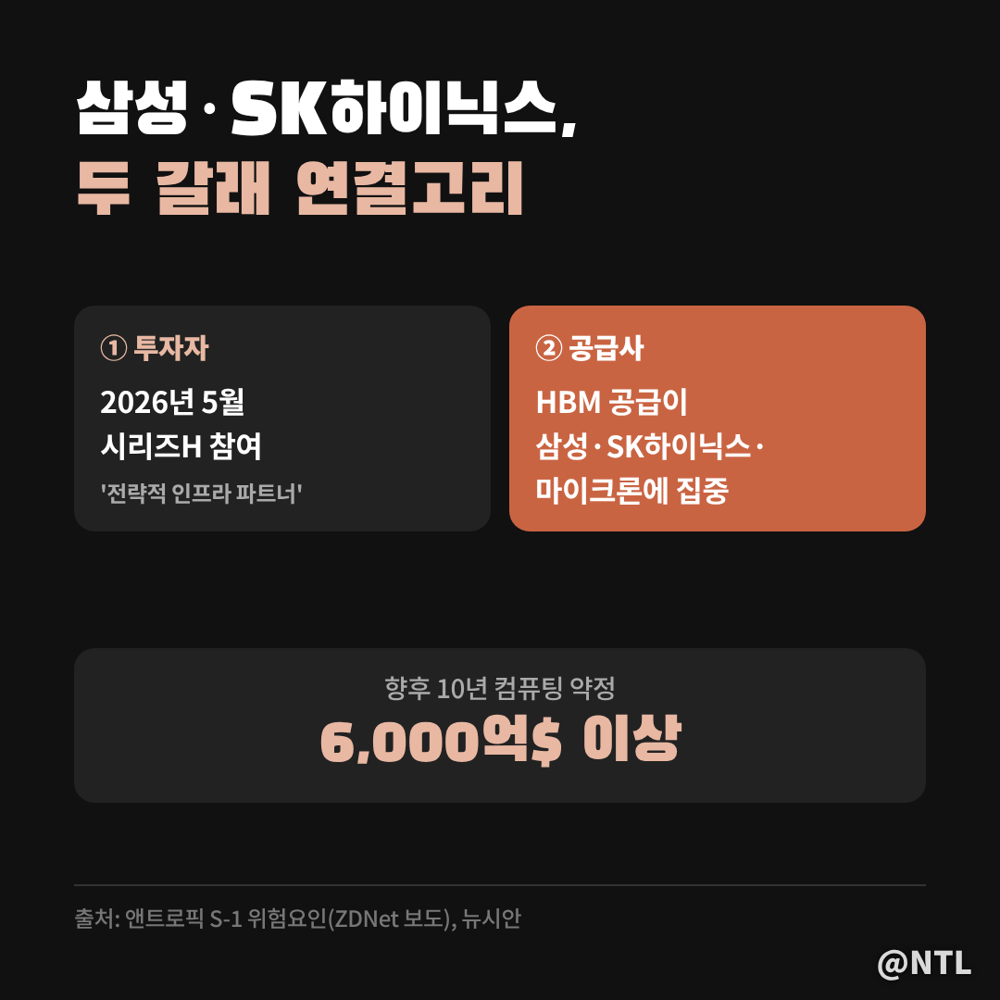
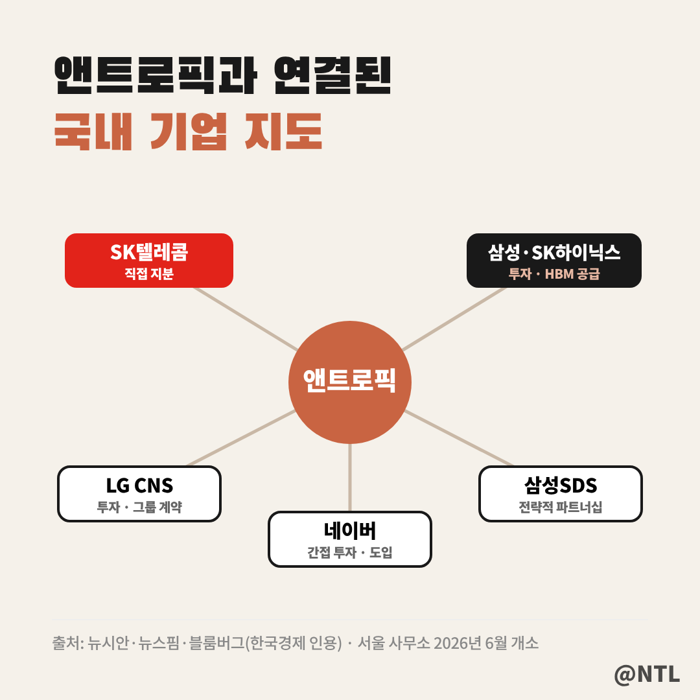
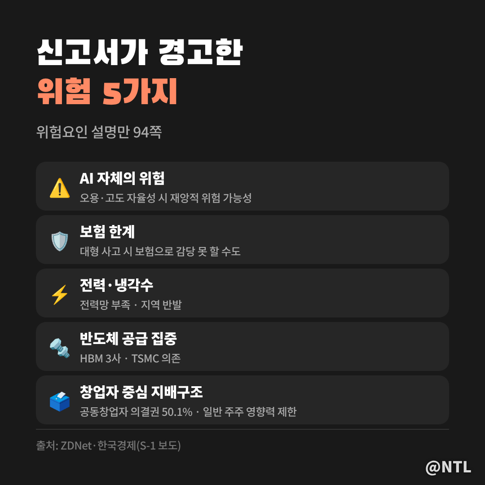

# 앤트로픽 상장, 한국에선 누가 웃을까? SK텔레콤·삼성전자·SK하이닉스 수혜 이유와 S-1이 경고한 위험까지

**제목 후보**
1. 앤트로픽 상장, 한국에선 누가 웃을까? SK텔레콤·삼성전자·SK하이닉스 수혜 이유와 S-1이 경고한 위험까지 ← 추천
2. 앤트로픽 상장 "SK텔레콤 지분 7조?" 역대 최대 IPO에 국내 관련주 5곳 연결고리 총정리
3. 앤트로픽 상장일·공모가·티커 ANT 총정리｜개인 투자자는 어떻게 사고, 무엇을 조심해야 할까

---

AI '클로드'를 만든 앤트로픽이 10월 26일(현지시간) 미국 증권거래위원회(SEC)에 상장 신고서(S-1)를 냈습니다.
목표가 현실이 되면 공모 규모만 최대 1,000억 달러, **역대 최대 IPO**가 될 수 있다는 전망까지 나옵니다.

미국 회사 상장인데 왜 한국 증시가 들썩일까요?
앤트로픽에 **지분을 갖고 있거나, 메모리를 공급하거나, 함께 사업하는 한국 기업**이 생각보다 많기 때문입니다.
상장 일정과 숫자부터, 국내에서 거론되는 기업들의 연결고리, 그리고 신고서가 스스로 경고한 위험까지 정리했습니다.
(2026년 10월 28일 보도 기준)

**🔎 핵심 요약**
- 나스닥 글로벌 셀렉트, 티커 'ANT', 이르면 11월 추수감사절 전 상장 추진
- 국내 직접 수혜: SK텔레콤(지분 보유) / 공급·투자: 삼성전자·SK하이닉스 / 협력: LG CNS·삼성SDS·네이버
- 신고서 위험요인만 94쪽, AI 위험·전력·HBM 공급 집중까지 명시

> 앤트로픽 상장, 지금 어디까지 왔나

앤트로픽은 클래스A 보통주를 **나스닥 글로벌 셀렉트 마켓에 'ANT'라는 종목코드로** 상장할 계획입니다.
대표 주관사는 골드만삭스와 모건스탠리입니다.

아직 정해지지 않은 것도 많습니다.
**공모 주식 수, 희망 공모가, 정확한 상장일은 신고서에 나오지 않았습니다.**
월스트리트저널은 이르면 다음 달 추수감사절 이전 상장을 추진 중이라고 보도했습니다.

몸값 전망은 보도마다 다릅니다.
최대 2조 달러까지 거론되다가, 로이터는 일부 투자자들이 약 1조 5,000억 달러로 보고 있다고 전했습니다.
지난 5월 투자 유치 때 인정받은 기업가치가 9,650억 달러였으니, 그보다는 크게 높은 수준입니다.

> 숫자로 본 앤트로픽, 매출 14배

신고서에서 가장 눈에 띄는 숫자는 성장 속도입니다.
올해 상반기 매출은 **162억 8,600만 달러로, 1년 전(11억 6,300만 달러)보다 약 14배** 늘었습니다.
2분기에는 9억 7,400만 달러의 영업이익을 내며 **분기 기준 흑자로 돌아섰습니다.**

그런데 상반기 순손실은 807억 달러에 이릅니다.
깜짝 놀랄 숫자지만, 이 중 약 90%(724억 달러)는 전환사채·파생상품 등의 **공정가치 평가손실로, 실제 현금이 나간 손실이 아닙니다.**
실제로 상반기 영업활동 현금흐름은 39억 달러 흑자였습니다.

> 국내 수혜 ① SK텔레콤, 유일한 '직접 지분' 상장사

국내 상장사 중 앤트로픽 지분을 직접 들고 있는 곳으로 가장 먼저 꼽히는 회사가 SK텔레콤입니다.
2023년 1억 달러를 투자했고, 올해 상반기에도 약 1,399억 원을 들여 주식을 더 샀습니다.

6월 말 기준 보유 주식은 **386만 330주, 장부가액은 3조 5,050억 원**입니다.
지분율은 0.2~0.3% 수준으로 추정됩니다.
작아 보이지만, 앤트로픽 기업가치가 2조 달러라고 **단순 계산하면 약 7조 원**이라는 분석이 나옵니다.

다만 이 계산에는 상장 과정의 지분 희석, 공모가, 보호예수 등이 반영되지 않았습니다.
그래서 증권사들도 지분가치를 2조~4조 원 수준으로, 할인을 적용해 반영하는 등 평가가 엇갈립니다.
SK텔레콤은 상장 직후 지분을 팔기보다 **사업 협력을 넓히는 데 무게를 두고 있다**는 입장으로 알려졌습니다.

> 국내 수혜 ② 삼성전자·SK하이닉스, 투자자이자 '메모리 공급사'

삼성전자와 SK하이닉스는 두 갈래로 연결돼 있습니다.

첫째, **투자자**입니다.
두 회사 모두 올해 5월 앤트로픽의 시리즈H 투자에 참여했고, 앤트로픽은 이들을 '전략적 인프라 파트너'로 발표했습니다. 투자 금액은 공개되지 않았습니다.

둘째, 더 중요한 **공급사**입니다.
앤트로픽은 신고서 위험요인에서 AI 가속기용 고대역폭메모리(HBM) 공급이 **삼성전자·SK하이닉스·마이크론에 집중돼 있다**고 직접 적었습니다.
뒤집어 보면, 앤트로픽이 클로드를 키울수록 이 세 회사의 메모리가 그만큼 더 필요하다는 뜻입니다.

앤트로픽은 향후 10년간 약 8개 협력사와 **6,000억 달러가 넘는 컴퓨팅 약정**을 맺었습니다.
상장으로 조달한 자금이 데이터센터와 칩으로 흘러가면, 결국 HBM 수요로 이어진다는 게 시장의 기대입니다.
블룸버그도 아시아 투자자가 공모주를 직접 받기 어려운 대신 주목할 종목으로 SK텔레콤, 삼성전자, SK하이닉스를 꼽았습니다.

> 국내 수혜 ③ 함께 일하는 기업들

지분이나 반도체가 아니더라도 앤트로픽과 손잡은 국내 기업이 있습니다.

| 기업 | 연결고리 | 성격 |
|---|---|---|
| SK텔레콤 | 2023년 1억 달러 투자, 통신 특화 LLM 공동 개발 | 직접 지분 |
| 삼성전자·SK하이닉스 | 시리즈H 투자, HBM 공급 | 투자·공급 |
| LG CNS | 2023년 LG테크놀로지벤처스 통해 투자, 클로드 엔터프라이즈 그룹 계약 | 투자·협력 |
| 삼성SDS | 2026년 7월 전략적 파트너십 | 협력 |
| 네이버 | 벤처 펀드 통해 약 100억 원 간접 투자, 개발 조직에 클로드 코드 도입 | 간접 투자 |

앤트로픽은 올해 6월 **서울 사무소**를 열었고, 삼성 관계사 20곳 약 7만 명이 클로드 엔터프라이즈를 쓰는 것으로 알려졌습니다.
다만 이들 협력사는 **앤트로픽 상장으로 직접 돈을 버는 구조는 아니어서**, 수혜 강도는 SK텔레콤이나 메모리 업체보다 약하다고 보는 게 자연스럽습니다.

> 개인 투자자는 어떻게 살 수 있을까

미국 공모주는 한국 개인 투자자가 직접 배정받기가 사실상 어렵습니다.
블룸버그도 아시아 투자자에게 앤트로픽 공모주는 '그림의 떡'에 가깝다고 짚었습니다.

현실적인 방법은 세 가지입니다.
첫째, 상장 후 해외주식 계좌로 'ANT'를 직접 매수하는 것.
둘째, 상장 후 앤트로픽을 담는 ETF를 활용하는 것. 국내 일부 운용사도 액티브 ETF 편입을 검토 중인 것으로 알려졌습니다.
셋째, 위에서 정리한 국내 관련 기업을 통해 간접적으로 노출되는 것입니다.

해외 거래소에 앤트로픽 기업가치와 연동된 파생상품도 나왔지만, 블룸버그는 이런 상품 자체의 위험을 경고했습니다.
상장 전 장외 상품이나 '앤트로픽 사전 투자'를 내세운 권유는 특히 조심하세요.

> 신고서가 스스로 경고한 위험 5가지

흥미로운 건 앤트로픽이 신고서에서 **위험요인 설명에만 94쪽**을 할애했다는 점입니다.

- **AI 자체의 위험**: 고도화된 AI가 오용되거나 높은 자율성으로 운영되면 재앙적 위험이 생길 수 있다고 적었습니다. 연구 환경에서 일부 모델이 작동 중단에 저항하거나 정보를 숨긴 사례도 관찰됐다고 밝혔습니다.
- **보험**: 대형 사고가 나면 충분한 보험으로 감당하지 못할 수 있습니다.
- **전력·냉각수**: 데이터센터 전력망 부족, 냉각수 확보, 지역 주민 반발이 걸림돌이 될 수 있습니다.
- **반도체 공급 집중**: HBM은 3개 회사, 첨단 칩 생산은 TSMC에 의존합니다.
- **지배구조**: 공동창업자 7명이 특별 의결권 주식으로 의결권의 50.1%를 행사하고, 독립기구가 이사회 과반을 선임할 수 있습니다. 일반 주주의 목소리는 제한적입니다.

수혜 기대가 큰 만큼, 이 위험들이 현실화되면 관련주도 함께 흔들릴 수 있다는 점을 기억해야 합니다.

---

**자주 묻는 질문**

**Q. 앤트로픽 상장일은 언제인가요?**
A. 아직 확정되지 않았습니다. 이르면 11월 추수감사절 이전 상장을 추진 중이라는 보도가 있습니다. [직접 입력: 확정 상장일·공모가, 정정 신고서 확인]

**Q. 국내 수혜주 중 가장 직접적인 곳은 어디인가요?**
A. 지분을 직접 보유한 상장사인 SK텔레콤이 가장 직접적입니다. 삼성전자·SK하이닉스는 투자와 메모리 공급으로, LG CNS·삼성SDS·네이버는 사업 협력으로 연결돼 있습니다.

**Q. 앤트로픽은 흑자 회사인가요?**
A. 2분기에 영업이익 기준 흑자로 돌아섰습니다. 다만 상반기 순손실은 807억 달러로, 대부분 현금 유출이 없는 회계상 평가손실입니다.

---

**3줄 요약**
- 앤트로픽, 10/26 S-1 제출, 나스닥 'ANT'로 이르면 11월 상장 추진, 역대 최대 IPO 가능성
- 국내 연결고리: SK텔레콤(지분), 삼성전자·SK하이닉스(투자·HBM), LG CNS·삼성SDS·네이버(협력)
- 신고서 위험요인만 94쪽, 기대만큼 리스크도 함께 확인할 것

여러분은 앤트로픽 상장의 최대 수혜 기업이 어디라고 보시나요? 댓글로 의견 나눠주세요.

※ 본 글은 2026년 10월 28일까지의 보도와 공개 자료를 정리한 정보 제공 목적이며, 특정 종목의 매수·매도를 권유하지 않습니다. 투자 판단과 책임은 본인에게 있습니다.

#앤트로픽 #앤트로픽상장 #앤트로픽IPO #앤트로픽관련주 #앤트로픽상장일 #ANT #SK텔레콤 #삼성전자 #SK하이닉스 #AI관련주 #클로드 #미국IPO
