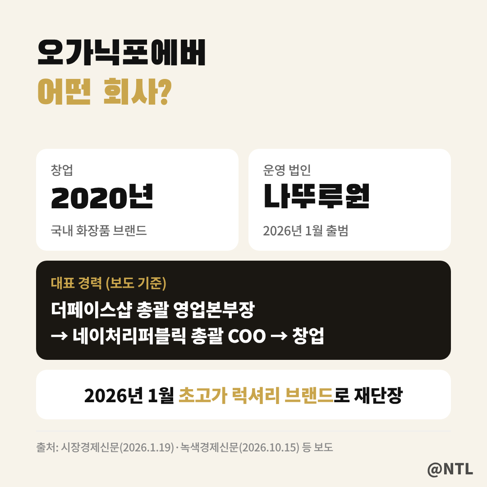
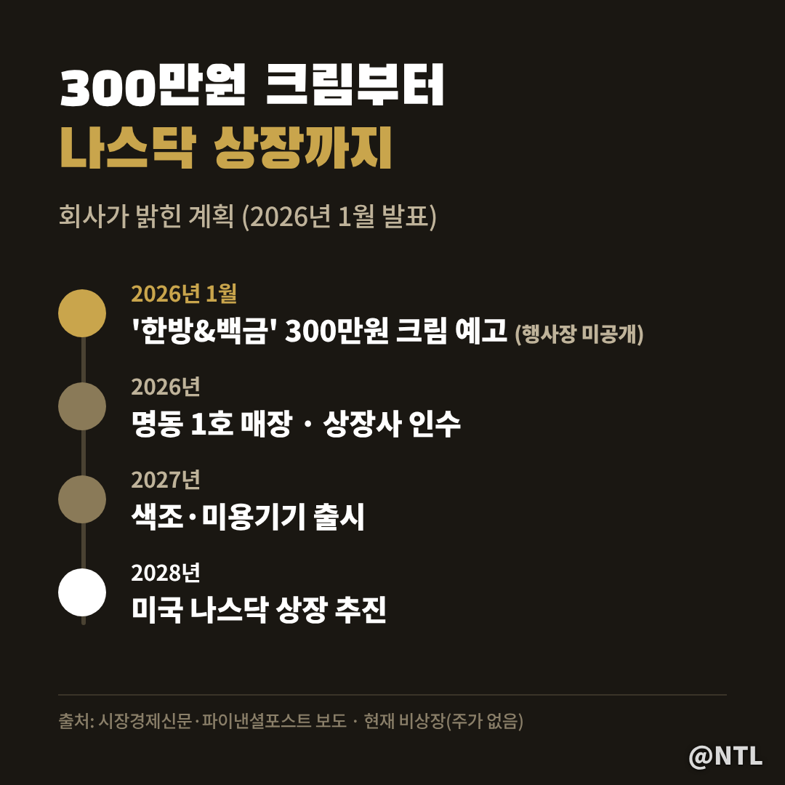
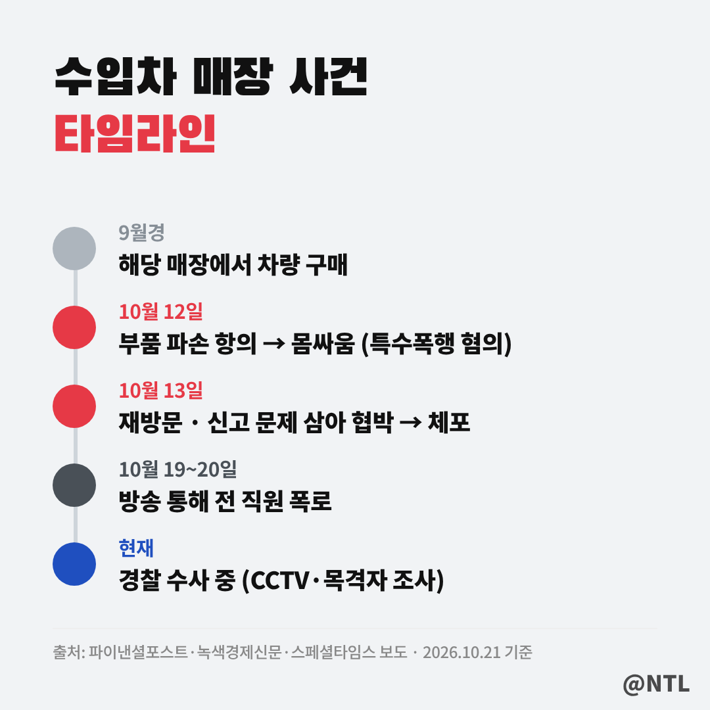
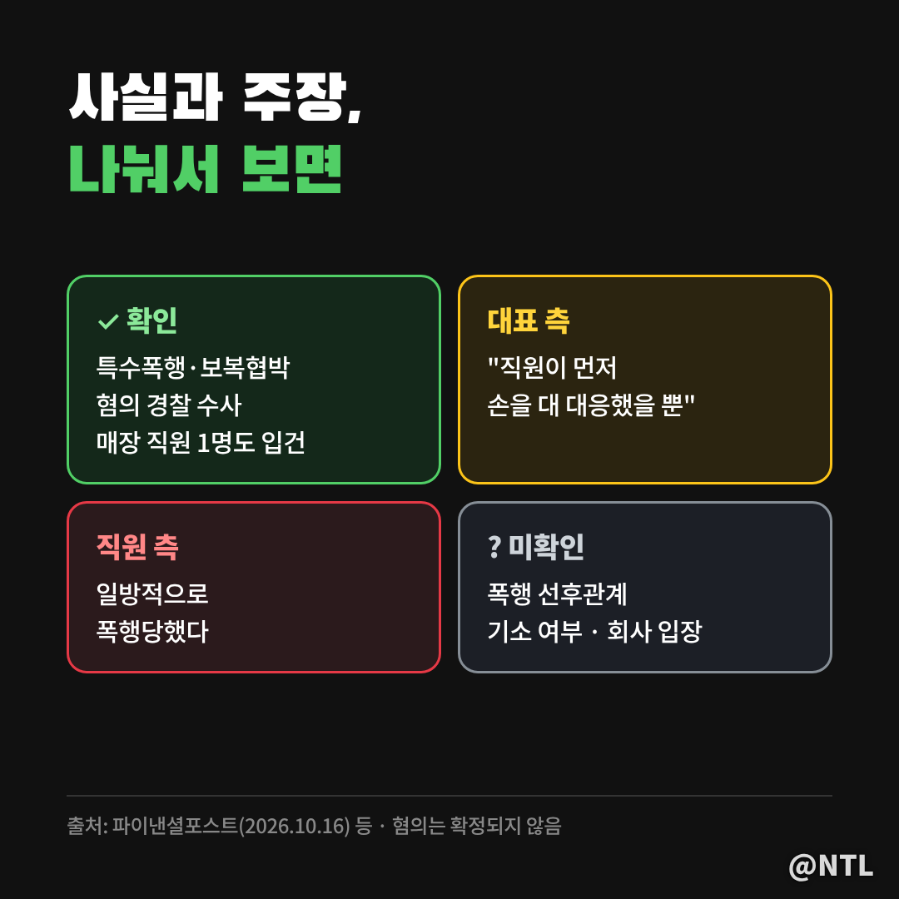
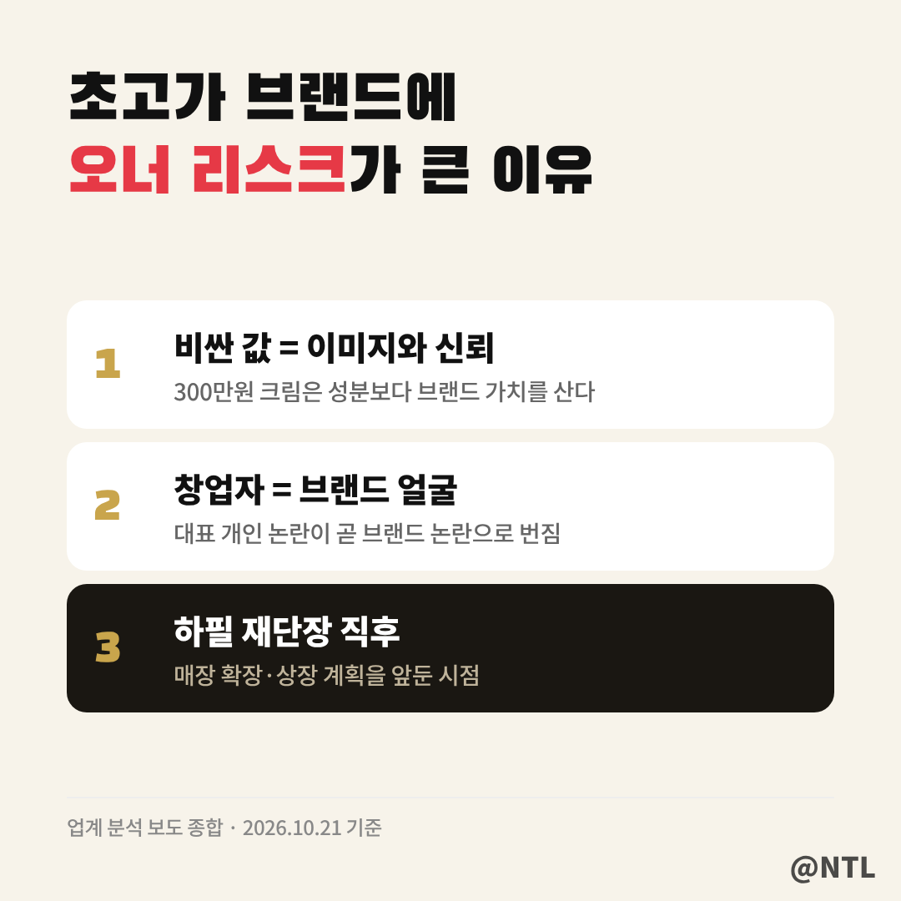
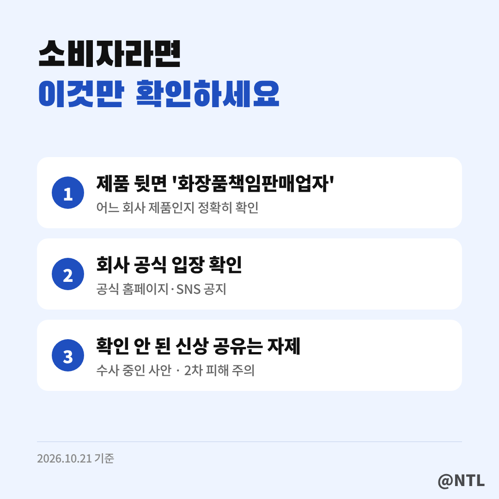

# 오가닉포에버 대표 논란, 무슨 일? 300만원 크림 브랜드에 '불매' 말 나온 이유와 확인된 사실

**제목 후보**
1. 오가닉포에버 대표 논란, 무슨 일? 300만원 크림 브랜드에 '불매' 말 나온 이유와 확인된 사실 ← 추천
2. 오가닉포에버 어떤 회사? 더페이스샵·네이처리퍼블릭 출신 대표가 세운 브랜드, 지금 상황은
3. 오가닉포에버 불매까지? 수입차 매장 사건부터 전 직원 주장까지 '사실'과 '주장' 나눠 보니

---

요 며칠 '오가닉포에버'를 검색하면 화장품 정보 대신 사건 기사가 먼저 뜹니다.
연관 검색어에는 '대표', '박평순', '불매'까지 붙었죠.

올해 1월 "크림 하나에 300만 원"을 예고하며 초고가 브랜드로 재단장한 회사라 관심이 더 컸습니다.
이 글에서는 **오가닉포에버가 어떤 회사인지, 무슨 일이 있었는지, 그리고 어디까지가 확인된 사실이고 어디부터가 주장인지** 나눠서 정리했습니다.
(2026년 10월 21일 보도 기준)

**🔎 핵심 요약**
- 오가닉포에버는 2020년 박평순 대표가 세운 화장품 브랜드, 올해 1월 초고가 라인으로 재단장 발표
- 박 대표는 10월 12~13일 수입차 매장 직원 폭행·보복협박 혐의로 경찰 수사 중
- 대표 측은 "직원이 먼저 손을 댔다"고 반박, 직원 1명도 함께 입건돼 사실관계는 수사로 가려질 예정

> 오가닉포에버는 어떤 회사일까

오가닉포에버는 박평순 대표가 2020년 창업한 국내 화장품 브랜드입니다.
박 대표는 더페이스샵 총괄 영업본부장, 네이처리퍼블릭 총괄 COO를 지낸 로드숍 업계 출신 경영인으로 알려져 있습니다.

전환점은 올해 1월이었습니다.
화장품 사업 법인 **'나뚜루원'**을 새로 출범시키고, 기존 회사명이던 오가닉포에버를 브랜드로 내세워 **글로벌 하이엔드 럭셔리 뷰티** 시장에 도전하겠다고 밝혔습니다.
1월 16일 그랜드 하얏트 서울에서 론칭 행사를 열기도 했습니다.

> 300만원 크림과 나스닥 상장 계획

가장 화제가 된 건 **'크림 하나에 300만 원'**이라는 최고가 라인 예고였습니다.
일명 '한방&백금' 라인으로, 세라마이드 광채 기술과 3중 히알루론산 등을 적용한다고 소개됐습니다.
다만 1월 행사장에서 이 제품이 실제로 공개되지는 않았습니다.
[직접 입력: 300만원 크림 실제 출시 여부·판매처, 확인일]

보시는 로드맵처럼 계획도 꽤 공격적입니다.
명동 1호 매장을 시작으로 연내 상장사 인수, 2027년 색조·미용기기 출시, **2028년 미국 나스닥 상장**까지 추진한다고 밝혔습니다.
"오가닉포에버 주가"를 찾는 분이 많은데, **현재는 상장사가 아니어서 주가는 없습니다.** 나스닥 상장은 추진 중인 계획 단계입니다.

> 수입차 매장에서 무슨 일이 있었나

논란의 시작은 10월 12일 오전, 서울 용산구 한남동의 한 수입차 전시장이었습니다.

보도에 따르면 박 대표는 한 달여 전 이 매장에서 산 차량의 부품이 망가졌다며 항의했습니다.
직원이 "결함보다는 사용 과정에서 생긴 손상일 수 있다"고 설명하자 언쟁이 몸싸움으로 번졌다는 것이 경찰이 파악한 경위입니다.
이 과정에서 박 대표가 **허리띠를 휘두르고, 주차장의 플라스틱 삽을 들고 직원들을 위협한 혐의**를 받고 있습니다.

다음 날인 13일, 박 대표는 매장을 다시 찾아 경찰에 신고한 것을 문제 삼으며 직원들을 협박한 혐의로 현장에서 체포된 것으로 전해졌습니다.
적용된 혐의는 **특수폭행과 보복협박**입니다.
보복협박은 특정범죄가중처벌법이 적용돼 1년 이상의 유기징역만 규정된 무거운 혐의입니다.

> 대표 측 입장과 수사 상황

이 사건은 한쪽 이야기만으로 판단하기 어려운 부분이 있습니다.

박 대표 측은 **"직원이 먼저 손을 대 대응했을 뿐"**이라는 입장입니다.
반면 피해 직원 측은 일방적으로 폭행당했다고 주장하고 있습니다.
경찰은 몸싸움 과정에서 박 대표를 때린 매장 직원 1명도 함께 입건했고, **매장 CCTV와 목격자 진술**을 바탕으로 누가 먼저였는지 선후관계를 조사하고 있습니다.

| 구분 | 내용 |
|---|---|
| 확인된 사실 | 10.12 수입차 매장 몸싸움, 특수폭행·보복협박 혐의로 경찰 수사, 매장 직원 1명도 입건 |
| 대표 측 주장 | 직원이 먼저 손을 대 대응한 것 |
| 직원 측 주장 | 일방적으로 폭행당함 |
| 아직 모르는 것 | 폭행의 선후관계, 기소 여부, 회사 공식 입장 |

> 전 직원 폭로, 어디까지 사실일까

사건이 알려진 뒤 방송을 통해 전 직원들의 폭로도 이어졌습니다.

전 직원 A씨는 박 대표가 과거 다른 화장품 회사 임원 시절 욕설과 강압적인 지시를 했고, 한 직원은 귀 부위를 맞아 고막을 다친 뒤 퇴사했다고 주장했습니다.
다만 A씨 스스로 **당시 녹음이나 촬영을 하지 못해 남은 증거는 없다**고 밝혔습니다.

전 직원 B씨는 약 6개월간 일하며 폭언을 겪었고, 지난 5월 퇴사 후 노동청에 직장 내 괴롭힘 진정을 냈다고 밝혔습니다.
노동청 조사 이후 **과태료 300만 원이 부과된 것으로 전해졌지만**, 부과 시점과 구체적인 사유는 보도에서 확인되지 않습니다.
박 대표 측은 이 폭로에 대해서는 아직 입장을 밝히지 않았습니다.

> '불매' 검색어, 브랜드에 어떤 영향이 있을까

화장품, 특히 초고가 브랜드는 **제품보다 이미지와 신뢰를 파는 사업**입니다.
300만 원짜리 크림을 사는 소비자는 성분만큼이나 브랜드가 주는 가치와 이야기를 삽니다.
창업자 개인의 논란이 곧바로 브랜드 신뢰 문제로 번지는 이유입니다.

게다가 오가닉포에버는 재단장 직후, 매장 확장과 상장을 앞둔 시점이라 타격이 더 클 수 있다는 분석이 나옵니다.
회사 차원의 공식 사과나 해명이 언제, 어떻게 나오는지가 앞으로의 분위기를 가를 것으로 보입니다.
[직접 입력: 회사 공식 입장문 발표 여부, 확인일]

> 소비자가 확인할 것

이미 제품을 쓰고 있거나 구매를 고민 중이라면 위 세 가지를 확인해 보세요.
제품 뒷면의 **'화장품책임판매업자'** 표기를 보면 어느 회사 제품인지 정확히 알 수 있습니다.
비슷한 이름의 다른 브랜드까지 덩달아 오해받는 일이 생기기 때문입니다.

그리고 사건이 수사 중인 만큼, 확인되지 않은 개인 정보나 가족 이야기를 퍼뜨리는 건 또 다른 피해를 낳을 수 있으니 주의가 필요합니다.

---

**자주 묻는 질문**

**Q. 오가닉포에버 주가는 어디서 보나요?**
A. 현재 상장사가 아니어서 주가가 없습니다. 2028년 나스닥 상장은 추진 중인 계획입니다.

**Q. 300만원 크림은 출시됐나요?**
A. 1월에 출시를 예고했지만 행사장에서는 공개되지 않았습니다. 실제 판매 여부는 공식 채널에서 확인이 필요합니다.

**Q. 대표는 유죄인가요?**
A. 아닙니다. 현재 경찰 수사 단계이며, 대표 측은 혐의 일부를 반박하고 있습니다. 결과는 수사와 재판을 통해 가려집니다.

---

**3줄 요약**
- 오가닉포에버는 2020년 창업, 올해 300만원 크림·나스닥 상장을 내건 초고가 화장품 브랜드
- 박평순 대표는 수입차 매장 직원 폭행·보복협박 혐의로 수사 중, 대표 측은 "직원이 먼저" 반박
- 전 직원 폭로는 주장 단계, 회사 공식 입장과 수사 결과를 지켜볼 필요

여러분은 제품을 고를 때 브랜드 대표의 이미지도 영향을 주는 편인가요? 댓글로 의견 나눠주세요.

※ 본 글은 10월 21일까지의 언론 보도를 정리한 것으로, 수사 중인 사안이며 혐의는 확정되지 않았습니다. 이후 수사 결과나 회사 입장에 따라 내용이 달라질 수 있습니다.

#오가닉포에버 #오가닉포에버대표 #박평순 #오가닉포에버불매 #오가닉포에버논란 #오가닉포에버화장품 #나뚜루원 #300만원크림 #초고가화장품 #오너리스크
