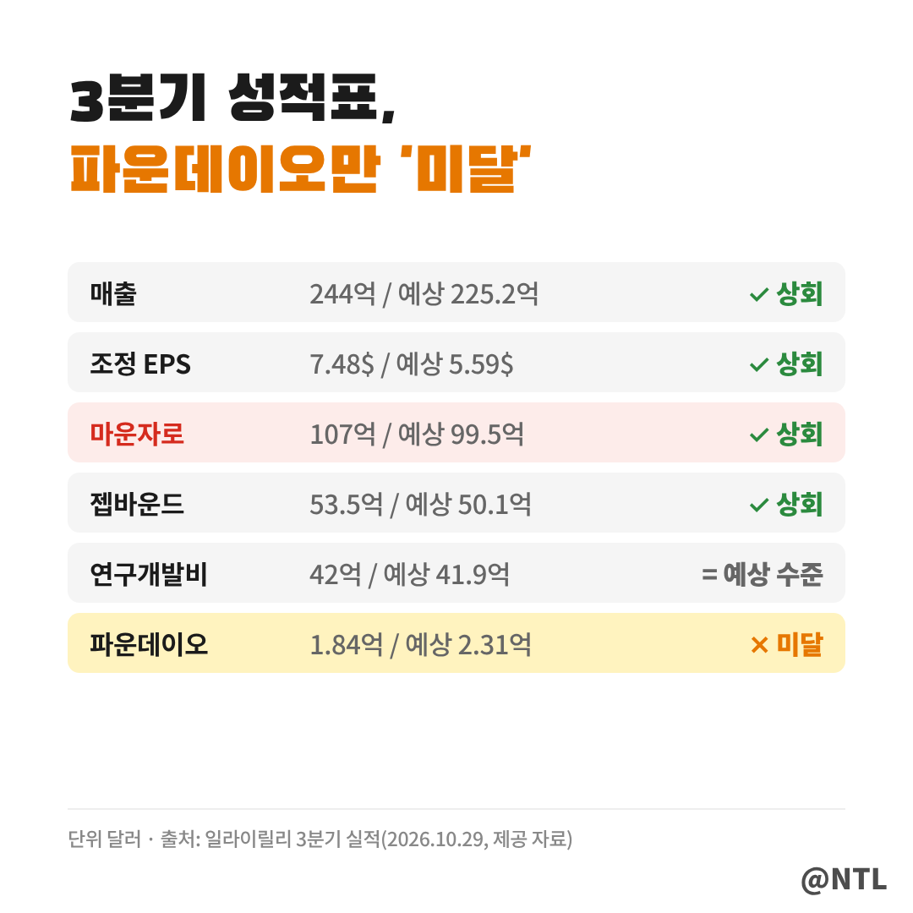
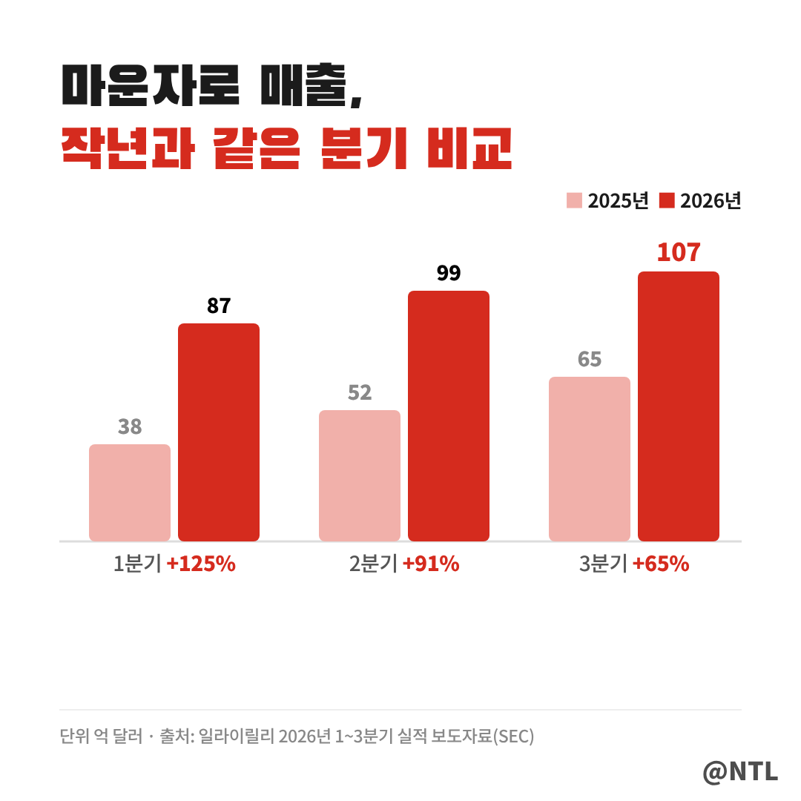
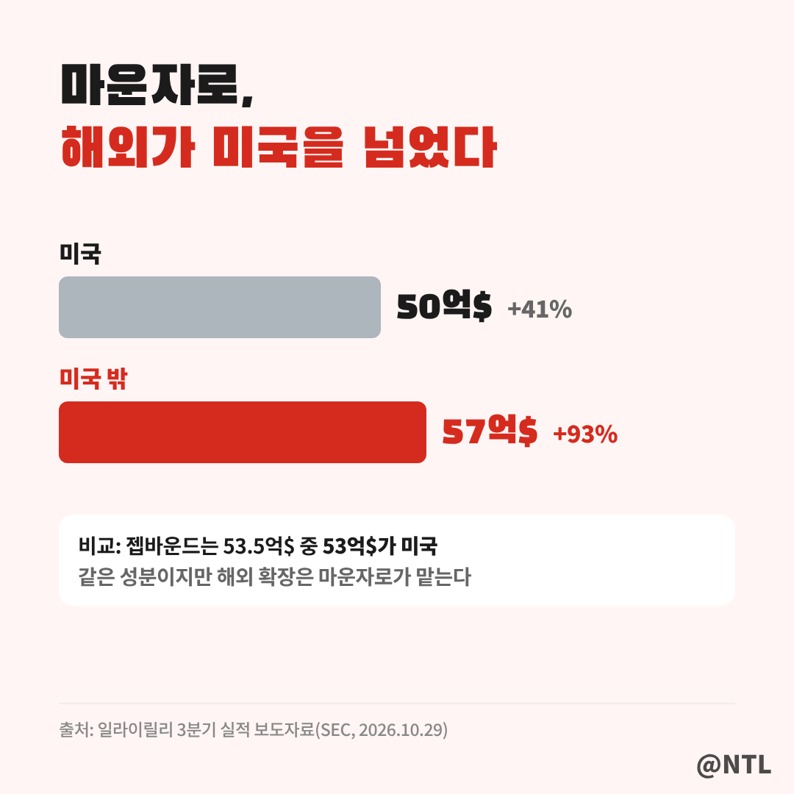
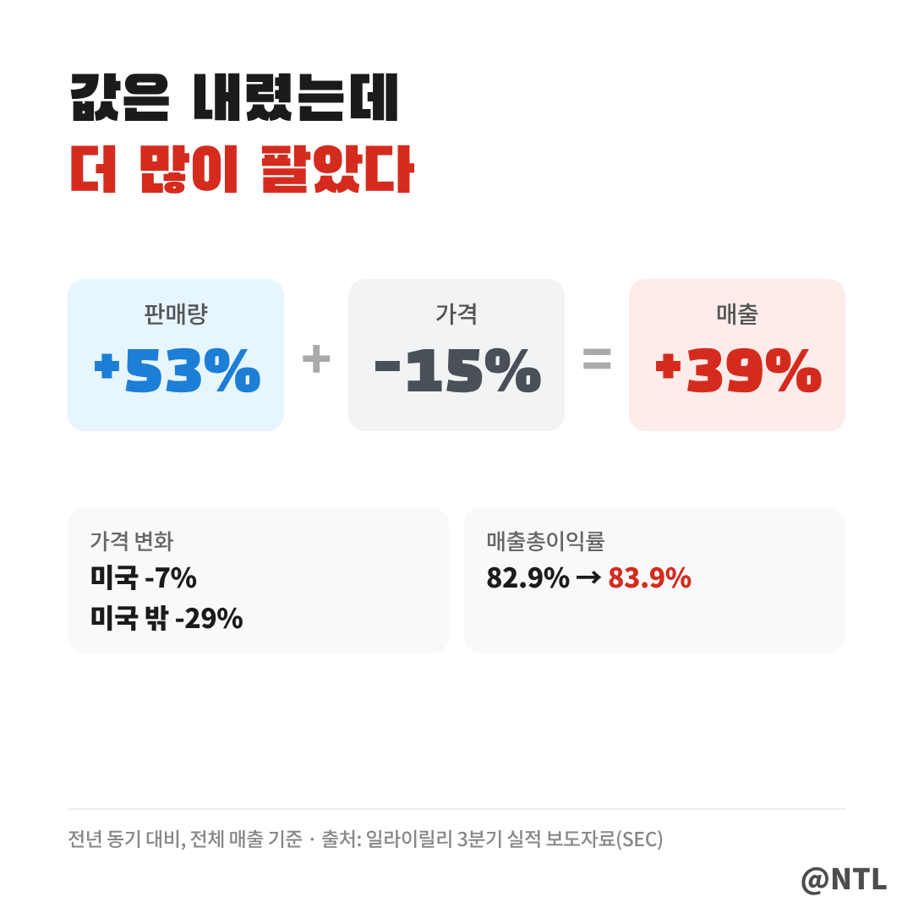
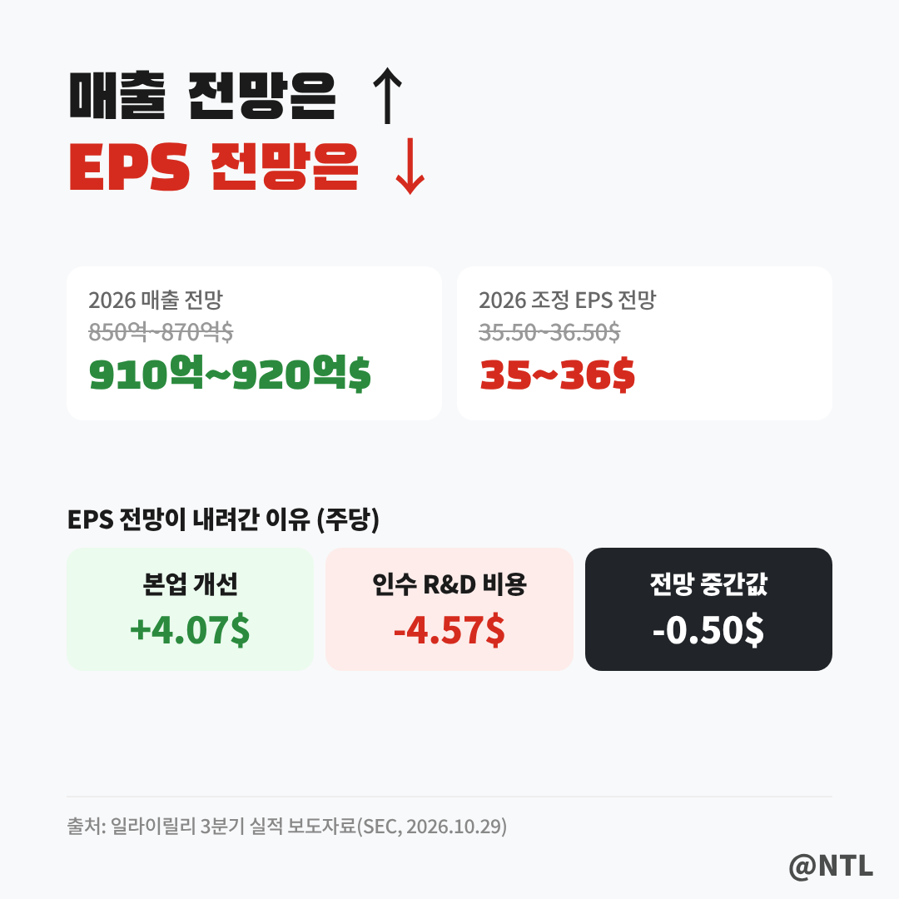
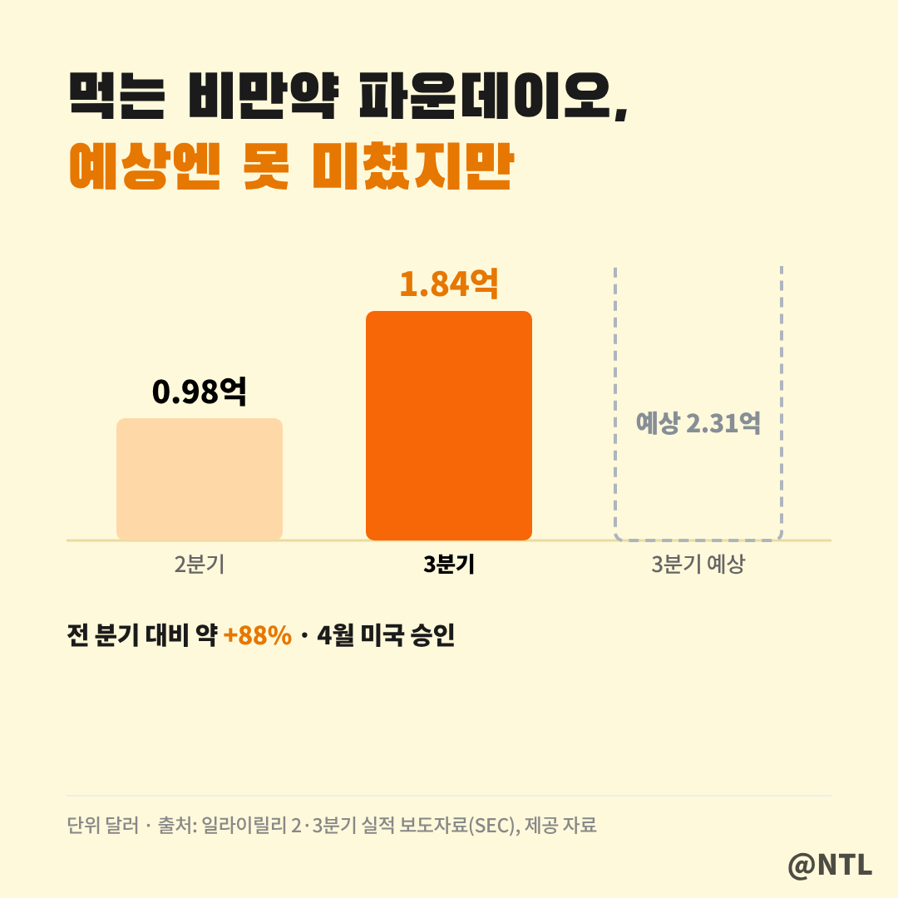

# 일라이릴리 실적, 비만약이 다 했다

**제목 후보**
1. 일라이릴리 실적, 비만약이 다 했다 ← 추천
2. 일라이릴리 실적, 매출 올리고 EPS 낮춘 이유
3. 일라이릴리 실적, 먹는 비만약만 아쉬웠다

---

일라이릴리가 10월 29일(현지시간) 3분기 실적을 발표했습니다.
매출은 244억 달러로 1년 전보다 **39% 늘었고**, 조정 EPS는 7.48달러로 예상(5.59달러)을 크게 넘었습니다.
일등공신은 단연 당뇨·비만 치료제 **마운자로**입니다.
그런데 연간 매출 전망은 올리면서 EPS 전망은 오히려 낮췄습니다. 그 이유까지 정리했습니다.
(2026년 10월 30일 기준)

**🔎 핵심 요약**
- 매출 244억 달러(+39%), 조정 EPS 7.48달러로 예상 크게 상회
- 마운자로 107억 달러(+65%), 미국 밖 매출이 93% 급증
- 연간 매출 전망 910억~920억 달러로 상향, EPS 전망은 인수 비용 탓에 소폭 하향

> 숫자로 본 3분기, 거의 다 '상회'

성적표처럼 주요 항목은 예상을 넘었고, 먹는 비만약 파운데이오만 예상에 못 미쳤습니다.

| 항목 | 3분기 실적 | 시장 예상 | 전년 대비 |
|---|---|---|---|
| 매출 | 244억 달러 | 225.2억 달러 | +39% |
| 조정 EPS | 7.48달러 | 5.59달러 | +7% |
| 마운자로 | 107억 달러 | 99.5억 달러 | +65% |
| 젭바운드 | 53.5억 달러 | 50.1억 달러 | +49% |
| 파운데이오 | 1.84억 달러 | 2.31억 달러 | 신제품 |
| 연구개발비 | 42억 달러 | 41.9억 달러 | +21% |

표에서 매출은 39% 늘었는데 조정 EPS는 7%밖에 안 늘어난 게 눈에 띕니다.
조정 EPS에도 기업 인수 비용(주당 4.57달러)이 그대로 들어가 있기 때문인데, 이 부분은 아래 연간 전망에서 자세히 다룹니다.

다만 매출에는 당뇨약 자디앙스 마일스톤(4.1억 달러) 등 약 9억 달러의 일회성 이익이 포함돼 있다는 점도 함께 봐야 합니다.

> 마운자로, 1년 새 65% 더 팔렸다

마운자로의 3분기 매출은 **107억 2,300만 달러**, 우리 돈 약 14조 원입니다.
그래프에서 같은 분기끼리 비교해 보면 성장 속도가 확 느껴집니다.
1분기 38억 → 87억 달러, 2분기 52억 → 99억 달러, 3분기 65억 → 107억 달러로 매 분기 크게 뛰었습니다.

증가율은 1분기 125%, 2분기 91%, 3분기 65%로 낮아지고 있지만, 이는 기준이 되는 작년 매출이 커졌기 때문입니다.
분기마다 매출 자체는 계속 새 기록을 쓰고 있습니다.
비만 전용 제품인 젭바운드(53.5억 달러, +49%)까지 합치면 두 약으로만 **160억 달러**를 넘게 벌었습니다.
젭바운드 증가율은 1분기 80%, 2분기 46%에 이어 3분기 49%로 다시 높아졌습니다.

> 이제는 해외가 더 많이 판다

눈여겨볼 변화는 매출이 나오는 지역입니다.
3분기 마운자로 매출은 미국 50억 달러(+41%), 미국 밖 57억 달러(+93%)로 **해외가 미국보다 많았습니다.**
막대 길이에서 보듯 해외 성장 속도가 미국의 두 배를 넘습니다.

해외 매출을 끌어올린 건 중국 등에서의 보험 등재와 각국 출시 확대입니다.
비만약 시장이 미국을 넘어 전 세계로 넓어지고 있다는 신호입니다.
반면 젭바운드는 매출 53.5억 달러 가운데 53억 달러가 미국에서 나와, 아직은 사실상 미국 시장 중심의 제품입니다.
같은 성분(터제파타이드)이지만 마운자로가 해외 확장의 선봉에 서 있는 셈입니다.

3분기에는 마운자로가 제2형 당뇨 성인의 **심혈관 위험 감소** 적응증도 미국에서 승인받았습니다.
혈당과 체중을 넘어 심장 질환 예방까지 효과를 인정받으면서, 처방 대상이 더 넓어질 수 있는 근거가 생겼습니다.

> 약값은 15% 내렸는데, 매출은 39% 늘었다

흥미로운 숫자가 하나 더 있습니다.
릴리의 3분기 실제 판매 가격은 1년 전보다 **15% 낮아졌습니다.**
미국은 7%, 미국 밖은 29% 내렸는데, 중국 국가보험 등재로 가격을 낮춘 영향이 컸습니다.

그런데도 매출이 39% 늘어난 건 **판매량이 53%나 늘었기 때문**입니다.
값을 내려 더 많은 환자에게 팔고, 그만큼 더 버는 구조입니다.
매출총이익률도 83.9%로 오히려 1년 전(82.9%)보다 높아졌습니다.

> 매출 전망은 올리고, EPS 전망은 왜 낮췄나

릴리는 올해 매출 전망을 850억~870억 달러에서 **910억~920억 달러**로 올렸습니다.
시장 예상(888.5억 달러)보다도 높습니다.

반면 조정 EPS 전망은 35.50~36.50달러에서 **35~36달러**로 낮췄습니다.
본업만 보면 EPS 전망을 주당 4.07달러 올릴 만큼 좋았지만, 3분기 기업 인수로 생긴 **연구개발 비용(주당 4.57달러)**이 이를 상쇄했습니다.
정신질환 신약 기업 아타이베클리와 큐어보 인수가 주된 이유입니다.
장사를 못해서가 아니라 **미래 신약을 사 오느라 쓴 돈**이라는 점이 핵심입니다.
참고로 이 비용은 9월 30일 이후 추가 인수가 생기면 더 늘어날 수 있어, 4분기에도 EPS 전망이 바뀔 여지는 남아 있습니다.

시장의 평가도 뜨거웠습니다.
실적 발표 뒤 일라이릴리 시가총액은 삼성전자를 제치고 세계 12위에 올랐다고 국내 언론이 전했습니다.
[직접 입력: 10월 29일 종가·등락률과 시가총액, 기준일]

> 아쉬운 하나, 먹는 비만약 파운데이오

4월 미국 승인을 받은 먹는 비만약 **파운데이오**는 3분기 매출 1억 8,400만 달러로 예상(2억 3,120만 달러)에 못 미쳤습니다.
다만 그래프처럼 2분기(9,800만 달러)보다 약 88% 늘어 출시 초기 성장세는 이어지고 있습니다.
파운데이오는 음식이나 물 섭취 제한 없이 하루 중 아무 때나 먹을 수 있는 알약이라는 점을 내세우고 있습니다.
주사를 꺼리는 환자층을 얼마나 끌어오느냐가 앞으로의 관전 포인트입니다.

다음 무기도 준비 중입니다.
차세대 비만약 레타트루타이드는 경쟁 약 대비 우수한 3상 결과를 냈고, 2027년 1분기 미국 허가 신청이 예정돼 있습니다.

---

**자주 묻는 질문**

**Q. 마운자로와 젭바운드는 뭐가 다른가요?**
A. 둘 다 같은 성분(터제파타이드)입니다. 마운자로는 제2형 당뇨 치료제로, 젭바운드는 비만 치료제로 허가받아 각각 따로 팔리고 있습니다.

**Q. 조정 EPS가 예상보다 높은데 왜 연간 EPS 전망은 내려갔나요?**
A. 3분기 기업 인수로 생긴 연구개발 비용(주당 4.57달러)이 반영됐기 때문입니다. 본업 기준 전망은 오히려 4.07달러 올라갔습니다.

**Q. 약값이 15% 내렸는데 이익은 괜찮나요?**
A. 판매량이 53% 늘면서 매출이 39% 증가했고, 매출총이익률도 83.9%로 1년 전보다 높아졌습니다. 다만 가격 하락이 계속될지는 지켜봐야 합니다.

---

**3줄 요약**
- 매출 244억 달러(+39%), 조정 EPS 7.48달러로 예상 크게 상회
- 마운자로 107억 달러(+65%), 가격은 15% 내렸지만 판매량이 53% 늘어
- 연간 매출 전망 상향, EPS 전망은 인수 비용으로 하향, 파운데이오는 예상 미달

여러분은 일라이릴리의 다음 성장 동력, 마운자로일까요 먹는 비만약일까요? 댓글로 의견 나눠주세요.

※ 본 글은 일라이릴리 3분기 실적 발표와 언론 보도를 정리한 정보 제공 목적이며, 특정 종목의 매수·매도를 권유하지 않습니다. 투자 판단과 책임은 본인에게 있습니다.

#일라이릴리 #일라이릴리실적 #LLY #마운자로 #젭바운드 #파운데이오 #비만치료제 #비만약 #일라이릴리주가 #레타트루타이드 #미국주식 #GLP1
