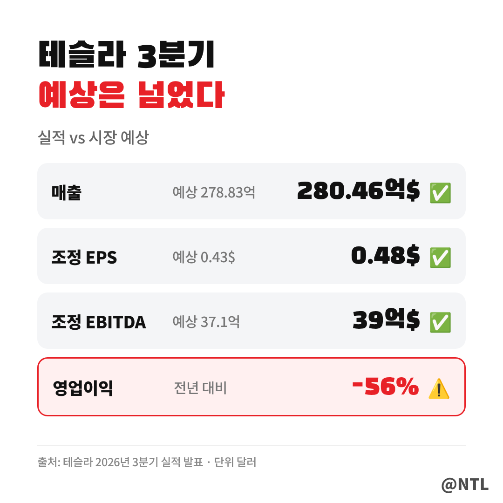
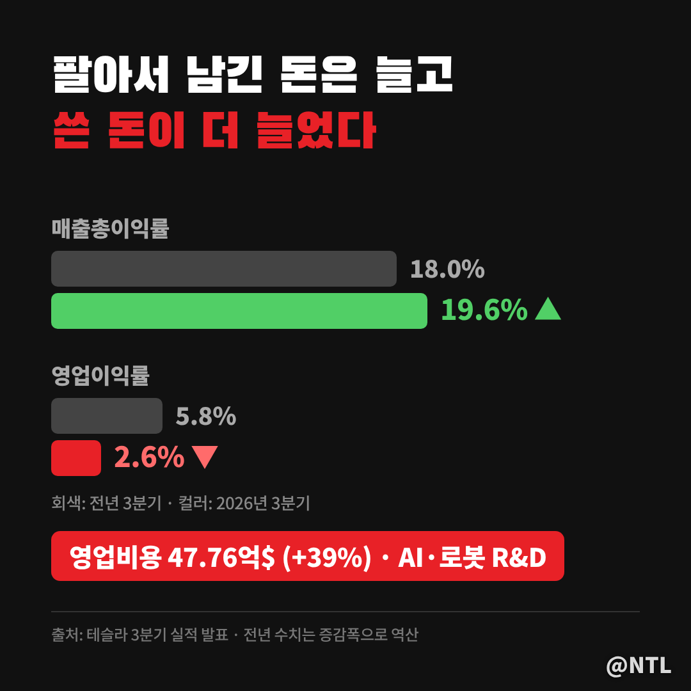
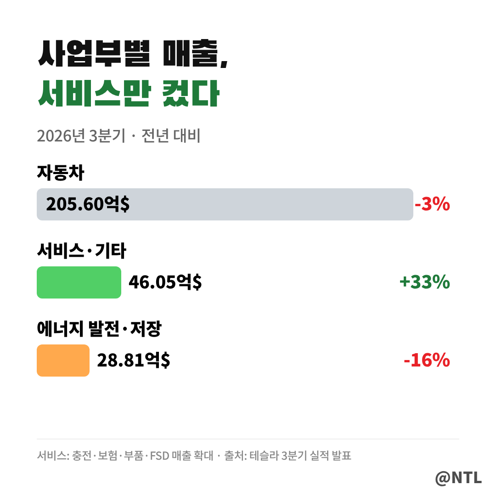
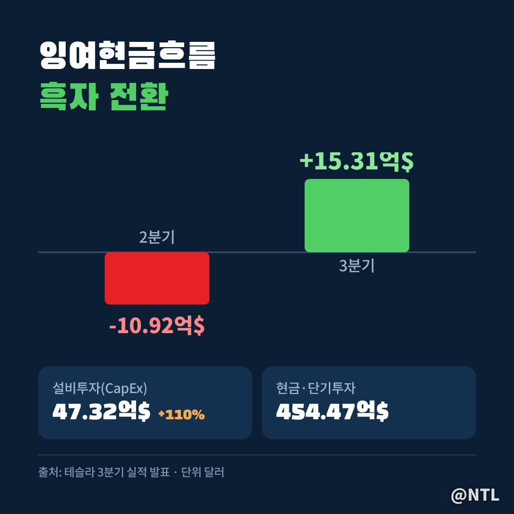
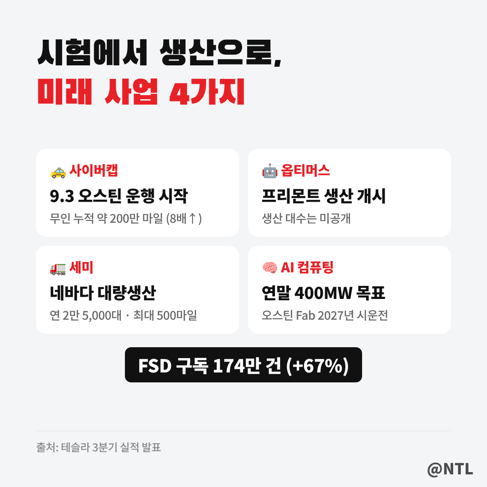
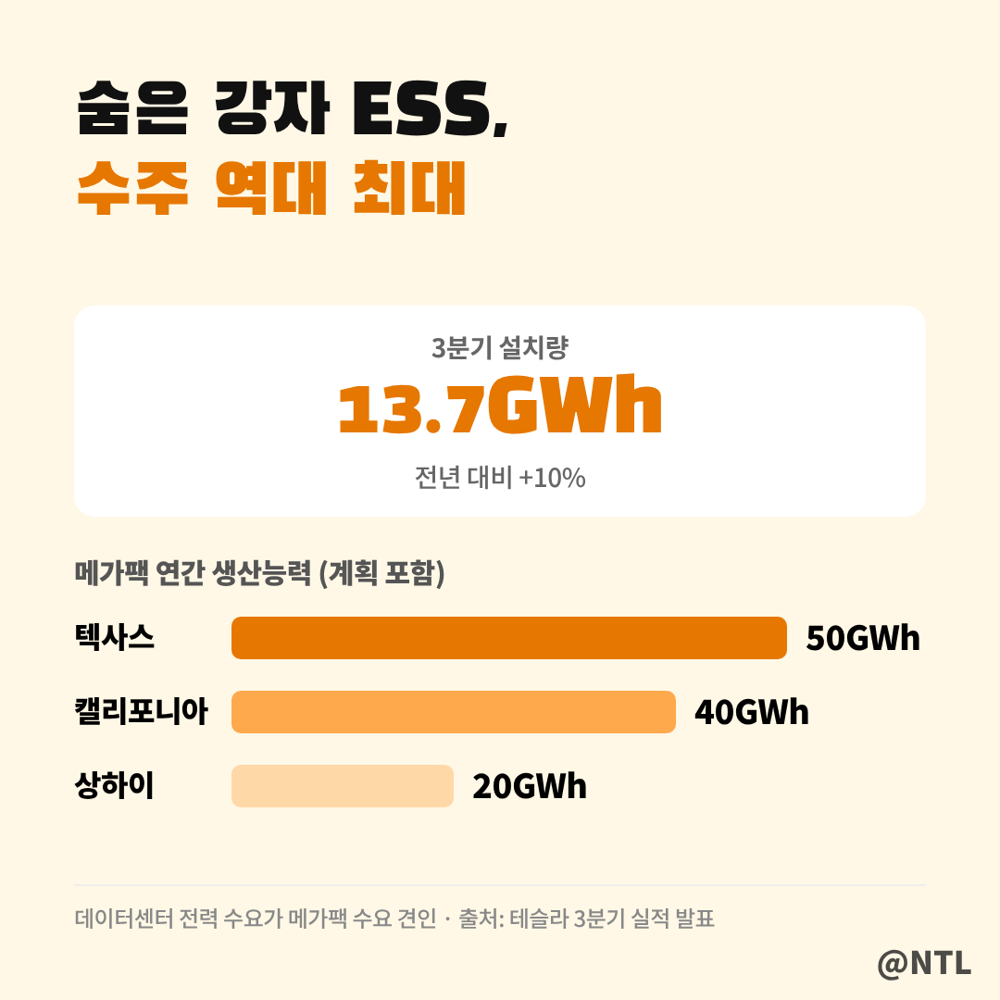

# 테슬라 3분기 실적 EPS 0.48달러로 예상 상회, 그런데 영업이익은 56% 줄었다? 숫자 뒤에 숨은 5가지

**제목 후보**
1. 테슬라 3분기 실적 EPS 0.48달러로 예상 상회, 그런데 영업이익은 56% 줄었다? 숫자 뒤에 숨은 5가지 ← 추천
2. 테슬라 3분기 실적, 차는 덜 팔렸는데 현금은 15억 달러 벌었다… FSD 구독 67% 급증의 의미
3. 테슬라 3분기 실적 총정리｜매출 280억 달러·로보택시·옵티머스 생산까지 한 번에

---

테슬라가 한국시간 10월 22일 새벽 2026년 3분기 실적을 발표했습니다.
매출과 주당순이익(EPS)은 시장 예상을 넘었고, 주가는 시간외 거래에서 약 1% 올랐습니다.

그런데 숫자를 하나씩 뜯어보면 분위기가 조금 다릅니다.
**영업이익은 1년 전보다 56% 줄었고**, 차량 매출도 뒷걸음질 쳤습니다.
반대로 현금은 다시 들어오기 시작했고, 로보택시·옵티머스·세미는 '시험'에서 '생산' 단계로 넘어갔습니다.

좋은 실적인지, 나쁜 실적인지 헷갈리는 분들을 위해 핵심만 정리했습니다.

**🔎 핵심 요약**
- 매출 280.5억 달러, 조정 EPS 0.48달러로 예상 상회 (시간외 +1%)
- 영업이익 7.2억 달러로 -56%, AI·로봇 투자 비용이 이익을 깎았다
- FCF 15.3억 달러로 흑자 전환, FSD 구독 174만 건(+67%)

> 숫자부터: 예상은 넘었는데 이익은 줄었다

보시는 것처럼 시장이 가장 먼저 보는 세 숫자는 모두 예상을 넘었습니다.
매출은 280.46억 달러로 예상(278.83억)을 웃돌았고, 조정 EPS는 0.48달러로 예상(0.43달러)보다 높았습니다.
조정 EBITDA도 39억 달러로 예상(37.1억)을 넘었습니다.

하지만 전년과 비교하면 이야기가 달라집니다.
매출은 보합, 조정 EPS는 4% 줄었고, **회계 기준(GAAP) 순이익은 7.87억 달러로 43% 감소**했습니다.
"예상보다는 좋았지만, 작년보다는 못했다"가 이번 실적의 한 줄 요약입니다.

| 항목 | 3분기 실적 | 시장 예상 | 전년 대비 |
|---|---|---|---|
| 매출 | 280.46억 달러 | 278.83억 달러 | 보합 |
| 조정 EPS | 0.48달러 | 0.43달러 | -4% |
| 조정 EBITDA | 39억 달러 | 37.1억 달러 | -8% |
| 영업이익 | 7.18억 달러 | - | -56% |
| GAAP 순이익 | 7.87억 달러 | - | -43% |

> 영업이익 반토막, 이유는 '미래에 쓴 돈'

영업이익이 줄어든 건 차가 안 팔려서만은 아닙니다.
오히려 **매출총이익은 54.94억 달러로 9% 늘었고**, GAAP 매출총이익률도 19.6%로 1.6%p 올랐습니다.

문제는 그 아래, 영업비용입니다.
영업비용이 47.76억 달러로 **39% 급증**하면서 영업이익률이 2.6%까지 떨어졌습니다.
AI와 로봇 연구개발비, 주식보상, 판관비가 늘어난 영향입니다.

쉽게 말해 **물건을 팔아 남긴 돈은 늘었는데, 로봇과 AI에 그보다 더 많이 쓴 분기**입니다.
투자자 입장에서는 이 지출이 언제 매출로 돌아오느냐가 핵심 질문이 됩니다.

> 사업부별 매출: 자동차는 줄고 서비스가 컸다

자동차 매출은 205.60억 달러로 3% 줄었습니다.
평균판매가격과 인도량, 규제 크레딧 수익이 모두 감소한 영향입니다.
에너지 발전·저장 매출도 28.81억 달러로 16% 줄었는데, 관세 관련 고객 환급이 일부 반영됐습니다.

눈에 띄는 건 **서비스·기타 매출이 46.05억 달러로 33% 급증**했다는 점입니다.
충전, 보험, 부품 판매와 FSD 매출이 늘면서 서비스 매출총이익은 7.34억 달러로 분기 최고를 찍었습니다.
차를 판 뒤에도 돈을 버는 구조가 조금씩 커지고 있다는 신호입니다.

> 현금은 다시 들어오기 시작했다

이번 실적에서 가장 반가운 숫자는 현금흐름입니다.
잉여현금흐름(FCF)은 15.31억 달러로, 전분기 -10.92억 달러에서 **흑자로 돌아섰습니다.**
제공된 시장 예상치(-49.21억 달러)도 크게 웃돌았습니다.

설비투자(CapEx)는 47.32억 달러로 1년 전보다 110% 늘었는데도 현금이 남았다는 점이 의미가 있습니다.
현금·단기투자는 454.47억 달러로 전분기보다 약 19.23억 달러 늘었습니다.
대규모 투자를 이어가도 버틸 체력은 충분하다는 뜻으로 읽힙니다.

> 차 판매와 FSD: 덜 팔았지만 더 많이 구독했다

3분기 인도량은 48만 6,532대로 2% 줄었고, 생산량은 46만 4,391대로 4% 늘었습니다.
모델 3/Y가 47만 8,237대로 대부분을 차지했고, 재고일수는 11일로 낮은 수준입니다.
캐나다·호주·일본·대만 일부 시장은 분기 인도 신기록을, 베를린 공장은 생산 신기록을 세웠습니다.
승용차 주문잔고는 최근 4년 최대지만, **배터리 공급 부족이 생산 확대의 발목**을 잡고 있습니다.

반면 FSD는 확실히 성장했습니다.
**활성 FSD 구독은 174만 건으로 67% 증가**했고, 북미 신규 인도 차량의 75% 이상이 FSD 구독을 포함했습니다.
유럽에서는 4개국이 추가 승인돼 EU 9개국에서 FSD(Supervised)를 쓸 수 있게 됐습니다.

> 로보택시·옵티머스·세미, '시험'에서 '생산'으로

이번 분기는 미래 사업이 실제 생산 단계에 들어선 분기이기도 합니다.

- **사이버캡 로보택시**: 9월 3일 오스틴에서 승차 서비스 시작. 무인 주행거리는 전분기 대비 8배 늘어 분기 말 약 200만 마일
- **옵티머스**: 프리몬트 대량생산 라인에서 휴머노이드 로봇 생산 시작. 다만 구체적인 생산 대수는 공개하지 않았습니다
- **세미**: 네바다 공장에서 전기트럭 대량생산 시작, 연간 생산능력 2만 5,000대
- **AI 컴퓨팅**: 연말까지 학습용 컴퓨팅 400MW 확보 목표, 오스틴 자체 반도체 공장(Fab)은 2027년 장비 시운전 예정

영업비용이 늘어난 이유가 바로 여기에 있습니다.
지금은 비용이지만, 이 사업들이 매출을 내기 시작하면 테슬라의 이익 구조 자체가 달라질 수 있습니다.

> 숨은 강자, 에너지저장장치(ESS)

에너지 매출은 줄었지만 속을 보면 다릅니다.
3분기 에너지저장장치 설치량은 13.7GWh로 10% 늘었고, **신규 주문 속도와 수주잔고 모두 역대 최대**를 기록했습니다.

테슬라는 데이터센터 전력 수요가 메가팩 수요를 계속 끌어올릴 것으로 봤습니다.
AI 데이터센터가 늘수록 전력 부하를 조절하고 전력망을 안정시키는 대형 배터리가 필요하기 때문입니다.
텍사스 메가팩토리가 생산을 시작하면서, 계획 기준 연간 생산능력은 텍사스 50GWh, 캘리포니아 40GWh, 상하이 20GWh가 됩니다.

> 그래서 테슬라 주가에는?

시간외 주가는 약 1% 오르는 데 그쳤습니다.
예상보다 나은 EPS와 현금흐름이 버팀목이 됐지만, 영업이익 감소와 차량 매출 부진이 상승폭을 제한한 것으로 보입니다.
[직접 입력: 10월 22일 정규장 종가·등락률, 출처]

앞으로 체크할 포인트는 세 가지입니다.
첫째, 로보택시가 오스틴 밖으로 언제 확장되는지.
둘째, 옵티머스 생산 대수와 판매 시점이 공개되는지.
셋째, 배터리 공급 부족이 풀려 인도량이 다시 늘어나는지입니다.

---

**자주 묻는 질문**

**Q. 이번 실적, 좋은 건가요 나쁜 건가요?**
A. 시장 예상 대비로는 '선방', 전년 대비로는 '부진'입니다. 현금흐름 흑자 전환과 FSD 성장은 긍정적이고, 영업이익 감소는 부담입니다.

**Q. 영업이익은 왜 이렇게 줄었나요?**
A. 매출총이익은 늘었지만 AI·로봇 연구개발비와 주식보상 등 영업비용이 39% 늘었기 때문입니다.

**Q. 테슬라 다음 실적 발표는 언제인가요?**
A. 4분기 실적은 통상 1월 말 발표됩니다. [직접 입력: 4분기 실적 발표일, 테슬라 IR 확인]

---

**3줄 요약**
- 테슬라 3분기 매출·EPS는 예상 상회, 하지만 영업이익은 AI·로봇 투자로 56% 감소
- 차 매출은 줄었지만 서비스 매출 +33%, FSD 구독 174만 건, FCF 흑자 전환
- 로보택시·옵티머스·세미가 생산 단계로, ESS 수주는 역대 최대

여러분은 이번 테슬라 실적, '미래를 위한 투자'로 보시나요 아니면 '이익 감소'가 더 걱정되시나요? 댓글로 의견 나눠주세요.

※ 본 글은 테슬라 3분기 실적 발표 자료를 정리한 정보 제공 목적이며, 특정 종목의 매수·매도를 권유하지 않습니다. 투자 판단과 책임은 본인에게 있습니다.

#테슬라 #테슬라3분기실적 #테슬라실적 #테슬라실적발표 #테슬라주가 #TSLA #미국주식 #로보택시 #사이버캡 #옵티머스 #테슬라FSD #테슬라세미 #메가팩
