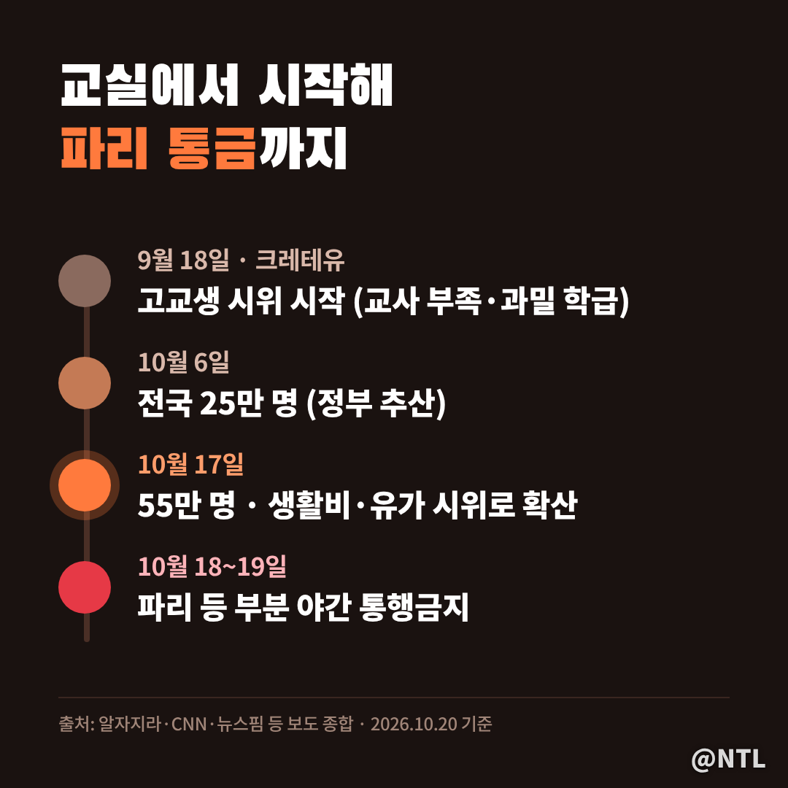
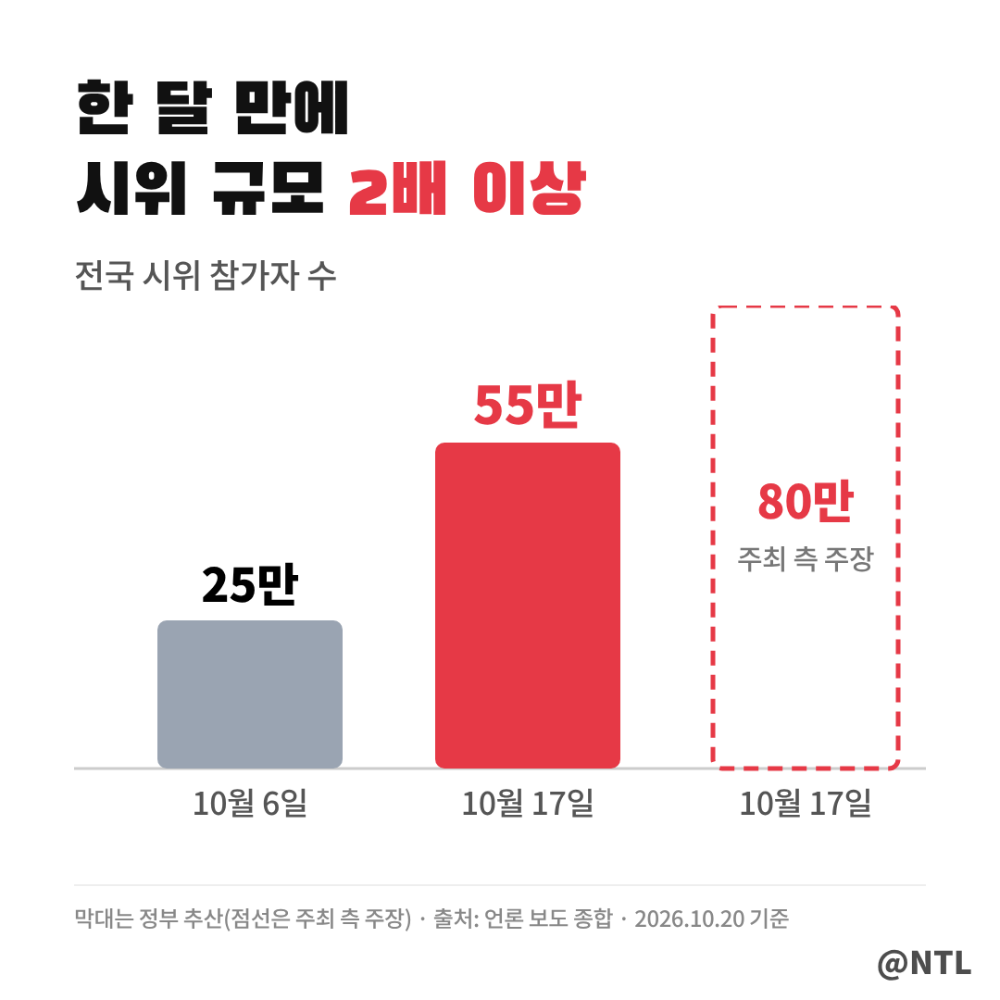
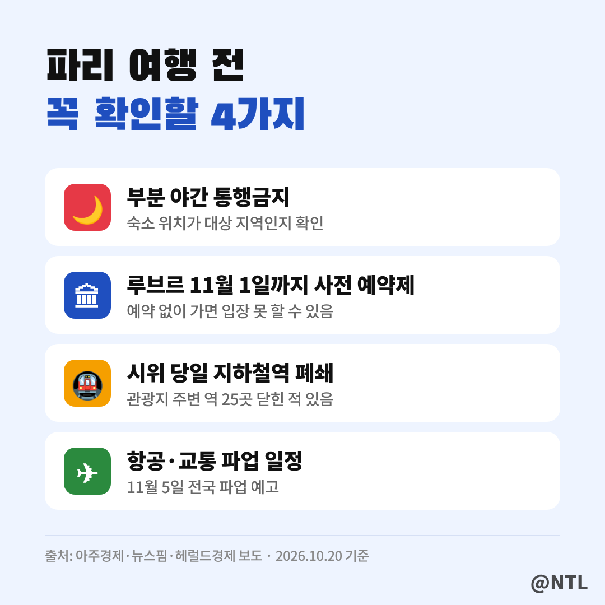
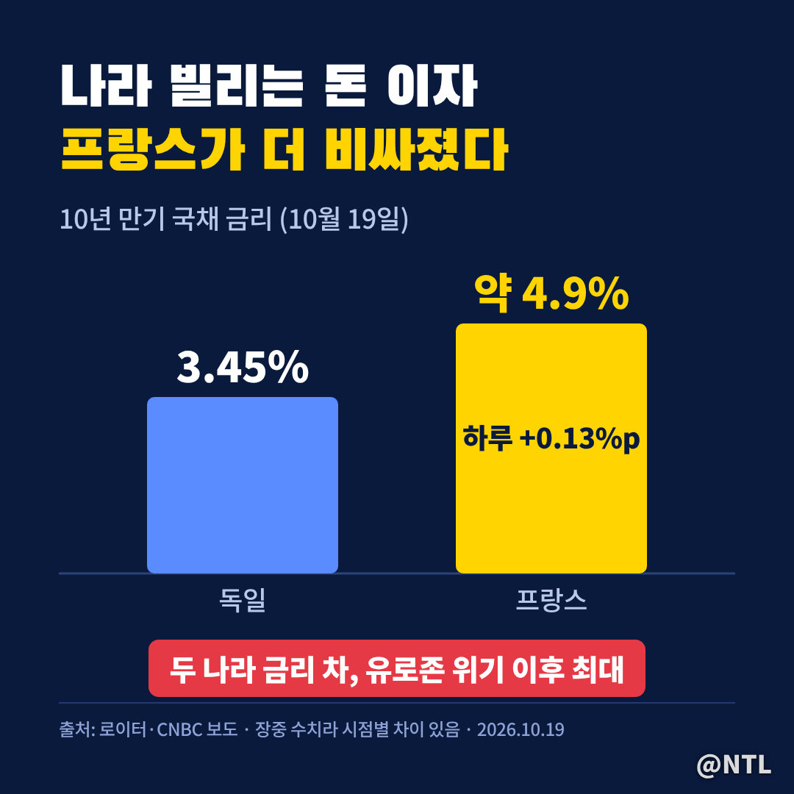
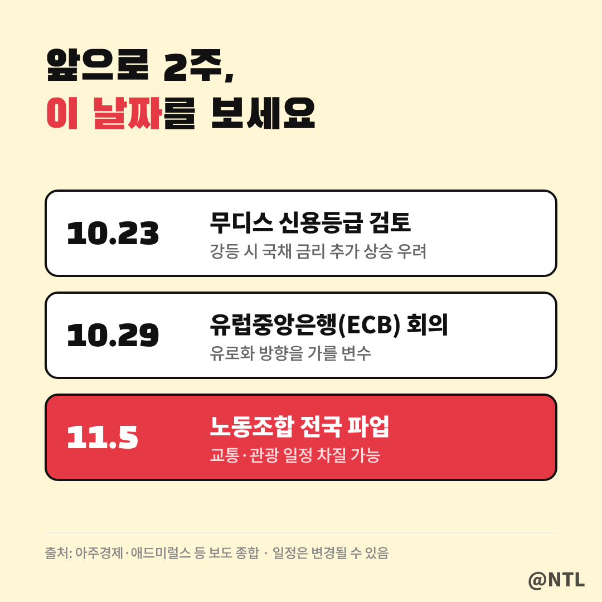

# 프랑스 시위 "노란 조끼 이후 최악" 파리 통금까지… 여행 가도 될까, 내 돈엔 무슨 영향?

**제목 후보**
1. 프랑스 시위 "노란 조끼 이후 최악" 파리 통금까지… 여행 가도 될까, 내 돈엔 무슨 영향? ← 추천
2. 프랑스 시위 55만 명 거리로, 교실에서 시작된 불씨가 국채 금리까지 번졌다
3. 프랑스 시위 "루브르도 막혔다" 11월 5일 전국 파업 전에 꼭 확인할 것

---

학교 교실이 부족하다는 고등학생들의 항의였습니다.
한 달 만에 55만 명이 거리로 나왔고, 파리에는 야간 통행금지가 내려졌습니다.

시작은 9월 18일, 파리 근교 크레테유였습니다.
교사 부족과 과밀 학급 문제에 생활비·기름값 불만이 겹치면서 전국 시위로 커졌습니다.
여행을 앞둔 분, 유럽 자산에 투자한 분이 알아야 할 것만 정리했습니다.
(2026년 10월 20일 기준)

> 한 달 만에 두 배, 얼마나 커졌나

정부 집계만 봐도 10월 6일 25만 명에서 17일 55만 명으로 두 배가 넘게 늘었습니다.
주최 측은 80만 명을 주장합니다.
17일 주말에는 시청 방화와 상점 약탈까지 이어져 체포자가 2천 명 안팎에 이르렀습니다.
현지 언론이 2018년 '노란 조끼' 이후 가장 격렬하다고 부르는 이유입니다.

> 지금 파리 여행, 가도 될까

여행 자체가 막힌 것은 아니지만 일정이 꼬일 변수가 많습니다.

특히 루브르는 11월 1일까지 **사전 예약자만** 입장할 수 있습니다.
시위 당일에는 관광지 주변 지하철역도 문을 닫았으니, 숙소와 동선을 시위 경로에서 떨어뜨려 두세요.
주프랑스 한국대사관도 시위 현장 근처 방문을 자제하라는 안전공지를 냈습니다.

| 확인할 것 | 어디서 |
|---|---|
| 통금 시간·지역 | 숙소, 현지 뉴스 |
| 항공편 변경 | 항공사 앱 |
| 안전공지 | 외교부 해외안전여행, 주프랑스 대사관 |

> 내 돈엔 무슨 영향? 국채 금리가 먼저 반응했다

시위 다음 거래일인 19일, 시장이 먼저 흔들렸습니다.

프랑스 10년물 금리는 약 4.9%로 하루 만에 0.13%p 올랐습니다.
독일과의 금리 차는 유로존 재정위기 이후 가장 넓어졌고, 이탈리아·그리스보다 높은 금리를 내야 하는 처지가 됐습니다.
CAC40 지수와 유로화도 함께 약세였습니다.
**나라가 돈을 빌리는 비용이 오른다**는 건 예산 개혁이 어렵다고 시장이 본다는 뜻입니다.

> 앞으로 2주가 고비다

23일 무디스의 신용등급 검토, 29일 유럽중앙은행 회의, 11월 5일 전국 파업이 줄줄이 기다립니다.
등급이 내려가거나 파업이 커지면 유로화와 유럽 펀드 수익률에도 다시 영향을 줄 수 있습니다.
[직접 입력: 10월 23일 무디스 결과, 출처]

---

**3줄 요약**
- 교실 문제로 시작된 시위가 생활비 시위로 번져 10월 17일 55만 명(정부 추산)
- 파리 부분 통금, 루브르는 11월 1일까지 사전 예약 필수
- 프랑스 국채 금리 급등, 10월 23일 무디스·11월 5일 전국 파업이 다음 고비

혹시 이번 가을 프랑스 여행 계획 있으신가요? 일정 바꾸실지 댓글로 나눠주세요.

※ 본 글은 언론 보도를 정리한 정보 제공 목적이며, 특정 자산의 매수·매도를 권유하지 않습니다.

#프랑스시위 #프랑스폭동 #파리시위 #파리통금 #루브르박물관 #프랑스여행 #파리여행주의 #프랑스국채 #유로화 #유럽증시
